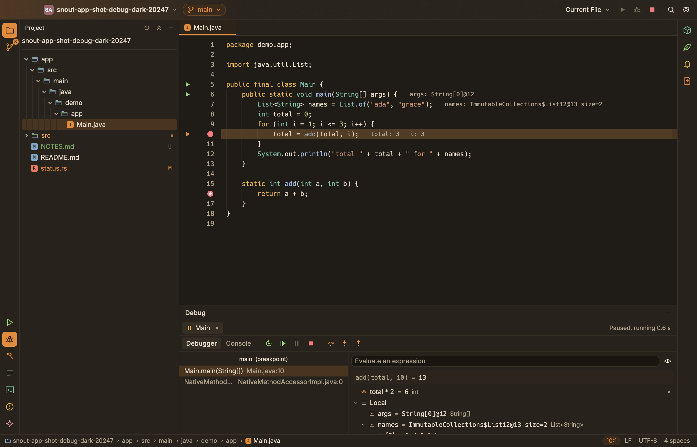

# SnoutCode

**[Read the user guide](docs/README.md)**

A native IDE for Java, Gradle and Spring Boot on macOS, written in Rust. It has Git and Claude Code built in, and can work on a Linux machine over SSH while the window stays on your Mac.



## Features

Each item links to its page in the user guide.

- **[Projects](docs/projects.md):** open any folder as the project, with one Gradle build or many side by side. The Project view shows the modules as Gradle sees them, or the plain files. File ▸ New Project… makes a Java application or a Spring Boot application.
- **[Editor](docs/editor.md):** tabs and split editors, find and replace, Find in Files, Go to File, Search Everywhere and the command palette.
- **[Java](docs/java.md):** completion that adds imports, go to definition (into libraries too), find references, rename, quick fixes, organize imports, formatting, parameter hints and problems. Scala classes in the build are compiled so Java sees them.
- **[Gradle](docs/gradle.md):** sync, the Gradle window and its tasks, build problems, a JDK that suits each build's Gradle version, with a download offered when none is installed.
- **[Run and debug](docs/run-and-debug.md):** run configurations, run icons in the gutter, tests with their results in a tree, and a debugger with breakpoints, stepping, variables and expressions.
- **[Spring](docs/spring.md):** beans and where they are injected, endpoints, the Spring window, and help in `application.properties` and `application.yml`.
- **[Git](docs/git.md):** changes, diffs, commit, branches, history, pull, fetch and push.
- **[Claude Code](docs/claude-code.md):** Claude Code in a docked console, its proposed changes reviewed in the editor, and every edit it makes shown live and kept for review.
- **[Remote SSH](docs/remote-ssh.md):** the project, Git, the Java engine, builds, runs and terminals on a Linux machine you reach with `ssh`.
- **[Processes](docs/processes.md):** what SnoutCode runs on your machine, and stopping it.

The Java features come from SnoutCode's Java engine (`engine/`, see [engine/README.md](engine/README.md)). The macOS app carries the engine with its own Java runtime, so you need no Java installed to start.

### Remote SSH

The window stays on your Mac while the project, Git, the Java engine, builds, runs, terminals and Claude Code are on a Linux machine you reach with `ssh`. SnoutCode installs its small server there by itself and reconnects when the link drops. See [docs/remote-ssh.md](docs/remote-ssh.md).

## Building

### Requirements

- **Rust 1.95 or newer.** Install it with [rustup](https://rustup.rs).
- **Git** on `PATH`. Push, pull and fetch use your normal Git credentials.
- **JDK 21**, to build the Java engine. `snout.sh` and `scripts/package-mac.sh` look for one (`SNOUT_JDK21`, then `JAVA_HOME` if it is 21, then `/usr/libexec/java_home`) and otherwise download Temurin 21 to `~/Library/Caches/SnoutCode`.
- **Docker**, only to build the Linux server for Remote SSH (`scripts/build-server-linux.sh`).
- **Optional:** [Claude Code](https://docs.claude.com/en/docs/claude-code), for the console.

### Build and run

```sh
git clone https://github.com/snoutdata/snout-code.git
cd snout-code
./snout.sh                  # build what changed, then start SnoutCode
./snout.sh ~/projects/shop  # open a folder as the project
./snout.sh --fg             # stay in the foreground, with logs in the terminal
```

`snout.sh` builds the release binary (`target/release/snout-code`) and the Java engine when they are missing or older than their sources. In the background, logs go to `$TMPDIR/snout-code.log`.

### macOS app

`scripts/package-mac.sh` builds `SnoutCode.app` and a disk image in `target/release/bundle/`, for this Mac's architecture. Open the `.dmg` and drag SnoutCode into Applications.

Without signing settings the app is signed ad hoc: it opens as is on the Mac that built it, and a copy on another Mac has to be allowed once in System Settings > Privacy & Security. To sign with a Developer ID and notarize, set `SNOUT_APPLE_DIR` and `SNOUT_NOTARY_ISSUER` in the environment or in a gitignored `.signing.env`; the comment at the top of the script lists what the folder holds.

## How it is built

```
crates/
  snout-app/           the SnoutCode app, on GPUI and GPUI Kit (binary: snout-code)
  snout-core/          Git operations, through the git CLI
  snout-lang/          the language server client
  snout-host/          the machine a workspace lives on: files, processes, terminals
  snout-remote/        the app's side of Remote SSH
  snout-remote-proto/  the wire protocol between the app and snout-server
  snout-server/        the remote side of Remote SSH
  snout-gui/           the earlier Git-only app (binary: snout)
engine/                the Java engine: Gradle sync, Eclipse JDT LS, debugging, Spring
```

`snout-core` runs the `git` CLI instead of using a library, so authentication, hooks and settings such as `pull.rebase` behave exactly as they do in a terminal.

## Tests

```sh
cargo test --workspace
cargo clippy --workspace --all-targets
cargo fmt --all --check
```

The GUI tests render the app headlessly. Set `SNOUT_SCREENSHOT=/path/to/dir` to save PNGs of the renders. The engine has its own tests: `cd engine && ./gradlew build`.

## Contributing

Issues and pull requests are welcome. Please run the three commands under [Tests](#tests) before opening a pull request.

## License

[MIT](LICENSE), copyright (c) 2026 SNOUTDATA INC.
