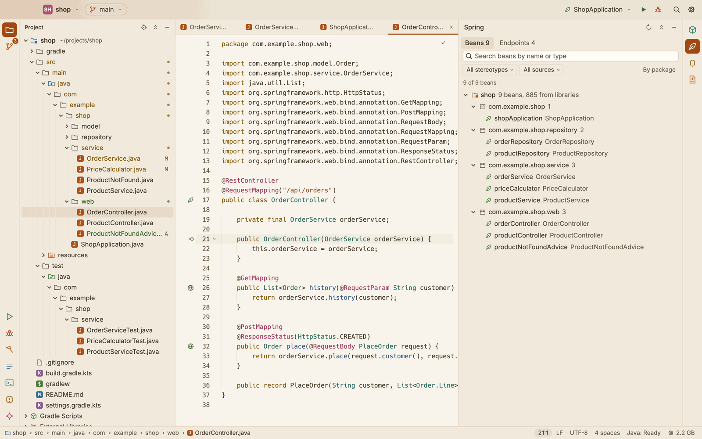
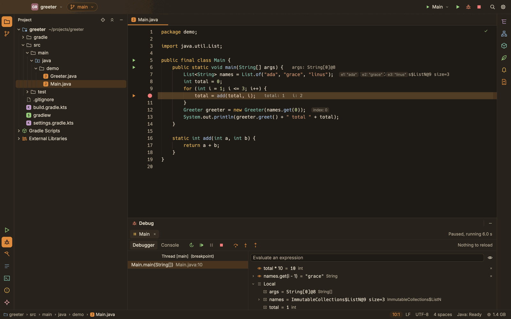

# SnoutCode

**[Read the user guide](docs/README.md)**

A native IDE for Java, Gradle, Maven and Spring Boot on macOS, Linux and Windows, written in Rust. It has Git and Claude Code built in, and can work on a Linux machine over SSH while the window stays on your desktop.





## Features

Each item links to its page in the user guide.

- **[Projects](docs/projects.md):** open any folder as the project, with one Gradle or Maven build or many side by side. The Project view shows the modules as the build sees them, or the plain files. File ▸ New Project… makes a Java application or a Spring Boot application, with Gradle or Maven.
- **[Editor](docs/editor.md):** tabs and split editors, find and replace, Find and Replace in Files, Go to File, Search Everywhere and the command palette.
- **[Java](docs/java.md):** completion that adds imports, go to definition (into libraries too), find references, rename, quick fixes, organize imports, formatting, parameter hints and problems. Scala classes in the build are compiled so Java sees them.
- **[Gradle](docs/gradle.md):** sync, the Gradle window and its tasks, build problems, a JDK that suits each build's Gradle version, with a download offered when none is installed.
- **[Maven](docs/maven.md):** Maven builds with no Maven install: reactors, parent POMs, BOM imports and profiles, the Maven window with its phases, goals and profiles, tests through Surefire, and POM completion from the local repository.
- **[Run and debug](docs/run-and-debug.md):** run configurations, run icons in the gutter, tests with their results in a tree, and a debugger with breakpoints, stepping, variables and expressions.
- **[Spring](docs/spring.md):** beans and where they are injected, endpoints, the Spring window, and help in `application.properties` and `application.yml`.
- **[Git](docs/git.md):** changes, diffs, commit, branches, history, pull, fetch and push.
- **[Coding agents](docs/agents.md):** Claude Code, Codex or your own agent in a docked console; each edit typed in live with the agent's caret and colour, every line it wrote marked, and its changes reviewed by prompt.
- **[Terminal](docs/terminal.md):** your shell in the bottom dock, with scrollback, find and links, on the built-in terminal engine or Ghostty's.
- **[Remote SSH](docs/remote-ssh.md):** the project, Git, the Java engine, builds, runs and terminals on a Linux machine you reach with `ssh`.
- **[Processes](docs/processes.md):** what SnoutCode runs on your machine, and stopping it.

The Java features come from SnoutCode's Java engine (`engine/`, see [engine/README.md](engine/README.md)). The macOS app, the Linux packages and the Windows installer carry the engine with its own Java runtime, so you need no Java installed to start.

## Linux

SnoutCode runs on Linux (x86_64 and aarch64, X11 and Wayland) and ships as a `.deb` for Debian and Ubuntu and as an Arch Linux package. The menus are drawn in the window's title bar, Ctrl takes the place of ⌘ (with IntelliJ IDEA's Linux keys where Ctrl was taken), and settings live in `~/.config/SnoutCode`. See [docs/linux.md](docs/linux.md).

## Windows

SnoutCode runs on Windows 10 and 11 (x64 and arm64) and ships as an installer that installs for the current user, with no administrator rights, and adds SnoutCode to the Start menu. The installer is not signed yet, so SmartScreen warns the first time. The menus and keys are the Linux ones, the Terminal tab runs PowerShell, and settings live in `%APPDATA%\SnoutCode`. See [docs/windows.md](docs/windows.md).

### Remote SSH

The window stays on your Mac while the project, Git, the Java engine, builds, runs, terminals and Claude Code are on a Linux machine you reach with `ssh`. SnoutCode installs its small server there by itself and reconnects when the link drops. See [docs/remote-ssh.md](docs/remote-ssh.md).

## Building

### Requirements

- **Rust 1.95 or newer.** Install it with [rustup](https://rustup.rs).
- **Git** on `PATH`. Push, pull and fetch use your normal Git credentials.
- **JDK 21**, to build the Java engine. `snout.sh` and `scripts/package-mac.sh` look for one (`SNOUT_JDK21`, then `JAVA_HOME` if it is 21, then `/usr/libexec/java_home` on a Mac or `/usr/lib/jvm` on Linux) and otherwise `snout.sh` downloads Temurin 21 to `~/Library/Caches/SnoutCode` (`~/.cache/SnoutCode` on Linux).
- **Docker**, to build the Linux server for Remote SSH (`scripts/build-server-linux.sh`) and the Linux packages (`scripts/package-linux.sh`).
- **On Linux**, a C toolchain and the libraries GPUI builds against; see [Build it from source](docs/linux.md#build-it-from-source).
- **On Windows**, the MSVC toolchain with the Windows SDK, and Inno Setup 6 for the installer; see [Build it from source](docs/windows.md#build-it-from-source).
- **Zig 0.15**, only for the Ghostty terminal engine (`brew install zig@0.15`; it is keg-only, and the scripts find it there). `scripts/package-mac.sh` needs it; `snout.sh` uses it when it finds it and otherwise builds with the built-in engine only; plain `cargo build` leaves it out.
- **Optional:** [Claude Code](https://docs.claude.com/en/docs/claude-code), for the console.

### Build and run

```sh
git clone https://github.com/snoutdata/snout-code.git
cd snout-code
./snout.sh                  # build what changed, then start SnoutCode
./snout.sh ~/projects/shop  # open a folder as the project
./snout.sh --fg             # stay in the foreground, with logs in the terminal
```

`snout.sh` builds the release binary (`target/release/snout-code`) and the Java engine when they are missing or older than their sources. When nothing changed it starts the app at once, without running cargo; when something did, it says "Building SnoutCode…" and shows cargo's progress before the app starts. In the background, logs go to `$TMPDIR/snout-code.log`. `SNOUT_STARTUP_TRACE=1 ./snout.sh` times the way to the first window (see [Troubleshooting](docs/troubleshooting.md#slow-start)).

### The Ghostty terminal engine

The terminals can run on Ghostty's terminal emulation (libghostty-vt) as well as the built-in one; see [docs/terminal.md](docs/terminal.md). It is the `ghostty` cargo feature of `snout-app`, off by default so that building and running need no Zig:

```sh
PATH="$(brew --prefix zig@0.15)/bin:$PATH" cargo build --release -p snout-app --features ghostty
cargo test --workspace --features snout-app/ghostty   # the terminal tests run on both engines
```

The first build fetches Ghostty's sources (a pinned commit) from GitHub and builds `libghostty-vt.a` with Zig. A build without the feature offers Ghostty in Settings ▸ Terminal as unavailable, and its terminals run on the built-in engine.

### macOS app

`scripts/package-mac.sh` builds `SnoutCode.app` and a disk image in `target/release/bundle/`, for this Mac's architecture, with the Ghostty terminal engine (`SNOUT_NO_GHOSTTY=1` leaves it out). Open the `.dmg` and drag SnoutCode into Applications.

Without signing settings the app is signed ad hoc: it opens as is on the Mac that built it, and a copy on another Mac has to be allowed once in System Settings > Privacy & Security. To sign with a Developer ID and notarize, set `SNOUT_APPLE_DIR` and `SNOUT_NOTARY_ISSUER` in the environment or in a gitignored `.signing.env`; the comment at the top of the script lists what the folder holds.

### Linux packages

`scripts/package-linux.sh` builds, in Docker, a `.deb` and an Arch Linux package for this machine's architecture (`x86_64`, `aarch64` or `all` as arguments) in `target/linux-packages/`, with the Java engine and its own Java 21 runtime. `scripts/test-linux.sh` runs clippy, the tests and the app under X11 and Wayland in the same image, and `scripts/linux/install-test.sh` installs the packages in clean Debian, Ubuntu and Arch containers and starts the app. The [Linux workflow](.github/workflows/linux.yml) does all three on GitHub for both architectures.

### Windows installer

`scripts/package-windows.ps1`, run on Windows, builds the installer (`SnoutCode-<version>-windows-<x64|arm64>-setup.exe`, made with Inno Setup) in `target\windows-package\`, with the Java engine and its own Java 21 runtime. It is unsigned for now; `-Sign` signs it with Azure Trusted Signing once that is set up. The [Windows workflow](.github/workflows/windows.yml) runs clippy, the tests and the app on a demo project, and builds, installs, starts and uninstalls the installer, for x64 and arm64.

## How it is built

```
crates/
  snout-app/           the SnoutCode app, on GPUI and GPUI Kit (binary: snout-code)
  snout-core/          Git operations, through the git CLI
  snout-lang/          the language server client
  snout-host/          the machine a workspace lives on: files, processes, terminals
  snout-remote/        the app's side of Remote SSH
  snout-remote-proto/  the wire protocol between the app and snout-server
  snout-server/        the remote side of Remote SSH
engine/                the Java engine: Gradle and Maven sync, Eclipse JDT LS, debugging, Spring
```

`snout-core` runs the `git` CLI instead of using a library, so authentication, hooks and settings such as `pull.rebase` behave exactly as they do in a terminal.

## Tests

```sh
cargo test --workspace
cargo clippy --workspace --all-targets
cargo fmt --all --check
```

The GUI tests render the app headlessly. Set `SNOUT_SCREENSHOT=/path/to/dir` to save PNGs of the renders. The engine has its own tests: `cd engine && ./gradlew build`.

## Contributing

Issues and pull requests are welcome. Please run the three commands under [Tests](#tests) before opening a pull request.

## License

[MIT](LICENSE), copyright (c) 2026 SNOUTDATA INC.
