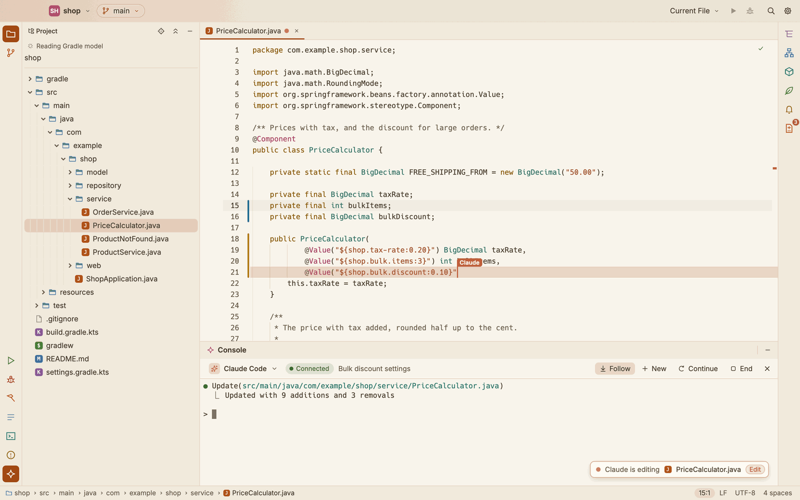
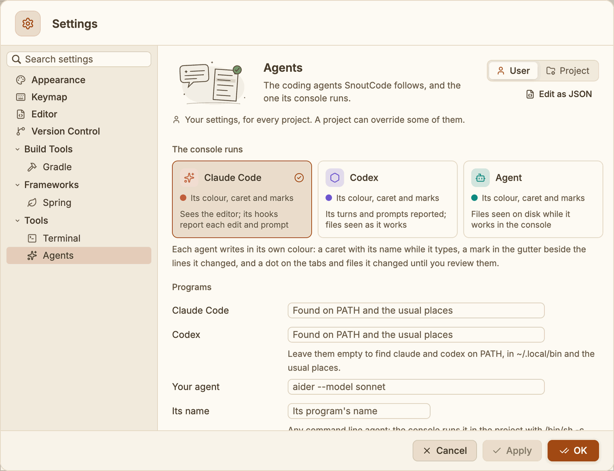
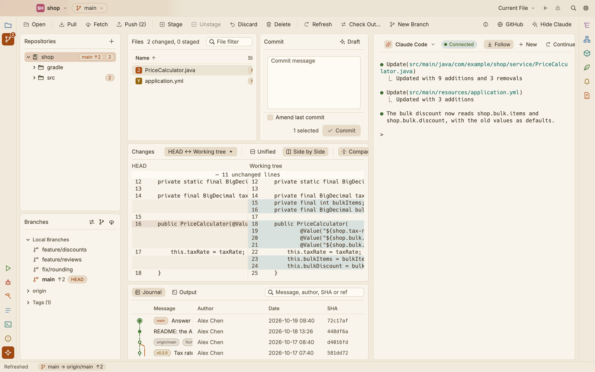
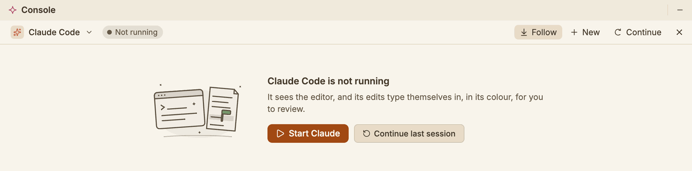
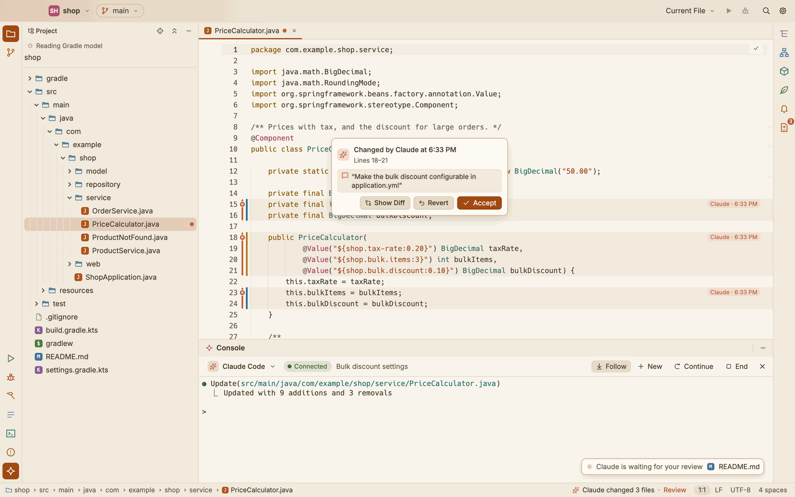
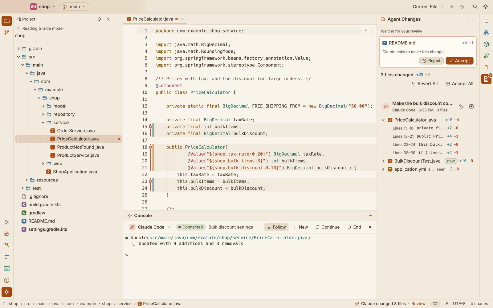
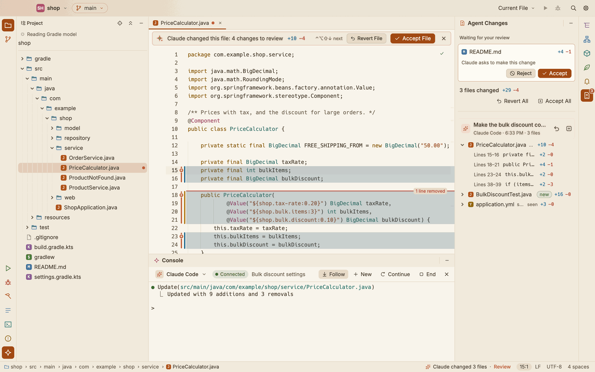

# Coding agents

SnoutCode runs a coding agent in a console inside the window and follows what it does in the editor, as it does it: Claude Code, OpenAI's Codex, or any other command line agent. You see the agent write, in its own colour, and you can review, keep or undo every change it made, by prompt, by file or by change.

The agents are installed and signed in separately. SnoutCode does not ship them.

| Agent | How SnoutCode follows it |
|---|---|
| [Claude Code](https://docs.claude.com/en/docs/claude-code) | It connects to the editor as its IDE: it sees your selection, open files and problems, and proposes changes there. Its hooks report every edit before and after, and the prompt of each turn. |
| [Codex](https://github.com/openai/codex) | SnoutCode sets its `notify` program for the session, which reports the end of each turn and its prompt. The files it changes are seen as it works. |
| Your own | Any command line agent the console runs. The files that change while it works on a turn (from Return until it goes quiet) are put down to it. |

*Claude Code at work: its caret, with its name, types the change in; the new lines fade from its colour to normal.*

## Choose the agent

Open Settings (⌘,) ▸ Tools ▸ Agents. The page lists the agents SnoutCode knows, each with its colour and icon and how SnoutCode follows it. Click one to have the console run it.

- **Programs**: SnoutCode looks for `claude` and `codex` on `PATH`, then in `~/.local/bin`, `~/.claude/local`, `~/.npm-global/bin`, `~/.bun/bin`, `/opt/homebrew/bin` and `/usr/local/bin`. Enter a path to use another program.
- **Your agent**: the command line of any other agent, run in the project with `/bin/sh -c`, and the name its caret and marks show. Leave the name empty to use the program's name.

You can also switch agents in the console's header: click the agent's name.

## The console

- Press ⌘J, choose View ▸ Agent Console, or click the console on the tool window stripe. In the Git view, the **Claude** button does the same.
- The console opens in the bottom dock, beside the **Terminal** tab (your login shell in the project, see [Terminal](terminal.md)).
- Press ⌘J again, or click × in the console's header, to hide it. The session keeps running.

The agent starts in the folder of the open project. There is one session per project: switch projects and each keeps its own, still running.

*The console beside the Git view, which shows what the agent changed.*

### The console's header

One row says which agent runs, how it is, and what you can do:

| Control | What it does |
|---|---|
| The agent's name | Click it to pick another agent for the console. |
| The status | **Connected**: Claude Code runs and sees the editor. **Working**: the agent is at work on your prompt. **Running**: it runs (Codex, your own agent). **Not connected**: Claude Code runs but has not connected to the editor. **Not running**, **Starting** and **Ended** say what they say. |
| **Follow** | Turns following of the agent's edits on or off (see [Follow the agent](#follow-the-agent)). |
| **New** | Starts the agent again on a new conversation. |
| **Continue** | Starts it again on the most recent conversation in this folder (`claude --continue`, `codex resume --last`). |
| **End** | Ends the session. |

When no session runs, the console says so, with **Start** and **Continue last session**. Ending a session keeps it ended until you start it again.

### Keys in the console

The console is a real terminal, so the agent behaves as it does in a terminal app.

- ⇧⇥ cycles Claude Code's modes, and Esc interrupts it.
- ⇧↩ or ⌥↩ adds a new line to the prompt.
- ⌘V pastes text. ⌃V goes to the agent, which pastes an image.
- Drag to select text, then press ⌘C to copy it.
- Scroll to see earlier output, and press ⌘F to find text in it.
- ⌘-click a link to open it.

The console runs on the terminal engine chosen in Settings ▸ Tools ▸ Terminal, Ghostty or the built-in one. See [Terminal](terminal.md).

While the agent works, the Git view reads the repository again: once the console has gone quiet for a moment, and every 3 seconds while it keeps printing. See [Git](git.md).

## Send the selection to the agent

Select code in an editor and press ⌥⌘K, or choose Code ▸ Send Selection to Claude (also in the editor's right-click menu). SnoutCode mentions the file and lines to the agent and brings the console forward. With nothing selected, it mentions the whole file.

- Claude Code, connected: the mention appears in its prompt as `@src/main/java/…/Util.java#L442-453`, ready for you to type the rest.
- Any other agent, or Claude Code not connected: SnoutCode types the same mention into the console.

The lines sent light up in the agent's colour for a moment, and a note by the console says what went: **Sent Util.java lines 442–453 to Claude**.

You do not need to send the selection for Claude Code to see it: while connected, it hears your selection as it changes.

## Watch the agent write

With **Follow** on (the default), the editor follows the files the agent changes:

- The agent's caret shows in its colour with a small flag of its name (**Claude**, **Codex**), and moves along as the text types itself in.
- The lines it writes light up in its colour and fade to normal over about a second. Only those lines change; the rest of the file stays as it is.
- It opens the file it changes and keeps the view on the typing. It never jumps while you are typing. A file that changes while another is in front gets its turn a moment later.
- Each tab the agent writes in shows the agent's dot, pulsing.

When the agent writes out of sight (you scrolled away, or **Follow** is off), a chip at the edge of the editor says where: **Claude is editing line 120 ↓**. Click it to go there. The scrollbar marks the place too.

With **Follow** off, the editor stays where it is, and a dot in the agent's colour marks a tab the agent changed.

While Claude Code edits, a note floats over the lower right of the editor: **Claude is editing** with the file and the tool, or **Claude is waiting for your review**. Click it to open that file.

## Who wrote which lines

Lines an agent changed keep its mark until the end of the session (and across restarts, while the file still holds them):

- **A lane in the gutter**, apart from Git's change bars, in the agent's colour, with the agent's mark where each run begins. It is full while the lines wait for review, paler after.
- **A soft tint** in the agent's colour behind the lines, until you review them.
- **Dots**: on the editor tab and on the file in the Project tree, in the agent's colour, while its changes wait for review.
- **The status bar**: **Claude changed 3 files · Review**. Click it to open the Agent Changes window.

Hover a mark in the lane for its card: **Changed by Claude at 3:39 PM**, the prompt that led to it, and **Accept**, **Revert** and **Show Diff** for that change.

*The lines Claude changed, a mark's card with the prompt behind it, and Annotate with Agents at the right.*

**Annotate with Agents** (Code ▸ Annotate with Agents, or the command palette) shows, beside each run of lines, which agent wrote it and when. Run it again to hide it.

Accepting a change takes away its tint and dots; the mark stays, paler, so you can still see who wrote it. Typing over the agent's lines makes them yours. Reverting puts the lines back as they were.

The record of a project is kept in SnoutCode's folder when you quit, and comes back with the project for the files that have not changed since.

## Review a proposed change

When Claude Code asks before it edits a file, the change opens in that file's tab:

1. The new text types itself into the tab. New lines show in blue, and an orange rule marks where lines were removed.
2. A bar over the tab says **Claude Code proposes a change** (or **Claude Code proposes a new file**), with the lines added and removed.
3. Click **Accept** or press ⌘↩ to keep it. Click **Reject** or press Esc to put the text back.

You can edit the proposed text before you accept it; Claude Code then writes what the tab shows. Rejecting a new file closes its tab. When Claude Code proposes several changes to one file, the bar shows how many more are waiting, and they come one after another.

Accept Claude's Change and Reject Claude's Change are also in the command palette (⇧⌘P).

## The Agent Changes window

*The changes of a prompt, with its files; a change Claude asks to make waits at the top.*

Agent Changes, on the right tool window stripe, lists what the agents changed in the session that you have not reviewed yet, grouped by prompt (turn), the latest first. The count on its stripe icon is the number of files.

- **Editing** at the top shows the file Claude Code is working on, and the tool it uses.
- **Waiting for your review** lists the changes Claude Code asks to make. Click **Accept** or **Reject** on one, or click it to open its tab.
- Each turn shows its agent, its prompt (or its number, when the agent does not say), when it began and how many files it changed, with **Accept** and **Revert** for all of them.
- Under it, each changed file shows its lines added and removed, and **new** when the agent created it. A file marked **seen** was changed on disk while the agent worked, but no hook reported it.

To review the changes:

| To | Do this |
|---|---|
| See a file's changes | Click its chevron to list them in the window, or click the file to open it with its changes inline. |
| Keep or undo one change | Use the buttons on the change, or on its mark's card in the editor. |
| Keep or undo a whole file | Hover the file and use **Accept the file** or **Revert the file**. |
| Keep or undo a prompt's changes | Use the buttons on the turn. |
| Keep or undo everything | **Accept All** (⌥⇧⌘Y) keeps every change and empties the list. **Revert All** (⌥⇧⌘Z) puts back every file as it was before the agent changed it. |

Reverting puts back exactly what the file held before the agent's first edit since your last review. Reverting a file the agent created deletes it. Accepting only takes the change off the list; the file stays as it is. A file changed in several turns shows under the first of them.

Accept All Claude Changes (⌥⇧⌘Y), Revert All Claude Changes (⌥⇧⌘Z) and Show Agent Changes work wherever the keyboard is. They are in the Code menu and the command palette (⇧⌘P), and their keys can be changed in the keymap.

### Review in the editor

A file opened from the window shows the changes inline, with a bar: **Claude changed this file: 3 changes to review**. The bar has **Revert File** and **Accept File**, and × hides the inline changes.

| Shortcut | Action |
|---|---|
| ⌃⌥⇧↓ | Next change (on to the next file at the end) |
| ⌃⌥⇧↑ | Previous change |
| ⌥⌘Y | Accept the change at the caret |
| ⌥⌘Z | Revert the change at the caret |

These are in the command palette as Next Claude Change, Previous Claude Change, Accept Claude Change at Caret and Revert Claude Change at Caret, and can be changed in the keymap ([Settings and keymap](settings-and-keymap.md)).

## Claude Code and the editor

A `claude` started in the console connects to SnoutCode as its IDE. The header shows **Connected** while it is. Claude Code can then:

- open files in the editor and select text in them;
- see your current selection, and the files you have open;
- read the problems the editor shows: the errors and warnings of the open files, or of one file;
- check whether a file has unsaved changes, and save it;
- propose a change for you to accept or reject in the editor.

SnoutCode also passes the console's `claude` extra settings for its hooks (`--settings`), so it hears about every file edit Claude Code makes, including the ones you let it make without asking, and the prompt of each turn. Your own Claude Code settings are never changed. The hooks post to SnoutCode with `curl`, on the machine `claude` runs on.

## Codex

A `codex` started in the console gets `-c notify=[…]` for that session only: Codex runs it at the end of each turn with the turn's prompt, and it posts them to SnoutCode with `curl`. Your `~/.codex/config.toml` is never changed. The files Codex changes are seen on disk while its turn runs, played out in its colour, and listed by turn in the Agent Changes window.

Install it with `npm install -g @openai/codex` (or as its README says) and sign in once in a terminal.

## Draft a commit message

In the Git view's Commit pane, click **Draft** (or choose Repository ▸ Draft Commit Message). Claude Code writes the message from what the commit would record, matching the style of the repository's recent commit subjects and building on anything you already typed. Click **Stop** to cancel.

Draft runs `claude` on its own in print mode, with its tools turned off, and sends it the patch. It does not touch the console's session. See [Git](git.md).

## On a remote machine

In a project on a remote machine, the console runs the agent on that machine, and everything on this page works as it does on your Mac: proposed changes, the selection, the agent's caret and marks, the Agent Changes window, Accept All and Revert All. Install the agent (and `curl`, for the hooks) on that machine.

SnoutCode writes Claude Code's lock file into that machine's `~/.claude/ide/`, and the agent reaches the window through ports of that machine's loopback that the SSH connection carries back to your Mac. A revert writes the file on that machine. See [Remote SSH](remote-ssh.md#claude-code-on-the-remote-machine).
