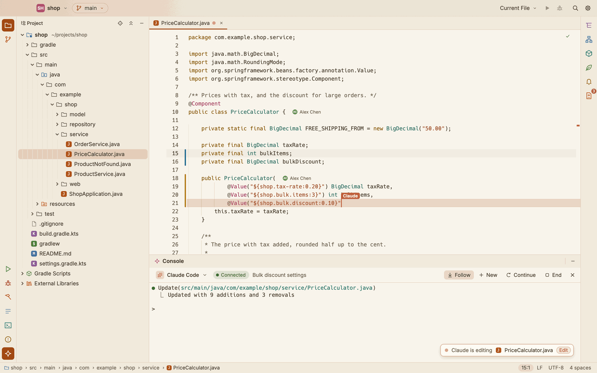
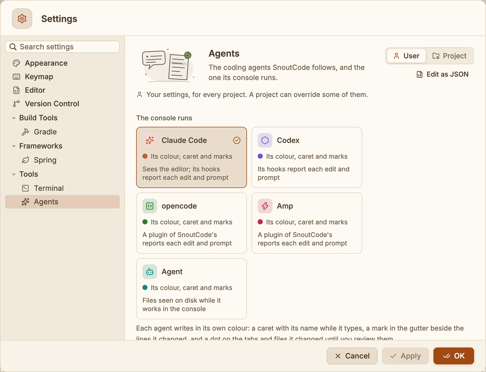
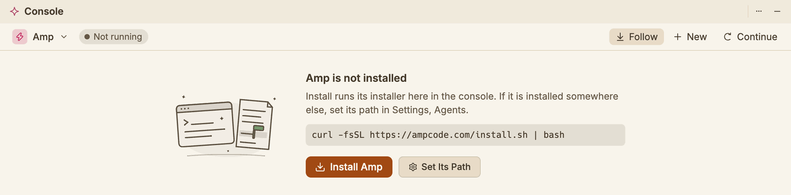
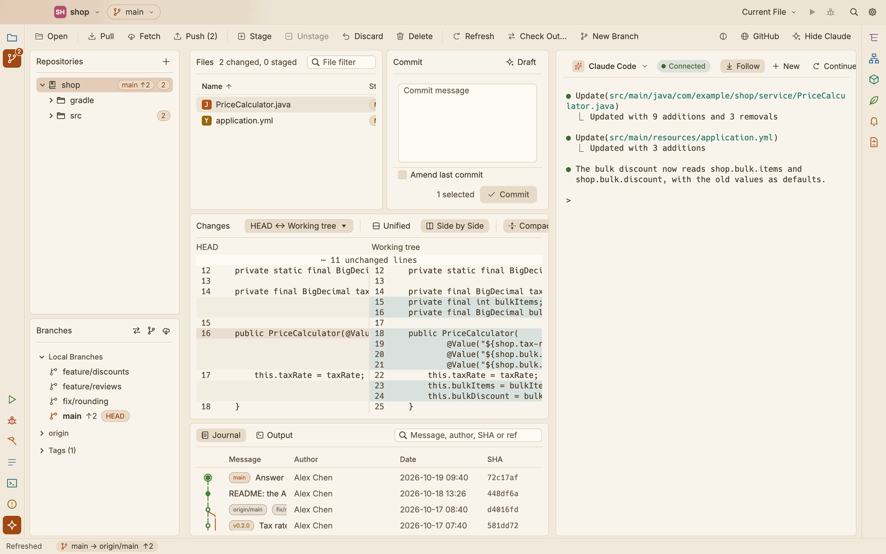
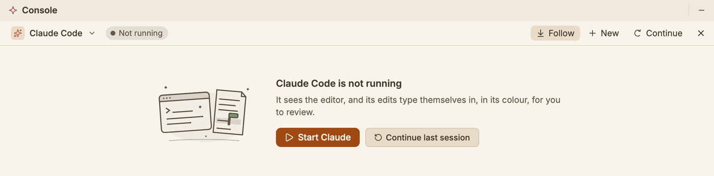
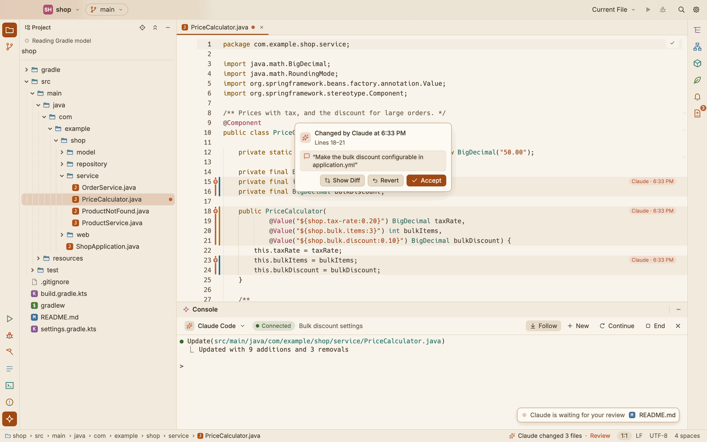
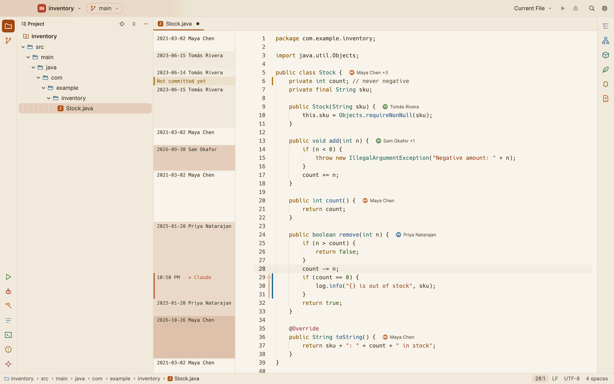
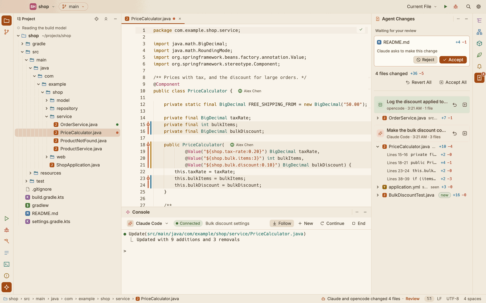
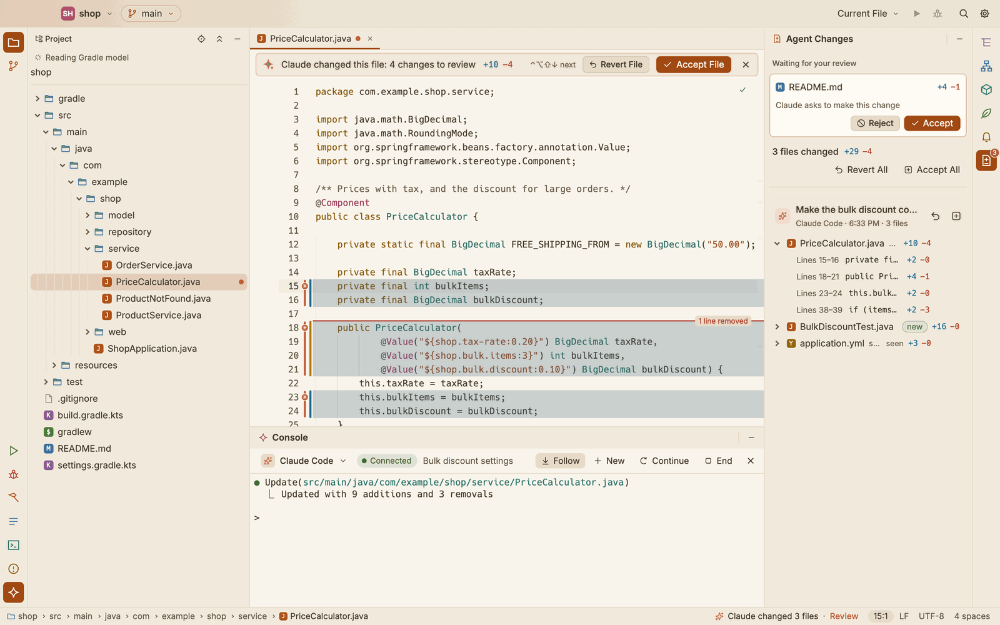
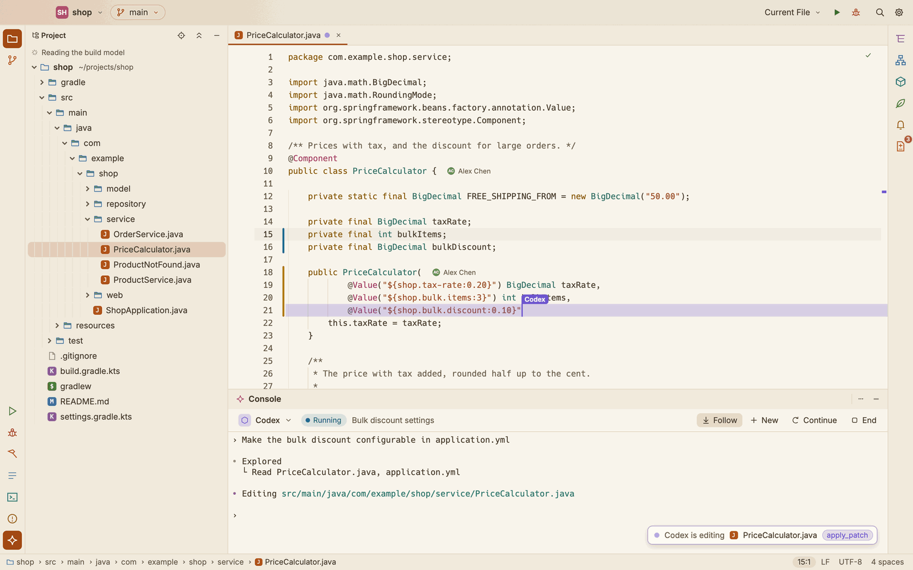

# Coding agents

SnoutCode runs a coding agent in a console inside the window and follows what it does in the editor, as it does it: Claude Code, OpenAI's Codex, opencode, Amp, or any other command line agent. You see the agent write, in its own colour, and you can review, keep or undo every change it made, by prompt, by file or by change.

SnoutCode does not ship the agents. When the one you pick is not installed, the console offers to install it for you (see [Install an agent](#install-an-agent)); you sign in to it once, in the console, as it asks.

| Agent | How SnoutCode follows it |
|---|---|
| [Claude Code](https://docs.claude.com/en/docs/claude-code) | It connects to the editor as its IDE: it sees your selection, open files and problems, and proposes changes there. Its hooks report every edit before and after, and the prompt of each turn. |
| [Codex](https://github.com/openai/codex) | SnoutCode gives it hooks for the session, which report every edit before and after, and the prompt of each turn. Its `notify` program reports the end of each turn. |
| [opencode](https://opencode.ai) | A plugin of SnoutCode's, loaded for the session only, reports every edit before and after, and the prompt of each turn. |
| [Amp](https://ampcode.com) | A plugin of SnoutCode's in Amp's plugins folder reports every edit before and after, including files a shell command writes, and the prompt of each turn as it ends. |
| Your own | Any command line agent the console runs. The files that change while it works on a turn (from Return until it goes quiet) are put down to it. |

With Claude Code, Codex, opencode and Amp, SnoutCode hears of each edit before the agent makes it, so the editor plays it out as it lands and **Revert** puts back exactly what the file held. Files the agent changes some other way (a shell command, a build) are seen on disk while its turn runs, and put down to it too.



*Claude Code at work: its caret, with its name, types the change in; the new lines fade from its colour to normal.*

## Choose the agent

Open Settings (⌘,) ▸ Tools ▸ Agents. The page lists the agents SnoutCode knows, each with its colour and icon and how SnoutCode follows it. Click one to have the console run it.



- **Programs**: SnoutCode looks for `claude`, `codex`, `opencode` and `amp` on `PATH`, then in `~/.local/bin`, `~/.claude/local`, `~/.opencode/bin`, `~/.amp/bin`, `~/.npm-global/bin`, `~/.bun/bin`, `/opt/homebrew/bin` and `/usr/local/bin`, then wherever your shell finds them (npm's folder under nvm, say). On Windows it also looks in npm's, pnpm's, Volta's, Scoop's and winget's folders, and asks PowerShell, so a program installed after SnoutCode started is found too. For a project inside WSL everything runs in that distro, so it looks there (see [SnoutCode on Windows](windows.md#projects-in-wsl)). Settings shows what it found for each; enter a path or use **Browse…** to choose another program.
- **Your agent**: the command line of any other agent, run in the project with `/bin/sh -c`, and the name its caret and marks show. Leave the name empty to use the program's name.

You can also switch agents in the console's header: click the agent's name and pick another. The console switches at once: the session in front ends (a note says so; **Continue** picks its conversation up again later) and the agent you picked starts in its place. The menu marks the agents that are not installed with **(install)**, and your own agent with **(set up)** until it has a command.

### Install an agent

Pick an agent that is not installed and the console says so, with two buttons:

- **Install**: runs the agent's installer in the console, in your own shell, so you see what it does and can answer it if it asks. When it finishes, the agent starts. If it fails, **Try again** runs it again.
- **Set Its Path**: opens Settings, Agents, for an agent installed somewhere SnoutCode does not look.



The installers SnoutCode runs:

| Agent | macOS and Linux | Windows |
|---|---|---|
| Claude Code | `curl -fsSL https://claude.ai/install.sh \| bash` | `irm https://claude.ai/install.ps1 \| iex` |
| Codex | `npm install -g @openai/codex` (needs Node.js) | the same |
| opencode | `curl -fsSL https://opencode.ai/install \| bash` | `npm install -g opencode-ai` |
| Amp | `curl -fsSL https://ampcode.com/install.sh \| bash` | `npm install -g @sourcegraph/amp` |

Your own agent has nothing to install: until it has a command, the console offers **Agent Settings** to give it one.

## The console

- Press ⌘J, choose View ▸ Agent Console, or click the console on the tool window stripe. In the Git view, the toolbar button named after the agent (**Claude**, **Codex**, and so on) does the same.
- The console opens in the bottom dock, beside the **Terminal** tab (your login shell in the project, see [Terminal](terminal.md)). To keep it on the left or the right instead, [move it](tool-windows.md#move-a-tool-window): Options (the three dots) in its header, **Move to**.
- Press ⌘J again, or click **Hide** (the minus) in its header, to hide it. It hides where it is: on the right, the right dock closes and the bottom dock stays as it was; on the left, the Project view comes back. In the Git view, × in the console's row hides it. The session keeps running.
- With the console open but behind another window of its dock, ⌘J brings it to the front.

The agent starts in the folder of the open project. There is one session per project: switch projects and each keeps its own, still running.



*The console beside the Git view, which shows what the agent changed.*

### The console's header

One row says which agent runs, how it is, and what you can do:

| Control | What it does |
|---|---|
| The agent's name | Click it to pick another agent for the console. |
| The status | **Connected**: Claude Code runs and sees the editor. **Working**: the agent is at work on your prompt. **Running**: it runs (Codex, opencode, Amp, your own agent). **Not connected**: Claude Code runs but has not connected to the editor. **Not running**, **Starting** and **Ended** say what they say. |
| **Follow** | Turns following of the agent's edits on or off (see [Follow the agent](#follow-the-agent)). |
| **New** | Starts the agent again on a new conversation. |
| **Continue** | Starts it again on the most recent conversation in this folder (`claude --continue`, `codex resume --last`, `opencode --continue`, `amp threads continue --last`). |
| **End** | Ends the session. |

When no session runs, the console says so, with **Start** and **Continue last session**. Ending a session keeps it ended until you start it again.

With no project open, the console waits for **Start**, then runs the agent in your home folder, so you can have it make a project. Open that project when it is there: SnoutCode follows an agent's edits in the open project, and the agent starts afresh in it. The session in the home folder keeps running, and shows again when no project is open.



### Keys in the console

The console is a real terminal, so the agent behaves as it does in a terminal app.

- ⇧⇥ cycles Claude Code's modes, and Esc interrupts it.
- ⇧↩ or ⌥↩ adds a new line to the prompt.
- ⌘V pastes text. ⌃V goes to the agent, which pastes an image.
- Drag to select text, then press ⌘C to copy it.
- Scroll to see earlier output, and press ⌘F to find text in it.
- ⌘-click a link to open it.

The console runs on the terminal engine chosen in Settings ▸ Tools ▸ Terminal, Ghostty or the built-in one. See [Terminal](terminal.md).

While the agent works, the Git view reads the repository again: once the console has gone quiet for a moment, and every 3 seconds while it keeps printing. See [Git](git.md).

## What an agent can do in the window

An agent in the console can work the whole window, not only write files: open or switch projects, start runs and read their output and test results, ask the Java and TypeScript engines what the code is, run build tasks, use the Git view, and show you a report in the **Agent View**. See [The API for agents](editor-api.md) for all of it.

What changes something asks you first, on a card in the window: **Allow**, **Allow for This Session** for that tool, or **Don't Allow**, which tells the agent you said no. Return does not answer the card, because it can come up while you are typing. **View ▸ Agent Log** lists every call an agent made and how it ended.

## Send the selection to the agent

Select code in an editor and press ⌥⌘K, or choose Code ▸ Send Selection to Claude (also in the editor's right-click menu). SnoutCode mentions the file and lines to the agent and brings the console forward. With nothing selected, it mentions the whole file.

- Claude Code, connected: the mention appears in its prompt as `@src/main/java/…/Util.java#L442-453`, ready for you to type the rest.
- Any other agent, or Claude Code not connected: SnoutCode types the same mention into the console.

The lines sent light up in the agent's colour for a moment, and a note by the console says what went: **Sent Util.java lines 442–453 to Claude**.

You do not need to send the selection for Claude Code to see it: while connected, it hears your selection as it changes.

## Ask the agent to fix a problem

For any problem in the code, **Ask Claude to fix** is in the context actions (⌥↩ on the problem, or the bulb in the gutter), and in the Problems window's (right-click a problem). When the engine has no fix for a problem, it is also the button of the problem's hover card. With another agent in the console, it says that agent's name, such as **Ask Codex to fix**.

SnoutCode puts the file, the problem's lines and what is wrong in the agent's prompt, and brings the console forward:

```
@src/main/java/com/example/shop/service/OrderService.java#L27 Fix this error: LocalDate cannot be resolved to a type
```

- Claude Code, connected: the file and lines arrive as a mention, and the words are typed after it.
- Any other agent (Codex, a command of your own, or Claude Code not connected): SnoutCode types all of it into the console.

Nothing is sent until you press ↩, so you can add to it first. The lines light up in the agent's colour for a moment, and a note by the console says what went: **Asked Claude to fix OrderService.java line 27**.

## Watch the agent write

With **Follow** on (the default), the editor follows the files the agent changes:

- The agent's caret shows in its colour with a small flag of its name (**Claude**, **Codex**, **opencode**, **Amp**), and moves along as the text types itself in.
- The lines it writes light up in its colour and fade to normal over about a second. Only those lines change; the rest of the file stays as it is.
- It opens the file it changes and keeps the view on the typing. It never jumps while you are typing. A file that changes while another is in front gets its turn a moment later.
- Each tab the agent writes in shows the agent's dot, pulsing.

When the agent writes out of sight (you scrolled away, or **Follow** is off), a chip at the edge of the editor says where: **Claude is editing line 120 ↓**. Click it to go there. The scrollbar marks the place too.

With **Follow** off, the editor stays where it is, and a dot in the agent's colour marks a tab the agent changed.

Only the agent's own edits count. Files Git changes (a pull, a checkout, a discard, from SnoutCode or from a terminal) are never put down to an agent, even with it connected: nothing opens, and nothing waits for review in the Agent Changes window.

While an agent edits, a note floats over the lower right of the editor, in its colour: **Claude is editing** (or **Codex**, **opencode**, **Amp**) with the file and the tool, or **Claude is waiting for your review**. Click it to open that file.

## Who wrote which lines

Lines an agent changed keep its mark until the end of the session (and across restarts, while the file still holds them):

- **A lane in the gutter**, apart from Git's change bars, in the agent's colour, with the agent's mark where each run begins. It is full while the lines wait for review, paler after.
- **A soft tint** in the agent's colour behind the lines, until you review them.
- **Dots**: on the editor tab and on the file in the Project tree, in the agent's colour, while its changes wait for review.
- **The status bar**: **Claude changed 3 files · Review**. Click it to open the Agent Changes window.

Hover a mark in the lane for its card: **Changed by Claude at 3:39 PM**, the prompt that led to it, and **Accept**, **Revert** and **Show Diff** for that change.



*The lines Claude changed, and a mark's card with the prompt behind it.*

**Annotate with Agents** (Code or Git ▸ Annotate with Agents, the gutter's right-click menu, or the command palette) opens the annotation column left of the line numbers, the same one as Annotate with Git Blame: lines an agent wrote that are not committed yet show the agent's mark, name and time, in its colour; lines you changed read **Not committed yet**; the rest show their commit's date and author. Hover an agent's line for its card. Run it again to hide the column. See [Annotate with Git Blame](blame.md).



Accepting a change takes away its tint and dots; the mark stays, paler, so you can still see who wrote it. Typing over the agent's lines makes them yours. Reverting puts the lines back as they were.

The record of a project is kept in SnoutCode's folder when you quit, and comes back with the project for the files that have not changed since.

## Review a proposed change

When Claude Code asks before it edits a file, the change opens in that file's tab:

1. The new text types itself into the tab. New lines show in blue, and an orange rule marks where lines were removed.
2. A bar over the tab says **Claude Code proposes a change** (or **Claude Code proposes a new file**), with the lines added and removed.
3. Click **Accept** or press ⌘↩ to keep it. Click **Reject** or press Esc to put the text back.

You can edit the proposed text before you accept it; Claude Code then writes what the tab shows. Rejecting a new file closes its tab. When Claude Code proposes several changes to one file, the bar shows how many more are waiting, and they come one after another.

Accept Claude's Change and Reject Claude's Change are also in the command palette (⇧⌘P).

## The Agent Changes window



*Each prompt with its agent and its files, the latest first (here opencode's, after Claude's); a change Claude asks to make waits at the top.*

Agent Changes, on the right tool window stripe, lists what the agents changed in the session that you have not reviewed yet, grouped by prompt (turn), the latest first. The count on its stripe icon is the number of files.

- **Editing** at the top shows the file the agent is working on, and the tool it uses.
- **Waiting for your review** lists the changes Claude Code asks to make. Click **Accept** or **Reject** on one, or click it to open its tab.
- Each turn shows its agent, its prompt (or its number, when the agent does not say), when it began and how many files it changed, with **Accept** and **Revert** for all of them.
- Under it, each changed file shows its lines added and removed, and **new** when the agent created it. A file marked **seen** was changed on disk while the agent worked, but no hook reported it.

To review the changes:

| To | Do this |
|---|---|
| See a file's changes | Click its chevron to list them in the window, or click the file to open it with its changes inline. |
| Keep or undo one change | Use the buttons on the change, or on its mark's card in the editor. |
| Keep or undo a whole file | Hover the file and use **Accept the file** or **Revert the file**. |
| Keep or undo a prompt's changes | Use the buttons on the turn. |
| Keep or undo everything | **Accept All** (⌥⇧⌘Y) keeps every change and empties the list. **Revert All** (⌥⇧⌘Z) puts back every file as it was before the agent changed it. |

Reverting puts back exactly what the file held before the agent's first edit since your last review. Reverting a file the agent created deletes it. Accepting only takes the change off the list; the file stays as it is. A file changed in several turns shows under the first of them.

Accept All Claude Changes (⌥⇧⌘Y), Revert All Claude Changes (⌥⇧⌘Z) and Show Agent Changes work wherever the keyboard is. They are in the Code menu and the command palette (⇧⌘P), and their keys can be changed in the keymap.

### Review in the editor

A file opened from the window shows the changes inline, with a bar: **Claude changed this file: 3 changes to review**. The bar has **Revert File** and **Accept File**, and × hides the inline changes.



| Shortcut | Action |
|---|---|
| ⌃⌥⇧↓ | Next change (on to the next file at the end) |
| ⌃⌥⇧↑ | Previous change |
| ⌥⌘Y | Accept the change at the caret |
| ⌥⌘Z | Revert the change at the caret |

These are in the command palette as Next Claude Change, Previous Claude Change, Accept Claude Change at Caret and Revert Claude Change at Caret, and can be changed in the keymap ([Settings and keymap](settings-and-keymap.md)).

## Claude Code and the editor

A `claude` started in the console connects to SnoutCode as its IDE. The header shows **Connected** while it is. Claude Code can then:

- open files in the editor and select text in them;
- see your current selection, and the files you have open;
- read the problems the editor shows: the errors and warnings of the open files, or of one file;
- check whether a file has unsaved changes, and save it;
- propose a change for you to accept or reject in the editor.

SnoutCode also passes the console's `claude` extra settings for its hooks (`--settings`), so it hears about every file edit Claude Code makes, including the ones you let it make without asking, and the prompt of each turn. Your own Claude Code settings are never changed. The hooks post to SnoutCode with `curl`, on the machine `claude` runs on.

### Ask Claude to open a file

Ask Claude to open a file, or to show you a line or a method, and it opens it in SnoutCode's editor, with the lines or the text selected. It can also read your open tabs, your selection and the problems of a file, and save a file.

This goes through an Agent Skill and a [UTCP](https://www.utcp.io) manual over a small HTTP API, not an MCP server, so these tools cost almost nothing in a session that does not use them: about 140 tokens per request instead of about 5,500. Nothing is installed into your own Claude Code setup. See **[The editor API for agents](editor-api.md)** for how it works, what it saves, and how other agents can use it.

## Codex

A `codex` started in the console gets its hooks for that session only (`-c hooks.PreToolUse=…` and the like): before and after each `apply_patch`, Codex's way of changing files, the hook posts the patch to SnoutCode with `curl`, and SnoutCode reads each file the patch names. The prompt of each turn comes the same way. It also gets `-c notify=[…]`, which Codex runs at the end of each turn. Your `~/.codex/config.toml` is never changed.

**Trust the hooks once.** Codex runs a hook only after you have reviewed it. The first time Codex starts in the console, it says new hooks are waiting: type `/hooks` and trust SnoutCode's four. They read the same in every window and every project, so Codex does not ask again. Until you trust them, Codex still works, and SnoutCode follows it as it follows any agent: the files that change while its turn runs.

Pick it in the console and press **Install**, or install it yourself with `npm install -g @openai/codex` (or as its README says). Sign in once, in the console, as it asks.



*Codex at work: each change its patch makes types itself in, in Codex's colour, as for Claude Code.*

## opencode

An `opencode` started in the console loads a plugin of SnoutCode's for that session only, through the variable `OPENCODE_CONFIG_CONTENT`; your own plugins load as usual, and your `opencode.json` is never changed. Before and after each `edit`, `write` and `apply_patch`, the plugin posts to SnoutCode, which reads the file. It also reports the prompt you send, and when the session goes idle.

Pick it in the console and press **Install**, or install it yourself with `curl -fsSL https://opencode.ai/install | bash` (or `npm install -g opencode-ai`). Sign in once, in the console, as it asks.

## Amp

Amp loads plugins only from its plugins folder, so SnoutCode puts its plugin there, as `~/.config/amp/plugins/snoutcode.js`, when the console starts Amp. The plugin does nothing in an Amp started anywhere else: it works only when SnoutCode's console runs it. The console also starts Amp with `PLUGINS=all`, unless you set `PLUGINS` yourself.

Before and after each tool call that changes files (`edit_file`, `create_file`, `apply_patch`, and shell commands that write files), the plugin posts the files to SnoutCode, which reads them. At the end of each turn it reports the turn's prompt. Delete the file to stop it; SnoutCode puts it back the next time its console starts Amp.

Pick it in the console and press **Install**, or install it yourself with `curl -fsSL https://ampcode.com/install.sh | bash` (or `npm install -g @sourcegraph/amp`). Sign in once, in the console, as it asks.

## Draft a commit message

In the Git view's Commit pane, click **Draft** (or choose Git ▸ Draft Commit Message). The agent in the console writes the message from what the commit would record, matching the style of the repository's recent commit subjects and building on anything you already typed. Click **Stop** to cancel.

Whichever agent you picked does it, in its session, where you can watch: the console opens if it is closed, and the agent starts if it is not running. SnoutCode types the request and presses Return once the agent is free, never over a question it is asking you. The agent gets the change from SnoutCode and hands the message back through the [editor API](editor-api.md), so the keyboard stays where you were typing.

Claude Code may run these calls without asking. Codex's sandbox blocks local network calls by default, so it may ask you to allow them. See [Git](git.md).

## On a remote machine

In a project on a remote machine, the console runs the agent on that machine, and everything on this page works as it does on your Mac: proposed changes, the selection, the agent's caret and marks, the Agent Changes window, Accept All and Revert All. Install the agent (and `curl`, for Claude Code's and Codex's hooks) on that machine. opencode's plugin is written on that machine too, and so is Amp's, into that machine's `~/.config/amp/plugins`.

SnoutCode writes Claude Code's lock file into that machine's `~/.claude/ide/`, and the agent reaches the window through ports of that machine's loopback that the SSH connection carries back to your Mac. A revert writes the file on that machine. See [Remote SSH](remote-ssh.md#claude-code-on-the-remote-machine).
