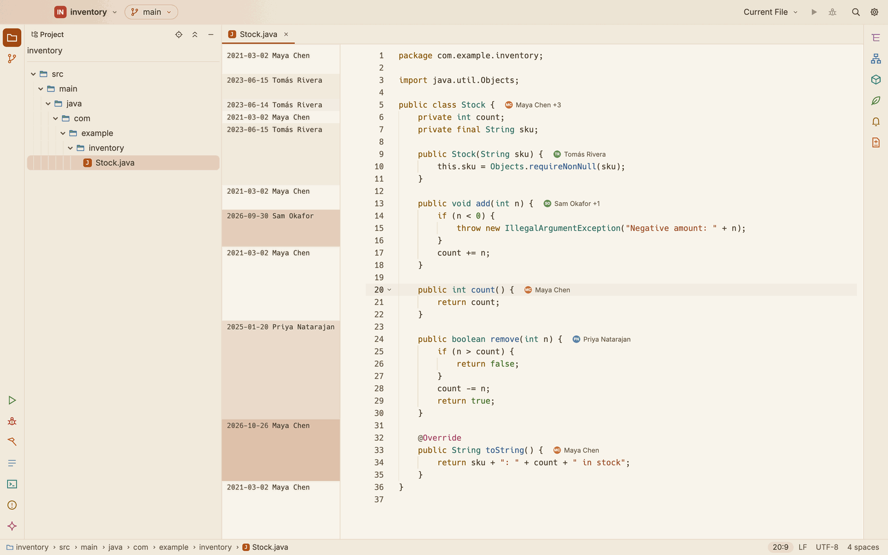
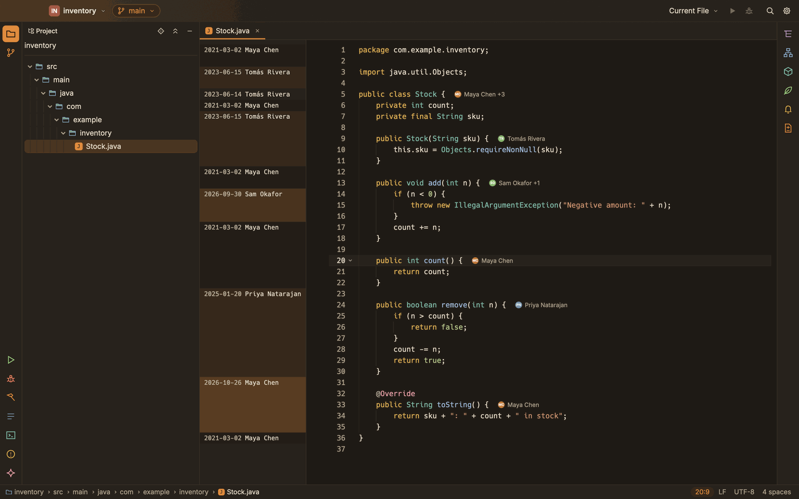
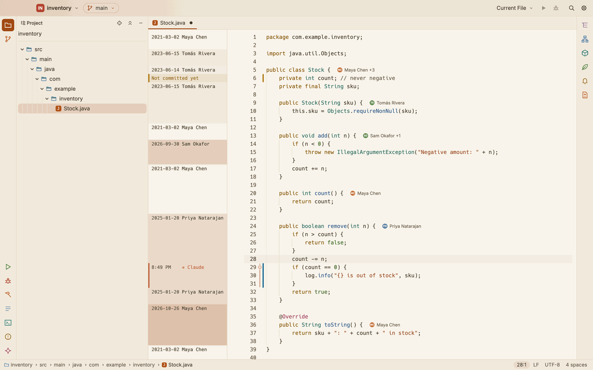
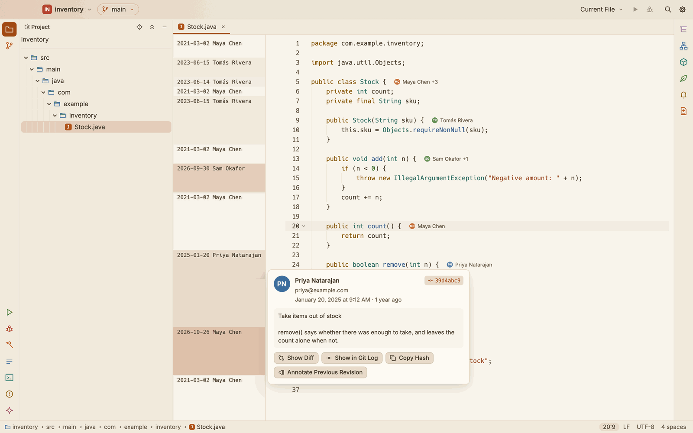
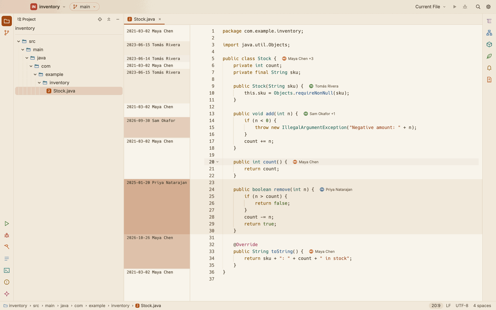
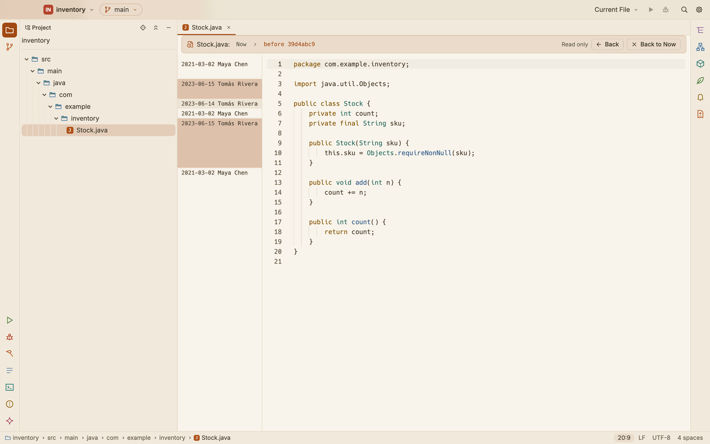
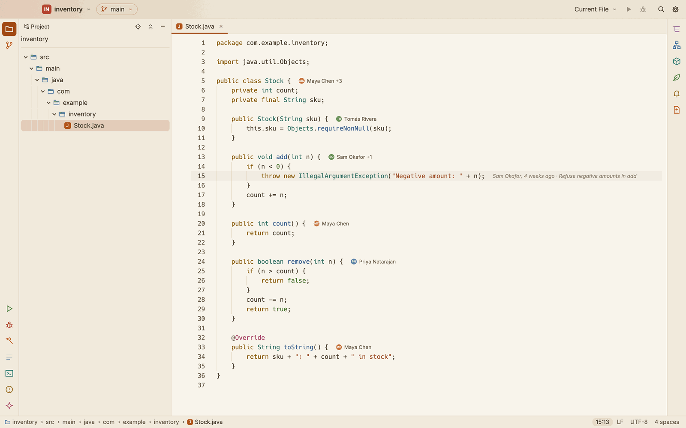

# Annotate with Git Blame

Annotate with Git Blame shows, beside every line of a file, when it was last changed and by whom. It is the same column as Annotate with Agents: lines you or an agent changed since the last commit say so.

*Each run of lines from one commit shows its date and author once. Recent lines are shaded stronger; old ones fade.*

## Open and close the column

- **Right-click the gutter** (the line numbers, or the strip left of them) and choose **Annotate with Git Blame**. With the column open, the same item reads **Close Annotations**.
- Choose **Git ▸ Annotate with Git Blame**.
- Press ⌥⇧⌘B, or run **Annotate with Git Blame** from the command palette. You can give it other keys in Settings ▸ Keymap.
- **Annotate with Agents** (Code or Git menu, the gutter's menu, or the command palette) opens the same column.

Running it again closes the column. Each editor tab has its own.

## What the column shows

- **The date and the author** of the commit that last changed the line, written once for each run of lines from one commit. In a narrow window the names shorten ("Maya C."), then turn into initials.
- **Shading by age**: the newest commits of the file are shaded strongest, the oldest barely. The shades come from the colour theme's accent, so they read the same in light and dark.

- **Not committed yet**, with a stripe in the change colour, for lines you changed since the last commit.
- **An agent's lines**: lines an agent wrote that are not committed yet show the agent's mark, name and the time of its edit, in its colour. Hover one for the agent's card (the prompt behind the change, **Accept**, **Revert** and **Show Diff**).

*Claude's three lines show Claude; the line you changed reads Not committed yet.*

The column follows your typing: lines you add read **Not committed yet** at once, and the lines after them move with the text. Save or commit, and the column catches up. It works the same on a remote machine over SSH, and on long files.

## A line's card

Rest the pointer on a line of the column for its card: the author's initials, name and email, the date (and how long ago), the commit's short hash and its whole message.

- **Show Diff** shows the file in that commit, against the commit before it, in the Git view.
- **Show in Git Log** shows the commit in the Git view's Journal.
- **Copy Hash** copies the commit's full hash.
- **Annotate Previous Revision** shows the file as it was just before that commit, annotated, read only. It follows the file through renames.

## Light up a commit

Click a line of the column: every line of that commit lights up, and the commit is selected in the Git view (press ⌘2 to see it). Click again to turn it off.

## Earlier revisions

**Annotate Previous Revision** replaces the editor with the file as it was before the commit, read only, with its own annotations. The bar above it shows where you are: **Now**, then each revision you stepped back to. Click a step to go back to it, **Back** to go back one, or **Back to Now** to return to your file.

From an earlier revision, a line's card can step back again.

## Author hints

In Java and Kotlin files, each class and method shows who wrote it after the end of its line: the author of most of its lines, and how many others wrote some ("Maya Chen +3"). Lines not committed yet do not count. Click a hint to list the authors, with how many lines each wrote and when they last changed it.

The hints are on by default. Turn them off in **Settings ▸ Version Control ▸ Annotations**.

## The current line's author

With **Show the current line's author and commit after its end** on (Settings ▸ Version Control, off by default), the caret's line shows its author faintly after its end: "Sam Okafor, 4 weeks ago · Refuse negative amounts in add". It shows once the caret rests on the line for the hover's delay (Settings ▸ Editor ▸ Hover), and not while the column is open.

## Outside Git

In a folder that is not in a Git repository, and in a library's class file, there is no history: the gutter's menu shows **Annotate with Git Blame** greyed out with the reason, and the command says why at the caret. Annotate with Agents still shows the agents' lines.
