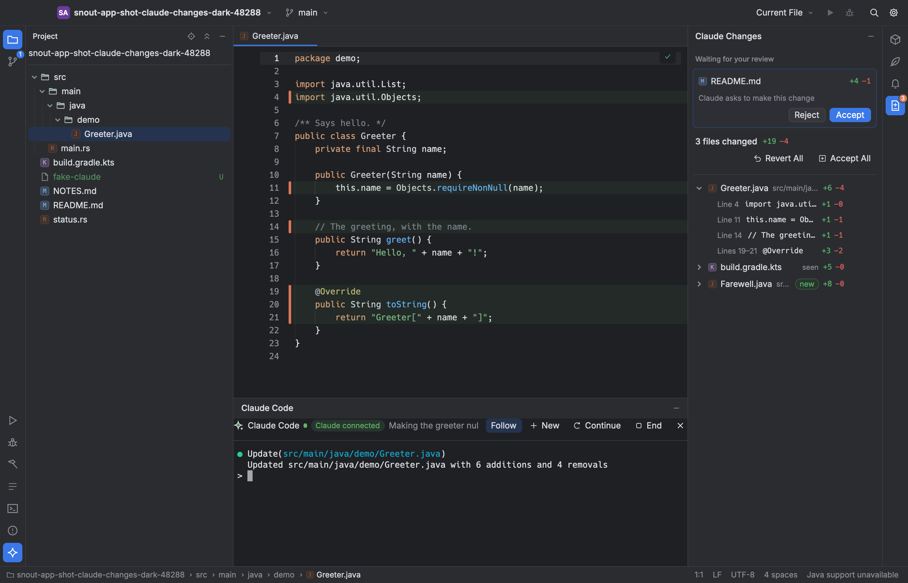

# Claude Code

SnoutCode runs [Claude Code](https://docs.claude.com/en/docs/claude-code) in a console inside the window and connects it to the editor, so you can watch, review and undo what it changes.

Claude Code is installed and signed in separately. SnoutCode does not ship it.

## Open the console

- Press ⌘J, choose View ▸ Claude Code Console, or click **Claude Code** on the tool window stripe. In the Git view, the **Claude** button does the same.
- The console opens in the bottom dock, beside the **Terminal** tab (your login shell in the project).
- Press ⌘J again, or click × in the console's header, to hide it. The session keeps running.

Claude Code starts in the folder of the open project. There is one session per project: switch projects and each keeps its own, still running.

### The console's header

| Control | What it does |
|---|---|
| **Claude connected** | Shows while Claude Code is connected to the editor (see [Claude Code and the editor](#claude-code-and-the-editor)). |
| **Follow** | Turns following of Claude's edits on or off (see [Follow Claude's edits](#follow-claudes-edits)). |
| **New** | Restarts Claude Code with a new conversation. |
| **Continue** | Restarts it with the most recent conversation in this folder (`claude --continue`). |
| **End** | Ends the session. Click **Start** to run it again. |

When Claude Code exits on its own, the console says so and offers **Start a new session**.

### Keys in the console

The console is a real terminal, so Claude Code behaves as it does in a terminal app.

- ⇧⇥ cycles Claude Code's modes, and Esc interrupts it.
- ⇧↩ or ⌥↩ adds a new line to the prompt.
- ⌘V pastes text. ⌃V goes to Claude Code, which pastes an image.
- Drag to select text, then press ⌘C to copy it.
- Scroll to see earlier output.

### The Git view follows along

While Claude Code works, the Git view reads the repository again: once the console has gone quiet for a moment, and every 3 seconds while it keeps printing. See [Git](git.md).

## Where SnoutCode finds `claude`

SnoutCode looks for `claude` on `PATH`, then in `~/.local/bin`, `~/.claude/local`, `~/.npm-global/bin`, `~/.bun/bin`, `/opt/homebrew/bin` and `/usr/local/bin`. When it finds none, the console says so and links to the install page; install it and click **Start**.

To use another program, open Settings (⌘,) ▸ Claude Code and enter its path in **Claude Code**. Leave the field empty to search the usual places. See [Settings and keymap](settings-and-keymap.md).

## Claude Code and the editor

A `claude` started in the console connects to SnoutCode as its IDE. The header shows **Claude connected** while it is. Claude Code can then:

- open files in the editor and select text in them;
- see your current selection, and the files you have open;
- read the problems the editor shows: the errors and warnings of the open files, or of one file;
- check whether a file has unsaved changes, and save it;
- propose a change for you to accept or reject in the editor.

SnoutCode also passes the console's `claude` extra settings for its hooks, so it hears about every file edit Claude Code makes, including the ones you let it make without asking. Your own Claude Code settings are never changed.

### Review a proposed change

When Claude Code asks before it edits a file, the change opens in that file's tab:

1. The new text types itself into the tab. New lines show in green, and a red rule marks where lines were removed.
2. A bar over the tab says **Claude Code proposes a change** (or **Claude Code proposes a new file**), with the lines added and removed.
3. Click **Accept** or press ⌘↩ to keep it. Click **Reject** or press Esc to put the text back.

You can edit the proposed text before you accept it; Claude Code then writes what the tab shows. Rejecting a new file closes its tab. When Claude Code proposes several changes to one file, the bar shows how many more are waiting, and they come one after another.

Accept Claude's Change and Reject Claude's Change are also in the command palette (⇧⌘P).

### Follow Claude's edits

With **Follow** on (the default), the editor follows the files Claude Code changes:

- It opens the file, scrolls to the change and plays it out: the removed text shows struck through in red, the new text types itself in, then a green band fades. Very large edits appear at once instead.
- It never jumps while you are typing. A file that changes while you are typing, or while another file is in front, gets its turn a moment later.
- Lines Claude changed keep a mark in the gutter until you review them. Hover the mark for the keys.

With **Follow** off, the editor stays where it is and a dot on a tab marks a file Claude Code changed.

While Claude Code edits, a note floats over the lower right of the editor: **Claude is editing** with the file and the tool, or **Claude is waiting for your review**. Click it to open that file.

### Send the selection to Claude

Select code in an editor and press ⌥⌘K, or choose Code ▸ Send Selection to Claude (also in the editor's context menu). SnoutCode mentions the file and lines to Claude Code and brings the console forward. With nothing selected, it mentions the whole file.

If Claude Code is not connected, SnoutCode types the mention into the console instead, as `@path#L12-20`.

You do not need to send the selection for Claude Code to see it: while connected, it hears your selection as it changes.

## The Claude Changes window

Claude Changes, on the right tool window stripe, lists what Claude Code changed in the session that you have not reviewed yet. The count on its stripe icon is the number of files.

- **Editing** at the top shows the file Claude Code is working on, and the tool it uses.
- **Waiting for your review** lists the changes Claude Code asks to make. Click **Accept** or **Reject** on one, or click it to open its tab.
- Below, each changed file shows its lines added and removed, and **new** when Claude created it. A file marked **seen** was changed on disk while Claude Code was connected, but its hooks did not report it (a `claude` started outside SnoutCode, for example).

To review the changes:

| To | Do this |
|---|---|
| See a file's changes | Click its chevron to list them in the window, or click the file to open it with its changes inline. |
| Keep or undo one change | Use the buttons on the change: **Accept this change** or **Revert this change**. |
| Keep or undo a whole file | Hover the file and use **Accept the file** or **Revert the file**. |
| Keep or undo everything | **Accept All** keeps every change and empties the list. **Revert All** puts back every file as it was before Claude changed it. |

Reverting puts back exactly what the file held before Claude's first edit since your last review. Reverting a file Claude created deletes it. Accepting only takes the change off the list; the file stays as it is.

### Review in the editor

A file opened from the window shows Claude's changes inline, with a bar: **Claude changed this file: 3 changes to review**. The bar has **Revert File** and **Accept File**, and × hides the inline changes.

| Shortcut | Action |
|---|---|
| ⌃⌥⇧↓ | Next Claude change (on to the next file at the end) |
| ⌃⌥⇧↑ | Previous Claude change |
| ⌥⌘Y | Accept the Claude change at the caret |
| ⌥⌘Z | Revert the Claude change at the caret |

These are in the command palette as Next Claude Change, Previous Claude Change, Accept Claude Change at Caret and Revert Claude Change at Caret, and can be changed in the keymap ([Settings and keymap](settings-and-keymap.md)).

## Draft a commit message

In the Git view's Commit pane, click **Draft** (or choose Repository ▸ Draft Commit Message). Claude Code writes the message from what the commit would record, matching the style of the repository's recent commit subjects and building on anything you already typed. Click **Stop** to cancel.

Draft runs `claude` on its own in print mode, with its tools turned off, and sends it the patch. It does not touch the console's session. See [Git](git.md).

## On a remote machine

In a project on a remote machine, the console runs `claude` on that machine. Its connection to the editor (proposed changes, the selection, Claude Changes) works for projects on your Mac only, for now. See [Remote SSH](remote-ssh.md).
