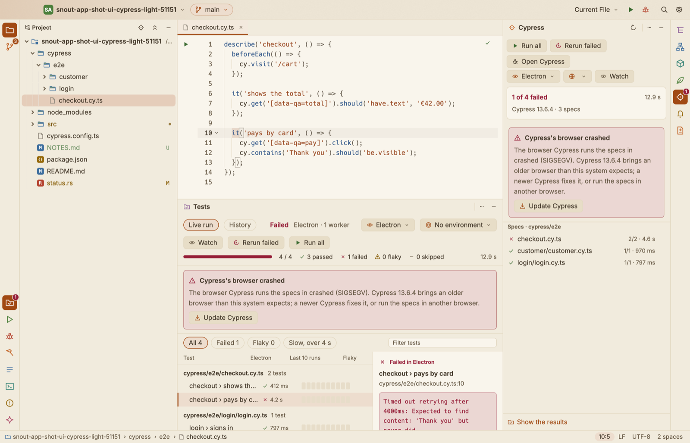

# Cypress

A package that tests with Cypress gets its specs in a **Cypress** window on the right, its runs followed live in the **Tests** window, and a fix a click away when a run goes wrong in a way SnoutCode knows.

*A Cypress run in Electron: three specs, one failure with the lines around it, and the browser crash that came after, with Update Cypress beside it.*

## What counts as one

A package tests with Cypress when its `package.json` depends on `cypress` or it has a `cypress.config.ts` (or `.js`, `.mjs`, `.cjs`, `.mts`, `.cts`). A package with Vitest or Jest too has both: its unit tests and its Cypress specs are two suites, and the Tests window's switch picks which **Run all** runs.

SnoutCode runs the package's own Cypress, from its `node_modules`, on the package's Node. Its specs are the files the configuration's `specPattern` names, when that is written as text (`specPattern: 'cypress/e2e/**/*.cy.ts'`, or a list of them); otherwise Cypress's own `cypress/e2e/**/*.cy.{js,jsx,ts,tsx}`.

## The Cypress window

Its button is on the right stripe, with the number of failed tests on it. **View ▸ Show the Cypress Window** opens it too.

- **Run all** runs every spec; **Stop** ends a run. **Rerun failed** runs the specs that failed in the last run.
- **Open Cypress** opens the Cypress app on the package (`cypress open --e2e`), in the browser picked, to watch a test step by step and debug it in the browser's developer tools.
- **The browser** the specs run in: Electron (the one Cypress comes with), or Chrome, Edge or Firefox when installed. The choice is kept with the project's settings on this machine.
- **The environment** the tests point at, the same list as Playwright's (see [Environments](playwright.md#environments)). Its application URL reaches Cypress as `baseUrl`, and each of its variables both as it is and as `CYPRESS_<name>`, so `Cypress.env('USER_EMAIL')` reads `USER_EMAIL`.
- **Watch** runs with the browser showing (`--headed`).
- **The summary** says how the last run went (`1 of 4 failed`), how long it took, and which Cypress the package has.
- **The specs**, named from the folder they sit in, each with how it went: passed, failed or flaky, how many of its tests ran, and its time. Before any run in this window, a spec shows how it went in the last run kept. Click a spec to show it in the preview tab, which the next spec you click replaces; double click it, or click the run icon at the end of its row, to run it alone.
- **Show the results** brings the Tests window forward.

The header's **Find the Specs Again** looks for specs again after you add or move some.

## Running specs

- **The Tests window** follows the run as it goes: each test as its spec starts, passed, failed or skipped, its time, retries (a test that passed on a retry is flaky), and for a failure its message, the lines around the one that failed, and the screenshot Cypress took of the page. **Show in editor** opens the test at its line; **Open in Cypress** opens the Cypress app to step through it.
- **Run icons.** A spec has an icon at each `describe` and test of its top level. Cypress runs whole specs, so each icon runs its spec.
- **The title bar's Run.** With **Current File**, Run runs the spec in front. In a project without Java and without a run configuration (`npm init`'s failing `test` script is not one), Run with no spec in front runs all the specs, as the Tests window's **Run all** does.
- **Scripts.** A `package.json` script that is a plain `cypress run` (such as `"test": "cypress run --browser chrome"`) runs as the script says, and the Tests window follows it all the same: SnoutCode adds its reporter to the run. A script that chains another command after Cypress runs as a script only.
- **The run's output** shows in the Run window as Cypress prints it, a line per test in place of Cypress's own `spec` reporter.

Every run is kept with the project's history, as Playwright's are (see [History](playwright.md#history)).

## When a run goes wrong

A run that goes wrong in a way SnoutCode knows says so above the results, in the Tests window and the Cypress window, with buttons that fix it. A fix that installs something runs in the Build window, then the same run starts again.

A run gets one notice, however many things went wrong. The one that matters most leads, with its explanation and fixes; each lesser one is a line under it with its own fix. The notice is red when the results cannot be trusted, and amber when they stand: a crash after every test passed, or a missing Rosetta, leaves the run green.

| What happened | What fixes it |
|---|---|
| **Cypress's browser crashed**: Electron went down with a signal such as `SIGSEGV`, most often as it closes after the specs. When every test passed, the results stand and only Cypress's exit code says otherwise. An older Cypress brings an older Electron than a newer system expects. SnoutCode keeps macOS's own “Cypress quit unexpectedly” window and crash report away for its runs: the notice says it all. | **Update Cypress** installs the latest Cypress into the package with its package manager (`npm install --save-dev cypress@latest`, `pnpm add -D`, `yarn add -D`, `bun add -d`). **Run in Chrome** (or Edge, or Firefox, when installed) runs the specs there from now on. |
| **The Cypress app is not installed**: the `cypress` package is there, but not the app it downloads on install. | **Install the Cypress App** runs `cypress install`. |
| **Nothing answers at the application's URL**: Cypress checked `baseUrl` and nothing was running there. | **Edit Environments** to point the runs at another environment, or start the application and **Run Again**. |
| **Cypress could not size its output**: a small helper of Cypress's is built for Intel Macs, and this Mac has no Rosetta (`Bad CPU type in executable`). The results are fine. When the browser crashed in the same run, the crash comes from this, and the two are one problem with Rosetta's fix. | **Install Rosetta** runs `softwareupdate --install-rosetta`. |

Tried with Cypress 13.6 on macOS 27, where it crashed only without Rosetta.
