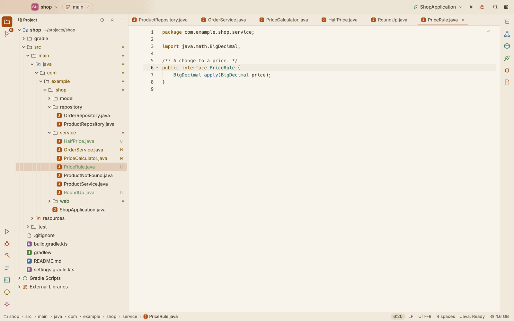
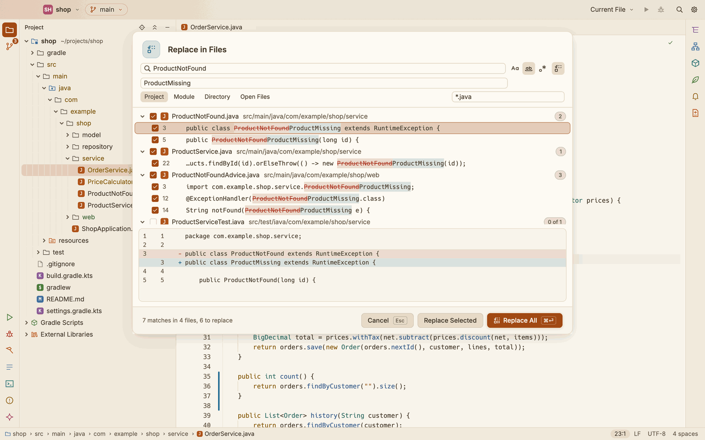
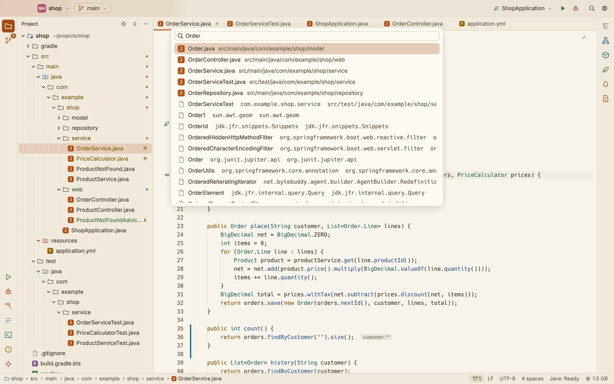
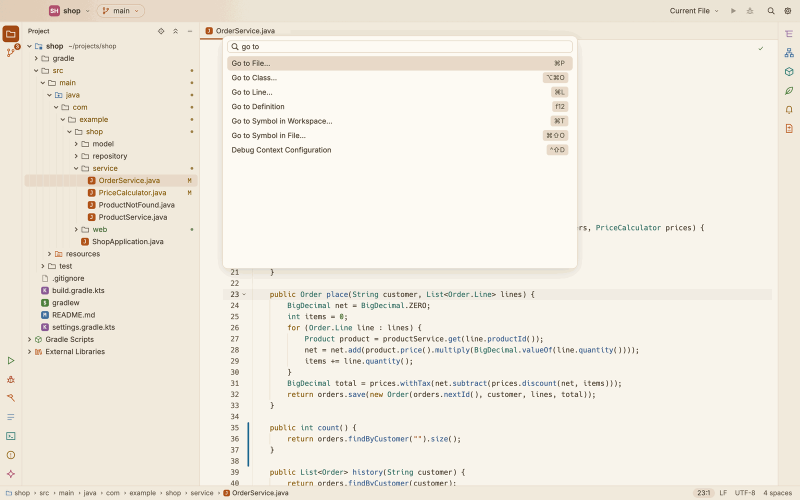

# The editor

How to open, edit, find and move around files in SnoutCode.

## Open a file

- Click a file in the Project view. A single click opens it in a preview tab, whose name is in italics. The next file you click takes the preview tab's place.
- Double click the preview tab, or edit the file, to keep it open.
- Press ⌘P (File ▸ Go to File…) and type part of the file's path. See [Go to File](#go-to-file).

SnoutCode highlights Java, Kotlin, Groovy (Gradle scripts and `Jenkinsfile`), YAML and `.properties` files. Other files open as plain text.

Java files of a Gradle build also get the language features described in [Java](java.md).

## Work with tabs

- **Save** with ⌘S (File ▸ Save). A dot on the tab means the file has unsaved changes.
- **Close** a tab with ⌘W (File ▸ Close Tab), with the × that shows when the pointer is over the tab, or with a middle click. A tab with unsaved changes asks first: Save, Don't Save or Cancel.
- **Reorder** tabs by dragging them. Drop a tab on another tab group to move it there.
- **Right click** a tab for **Close**, **Close Others**, **Close Tabs to the Right** and **Close All**, **Keep Open** for a preview tab, and **Copy Path** and **Reveal in Finder**.
- **Split** with ⌘\ (View ▸ Split Editor Right). The file in front opens a second time in a new group to the right. Both views show the same text: what you type in one shows in the other.

The tab bar also shows what Claude Code is doing with a file: a badge with the number of changes it proposes, or a small dot when it changed the file while the editor did not follow. See [Claude Code](claude-code.md).

### Tabs come back with the project

Each project keeps its editor tabs. When you open the project again, its tabs come back with the caret and scroll position they had. A tab whose file has been deleted since closes by itself. See [Settings and keymap](settings-and-keymap.md).

### When a file changes on disk

SnoutCode checks open files for changes made elsewhere, such as by Git, a build or Claude Code.

- A tab without unsaved changes takes the new text at once, and the caret stays where it was.
- A tab with unsaved changes shows a bar: "This file changed on disk, and this tab has unsaved changes." Choose **Reload from disk** to take the new text, or **Keep my changes** to keep yours. Saving then writes your text.

## What the editor shows

- **Git marks** in the gutter, beside the line numbers: lines added, changed and removed since the last commit. They update as you type.
- **Matching brackets**: the bracket at the caret and its match are framed.
- **The status bar**, for the tab in front: where the file sits in the project, the caret's line and column, how much is selected, the line endings (LF or CRLF), the encoding and the indentation (for example `4 spaces` or `Tab, 4`). A lock means the file is read only, such as a library class.

The indentation of a file is read from its own text. A file that shows none gets the tab size from Settings ▸ Editor.

## Edit text

| Command | Shortcut | Menu |
|---|---|---|
| Undo | ⌘Z | Edit ▸ Undo |
| Redo | ⇧⌘Z | Edit ▸ Redo |
| Toggle Comment | ⌘/ | Edit ▸ Toggle Comment |
| Duplicate Line | ⌘D | Edit ▸ Duplicate Line |
| Move Line Up | ⌥↑ | Edit ▸ Move Line Up |
| Move Line Down | ⌥↓ | Edit ▸ Move Line Down |
| Indent, Outdent | ⌘], ⌘[ | |
| Add a caret above, below | ⌥⌘↑, ⌥⌘↓ | |

- **Toggle Comment** comments the selected lines out with the language's line comment (`//` in Java, Kotlin and Groovy, `#` in YAML and properties files), or back in when they all are.
- **Duplicate Line** copies the selection after itself, or the caret's line below it.
- **Move Line Up** and **Move Line Down** move the selected lines, and the selection with them.

Each of these is one step that Undo takes back.

Right click in the editor for a menu with Cut, Copy, Paste, Select All and Send Selection to Claude. In a Java file it also has Go to Definition, Quick Fix… and a **Refactor** submenu (Rename Symbol…, Extract Method, Extract Variable, Extract Constant, Extract Field and Inline), and Run and Debug for what the caret is in. Each item shows its icon and, on the right, its shortcut. The arrow keys move through the menu (→ opens a submenu), ↩ picks an item and Esc closes it.

## Find and replace in a file

- Press ⌘F (Edit ▸ Find) to find in the file in front.
- Press ⌥⌘F (Edit ▸ Replace) to find and replace.

In the find bar, ↩ goes to the next match, ⇧↩ to the previous one, and Esc closes it. In replace mode you can replace the current match or all of them.

## Find in Files

Press ⇧⌘F (File ▸ Find in Files…, or Edit ▸ Find in Files…) to search the text of the project's files. The text selected in the editor in front, if any, is filled in.

- Type what to look for. The search runs once you pause typing.
- The buttons right of the field match case (**Aa**), only whole words, and treat the text as a regular expression.
- Pick where to look: the whole **Project**, a **Module** (the one of the file in front at first; **Choose…** picks another), a **Directory** (the folder of the file in front at first, from the project's folder), or the **Open Files**.
- The **file mask** narrows the files by name: `*.java, *.kt` takes those, `!*Test.java` leaves those out. A pattern with a `/` is matched against the path, such as `src/main/**`.
- Files that `.gitignore` excludes are left out, and so is the `.git` folder. A file open in an editor is searched as the editor has it, unsaved changes included.

The matches show as a tree, grouped by file; click a file's arrow to fold it. Under the tree, the lines around the match picked. Use ↑ and ↓ to pick a match, and ↩ (or a double click) to open the file at that line. Esc closes the window.

At most 5,000 matches are shown; the line at the bottom says when there were more.

## Replace in Files

Press ⇧⌘R (File ▸ Replace in Files…, or Edit ▸ Replace in Files…), or click the replace button in Find in Files, to replace text across the project. Everything Find in Files does works the same, with a second field for what to put in place of each match.

*`ProductNotFound` renamed in the Java files, its test left out.*

- Each match shows struck through, with what replaces it after it. The preview under the tree shows the change the picked row makes, as removed and added lines.
- Every match and every file has a tick box. Untick what should stay as it is; a file's box ticks or unticks all its matches.
- With a regular expression, the replacement can name the groups of the match: `$1`, `${name}`. `$$` is a dollar sign.
- **Replace All** (⌘↩ in a field) replaces every ticked match. **Replace Selected** replaces only the picked match, or the ticked matches of the picked file.

Files are written where the project is, so a project on a remote machine (see [Remote SSH](remote-ssh.md)) works the same. A file open in an editor takes the new text at once, as an edit of its own: ⌘Z in that editor takes it back. It is saved, unless it had unsaved changes before, in which case it stays unsaved. A file that changed since the search is left alone, and the line at the bottom says so.

**Edit ▸ Undo Replace in Files** puts every file of the last replacement back as it was, in one step. A file changed again since is left as it is.

## Go to File

Press ⌘P (File ▸ Go to File…) and type part of a file's path. Names match fuzzily: the letters you type must appear in order, not necessarily side by side. The best matches come first. ↑ and ↓ pick, ↩ opens, Esc closes.

## Go to Line

Press ⌘L (Edit ▸ Go to Line…) in an editor and type a line number, such as `120`, or a line and a column, such as `120:5`. ↩ moves the caret there.

## Go to Symbol

Symbols come from the Java engine, so these work for the Java files of a Gradle build.

- **Go to Class** (⌥⌘O, Navigate ▸ Go to Class…): classes of the project, its libraries and the JDK, by name. See [Java](java.md#go-to-class).
- **Go to Symbol in Workspace** (⌘T, Navigate ▸ Go to Symbol in Workspace…): classes, methods and fields of the whole project, by name.
- **Go to Symbol in File** (⇧⌘O in an editor, Navigate ▸ Go to Symbol in File…): the symbols of the file in front.
- **File Structure** (⌘F12 in an editor, Navigate ▸ File Structure…) and the **Structure** window (⌘7) show the file's symbols as a tree. See [Java](java.md#the-structure-of-a-file).

Outside an editor, ⇧⌘O checks out a branch instead. See [Git](git.md).

## Search Everywhere

Press ⇧⌘A (File ▸ Search Everywhere…), or click the magnifier at the right of the title bar. One box finds both files of the project, as Go to File does, and the matching symbols of its Java code, which follow the files.

*Search Everywhere for `Order`: the files first, then the classes.*

## Command palette

Press ⇧⌘P (File ▸ Command Palette…) and type part of a command's name. Every command is listed with the shortcut it has where the keyboard is now. Your recent projects are commands too, as `Open Recent: shop`. ↩ runs the command.

*The command palette: the Go to commands, with their shortcuts.*

## Zoom, soft wrap and whitespace

- **Zoom In** (⌘= or ⌘+), **Zoom Out** (⌘-) and **Actual Size** (⌘0), in the View menu, change the font size of every editor by one point, from 8 to 32. The size is kept for next time.
- **Soft Wrap** (⌥Z, View ▸ Soft Wrap) wraps long lines in the tab in front, or stops wrapping them.
- **Parameter Name Hints** (View menu) shows or hides the names of the parameters that literal arguments are passed to, in Java files. See [Java](java.md#parameter-name-hints).
- Settings ▸ Editor has **Soft wrap long lines**, **Show whitespace** and the parameter name hints for all editors, and the editor font and size are under Settings ▸ Appearance. See [Settings and keymap](settings-and-keymap.md).

Every shortcut on this page can be changed. See [Keyboard shortcuts](keyboard-shortcuts.md).
