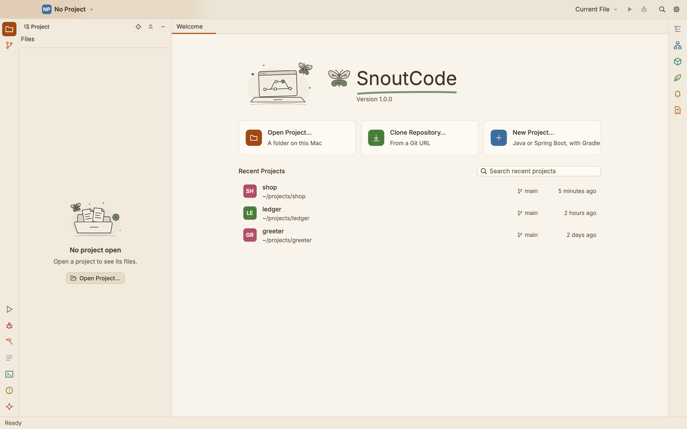
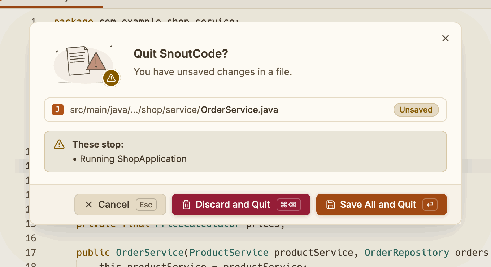

# Getting started

Install SnoutCode, open your first project, and get Java support running.

## What you need

- A Mac. SnoutCode is a native macOS app.
- Git on your `PATH`. A project is a folder inside a Git repository.
- Nothing else to start. The app carries its Java engine with a Java runtime of its own, so
  you do not need to install Java to open the app or to get Java support in the editor.

Your Gradle build runs on a JDK of its own, chosen to suit the build. When no installed JDK
fits, SnoutCode offers to download one (see [Java for your builds](#java-for-your-builds)).

## Install the app

1. Open the SnoutCode disk image (`.dmg`).
2. Drag SnoutCode into Applications.
3. Open SnoutCode from Applications.

A copy that was signed only for the Mac that built it has to be allowed once on any other
Mac: open System Settings > Privacy & Security and allow SnoutCode there.

### Build it from source

To build the app and its disk image yourself, run this from a clone of the repository:

```sh
scripts/package-mac.sh
```

It puts `SnoutCode.app` and a `.dmg` in `target/release/bundle/`, for the architecture of the
Mac that builds it. Building the Java engine needs JDK 21: the script uses `SNOUT_JDK21`, else
`JAVA_HOME` when it is 21, else one that `/usr/libexec/java_home` finds.

While you work on SnoutCode itself, `./snout.sh` builds the app and the engine when their
sources changed, and starts the app:

```sh
./snout.sh                     # reopen the project you had open last
./snout.sh ~/projects/shop     # open a folder as the project
./snout.sh --pick              # choose a folder with a dialog
./snout.sh --fg                # stay in the foreground, with the log in the terminal
```

When no JDK 21 is installed, `snout.sh` downloads one to build the engine with. The app starts
first and shows the engine build as a background task in the status bar.

## First launch

A small splash shows while the window gets ready. The first time, no project is open, and the
Welcome page shows:

- **Open Project…** opens a folder on this Mac.
- **Clone Repository…** copies a repository from a Git URL and opens it.
- **New Project…** makes a Java or Spring Boot project with Gradle.
- **Recent Projects** lists the projects you opened, with their branch and when you last
  opened them. Type in the search box to filter them.



*The Welcome page, with three recent projects.*

You can also drag a folder from Finder onto the window to open it.

After that, SnoutCode opens the project you had open last, with its editor tabs as you left
them. See [Projects](projects.md) for opening, switching and closing projects.

### The menus

The Mac's menu bar holds every command: File, Edit, View, Code, Navigate, Refactor, Run,
Repository (Git), Window and Help. Each item shows an icon, an SF Symbol as macOS's own menus
use, so commands are quick to spot; its shortcut, when it has one, is at the right. Items that
cannot act now (Save with no editor open, Stage with nothing selected) are greyed out.

### Open a project from the command line

The app's program takes one argument: a folder to open as the project, or a file to open in
its repository. Add `:line` or `:line:column` to a file to put the caret there.

```sh
/Applications/SnoutCode.app/Contents/MacOS/snout-code ~/projects/shop
/Applications/SnoutCode.app/Contents/MacOS/snout-code ~/projects/shop/src/main/java/shop/App.java:42
```

## Quitting

Press ⌘Q (SnoutCode ▸ Quit SnoutCode), or close the window: closing the last window quits.
SnoutCode asks first:



*Quitting with a file unsaved and a program running.*

- With unsaved files, it names them: **Save All and Quit** (⏎) saves them first, **Discard
  and Quit** (⌘⌫) drops the changes, **Cancel** (Esc) stays.
- It names what would stop: a program running or being debugged, a Gradle build or tests in
  progress, Claude Code editing a file, and on a remote machine the connection and what the
  project runs there.
- When nothing would be lost or stopped, tick **Don't ask again** to quit at once from then
  on. Settings ▸ Appearance ▸ **Confirm before quitting** turns the question back on. It is
  always asked when something would be lost or stopped.

The window goes the moment you quit. The Java engine, its language server and Gradle daemons,
and the programs and terminals SnoutCode started are stopped right after, in the background,
so you can open SnoutCode again at once. Each is asked to stop and usually has within a
second; one still there after 12 seconds is ended.

## Java support

Java support starts by itself for a Gradle project. While the Java engine starts, the status
bar, at the bottom right, shows what it is doing as a background task with a thin progress
bar. Click it to list everything running in the background. The editor works meanwhile.

Once the engine is done, the status bar shows `Java: Ready`. Click it to show the Problems
tab. See [Java](java.md) for what the engine gives you.

## Java for your builds

SnoutCode runs each Gradle build on a JDK that suits it: the Java level its build scripts ask
for, within what its Gradle version can run on. It looks for JDKs in these places:

- the JDKs `/usr/libexec/java_home` lists
- `~/Library/Java/JavaVirtualMachines` and `/Library/Java/JavaVirtualMachines`
- `~/.sdkman/candidates/java`
- `~/.gradle/jdks`
- `~/Library/Application Support/SnoutCode/jdks`, where SnoutCode puts the JDKs it downloads

When none fits, a bar above the editor says so: "This project needs JDK 17. Download it?"

- Click **Download** to download Eclipse Temurin of that version into
  `~/Library/Application Support/SnoutCode/jdks`. The bar shows the progress. The Java engine
  starts once the download is done, as does any other build waiting for the same JDK.
- Click **Not now** to hide the bar. It does not offer that version again until SnoutCode
  starts again.

If the download fails, the bar says why and offers **Try again**.

Temurin publishes no Java 8 for Apple silicon, so on such a Mac a build that asks for Java 8
gets Java 11, which builds and runs Java 8 code.

To choose the JDK of a build yourself, see [Settings](settings-and-keymap.md#build-tools--gradle).

## Next steps

- [Projects](projects.md): open, switch and close projects, and find your way in them.
- [Editor](editor.md): tabs, search and navigation.
- [Run and debug](run-and-debug.md): run your application and its tests.
- [Keyboard shortcuts](keyboard-shortcuts.md): every default shortcut.
- [Troubleshooting](troubleshooting.md): when something does not work.
