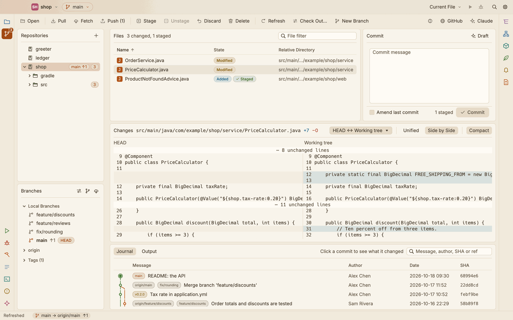
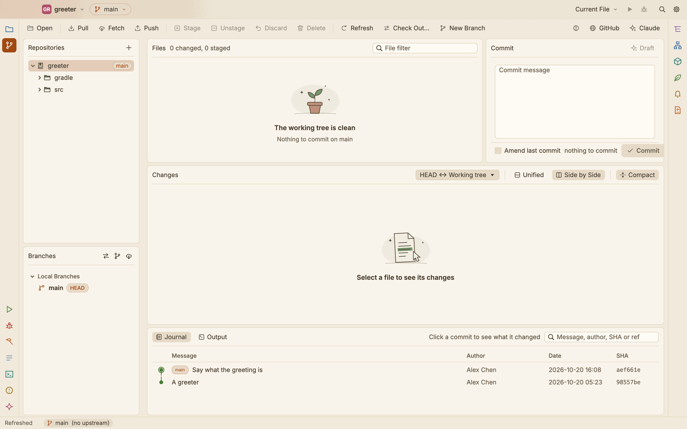
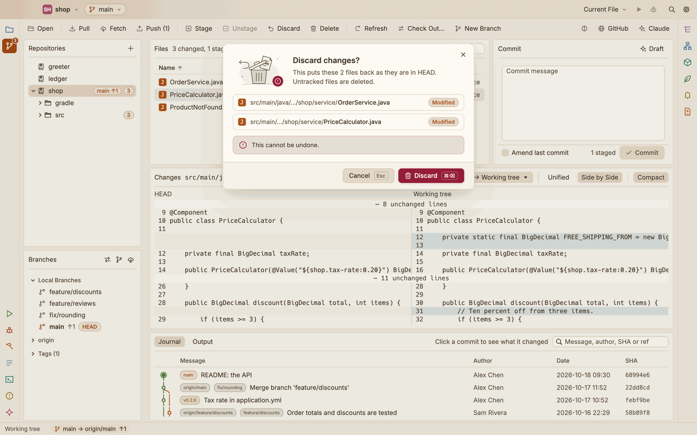
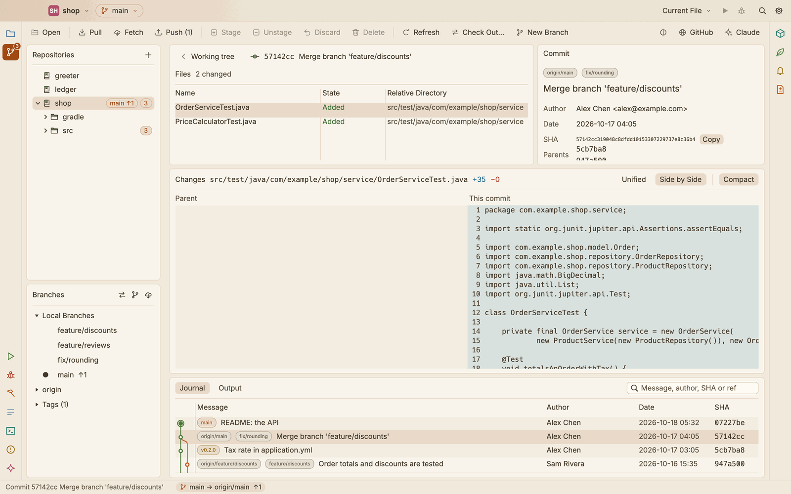
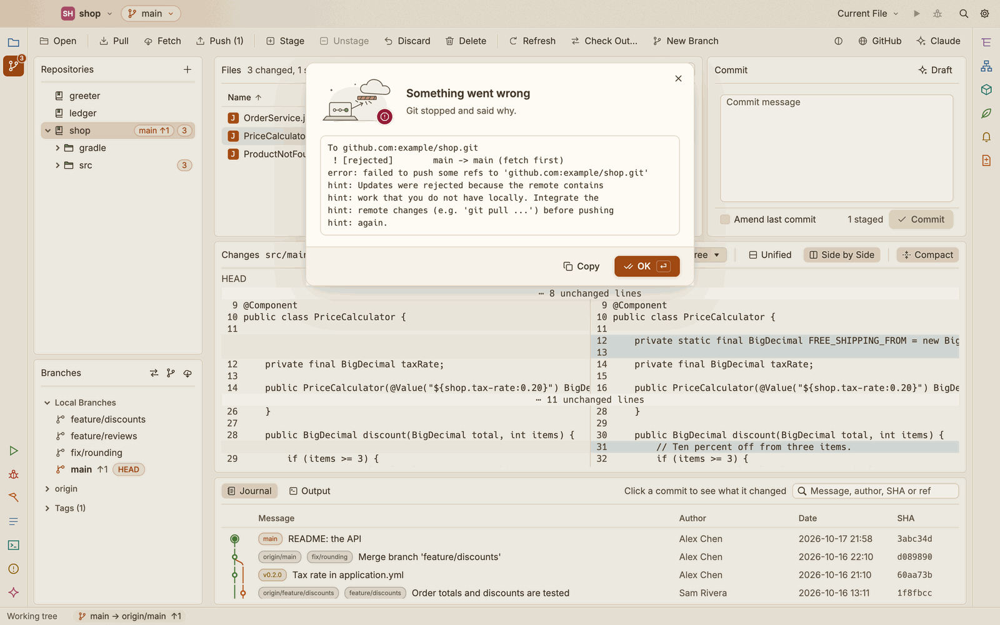

# Git

The Git view is where you see what changed, read the diff, commit, switch branches and sync with the remote.

Show it with **View ▸ Git**, ⌘2, or the Git icon in the activity bar. ⌘1 goes back to the Project view. The Git commands are also in the **Repository** menu and in the command palette (⇧⌘P).

The project you open is a Git repository, or a folder inside one. The Git view always shows that repository. See [Projects](projects.md) for opening and closing projects.

## The layout

*The shop's changes, the diff of one file, the branches, and the history with its graph.*

- **Toolbar** across the top: Open, Pull, Fetch, Push, Stage, Unstage, Discard, Delete, Refresh, Check Out…, New Branch, then the theme menu, GitHub and Claude.
- **Left column:** the Repositories list, and below it the branches and tags.
- **Middle:** Files and Commit side by side, Changes under them, and the Journal at the bottom.
- **Right:** the Claude Code console, when it is open (⌘J). See [Claude Code](claude-code.md).

Drag the edges between panes to resize them. In the Git view, the status bar shows the branch, its upstream and how far ahead (↑) and behind (↓) it is, for example `main → origin/main  ↑1`.

SnoutCode reads the repository again when the window comes forward, when you press F5 (**View ▸ Refresh**), and while the Claude Code console's agent is working.

## Repositories

The Repositories list holds the repositories you have opened, and lets you file them in groups.

- **Open** a repository: click it. This opens it as the project.
- **See its state:** the open repository shows its branch with ↑ and ↓ counts and its number of changed files. Others show what there is to pull, once the background fetch has counted it. A repository that is no longer on disk is marked **missing**.
- **Narrow the files to a folder:** the open repository expands into its folders, each with its number of changed files. Click a folder to show only the changes under it; click the repository, or the `in folder/ ✕` chip in Files, to show them all again.
- **Filter** the list: the field appears once you have more than 6 repositories. It matches repository and group names.
- **Right-click** a repository for **Open**, **Move to group** (a group, **No group**, or **New group…**), **Reveal in Finder**, **Copy path** and **Remove from list**. Removing the open repository closes the project.

### Groups

- **Create a group:** click **+** above the list and choose **New group…**, or right-click a group. The dialog asks for its name.
- **File a repository:** drag it onto a group, or use **Move to group** in its context menu.
- **Take it out of its group:** drag it onto the empty space below the list.
- **Rename** or **delete** a group from its context menu. Deleting a group keeps its repositories in the list.

A closed group still shows when one of its repositories has commits to pull.

### Adding repositories

The **+** button above the list has:

- **Open local repository…** (⌘O, or **File ▸ Open Project…**): pick a folder. When the folder is not in a Git repository, SnoutCode asks what to do: **Find repositories inside** looks through its subfolders and adds every repository it finds, and **Initialize a repository here** runs `git init`.
- **Find repositories in folder…** (also **File ▸ Find Repositories in Folder…**): adds every repository up to 4 levels below the folder you pick.
- **Clone from GitHub…** (also **File ▸ Clone from GitHub…**): enter the URL and the folder to clone into. The dialog shows where the clone lands, then clones it and opens it. Any Git URL works.
- **New group…**

You can also drag a folder from Finder onto the window to open it.

## Branches and tags

Below the Repositories list:

- **Local Branches**, then one section per remote, then **Tags** (with their count). Click a section's title to fold it.
- The current branch is in bold with a **HEAD** badge. Branches show how far ahead (↑) and behind (↓) of their upstream they are, and a **gone** badge when the upstream was deleted. When HEAD is detached, a `HEAD (detached at …)` line says so.
- Hover a branch or tag to see its upstream and its last commit.
- **Double-click** a branch to check it out, or a tag to check it out detached. A remote branch checks out as a local branch of the same name.
- **Right-click** a branch for **Check out**, **Create branch from here…**, **Delete…** (for a remote branch, **Delete from** the remote) and **Copy name**. A tag has **Check out (detached)**, **Create branch from tag…** and **Copy name**.
- **Delete a branch** with the trash can that appears when you hover its row.

The buttons at the top of this pane check out (⇧⌘O), create a branch and fetch.

### Deleting a branch

- **A local branch:** the dialog offers **Delete even if it is not fully merged**, and **Also delete** its upstream **on the remote** when it still exists there.
- **A remote branch:** the dialog asks before deleting it from the remote. Removing a branch from a remote affects everyone who uses it.

## Files

Files lists the changed files of the working tree: name (with the file type's icon), state and relative directory. The state is a small pill in its own colour: **Modified**, **Added**, **Deleted**, **Renamed**, **Untracked** or **Conflicted**, with **Staged** or **Partly staged** beside it once you stage the file. A long directory is shortened in its middle; point at it to read it whole. The header says how many files are changed and how many staged.

- **Sort** by a column: click its header; click again to reverse. An arrow marks the column and the order.
- **Resize** a column: point at the header and drag the handle that shows between two titles.
- **Filter** by name with the field in the header.
- **Select** a file to see its diff in Changes. The selection shows in the accent colour while the table has the keyboard, and in grey once you click elsewhere. ⌘-click adds or removes a file, ⇧-click selects a range, and ⌘A selects every file shown (when no text field has the keyboard).
- **Right-click** for **Stage**, **Unstage**, **Discard…**, **Delete…**, **Reveal in Finder** and **Copy path**. A right-click on a file that is not selected selects it first.

When nothing has changed, Files says the working tree is clean.

### Staging, discarding and deleting

Stage, Unstage, Discard and Delete act on the selected files. They are on the toolbar, in the context menu and in the **Repository** menu (**Stage**, **Unstage**, **Discard Changes…**, **Move to Trash…**).

- **Discard** puts the files back as they are in HEAD. Untracked files are deleted. SnoutCode asks first, because this cannot be undone: the dialog lists each file with its state, and goes ahead only when you click **Discard** or press ⌘⌫. ⏎ does not discard; Esc cancels.
- **Delete** (⌘⌫) moves the files to the Trash, where you can still get them back. SnoutCode asks first; click **Move to Trash** or press ⌘⌫ again.

## Changes

Changes shows the diff of the selected file.

- **Compare:** the menu in the header picks what to compare: **HEAD ↔ Working tree**, **Index ↔ Working tree** or **HEAD ↔ Index**.
- **Layout:** **Unified** or **Side by Side**.
- **Compact** hides unchanged lines away from the changes, keeping 3 lines of context around each.

The same choices are in **View ▸ Side by Side Diff**, **Unified Diff** and **Compact Diff**. A binary file, or one too large to show, says so instead.

## Commit

1. Type the message in the Commit box.
2. Press ⌘↩, or click **Commit**.

You do not have to stage first. The label beside the Commit button says what the commit takes:

- the staged changes, when anything is staged;
- otherwise the files selected in Files;
- otherwise every changed file.

**Amend last commit** replaces the last commit with this one. With nothing new to add, only its message changes.

### Draft the message with Claude Code

Click **Draft** (or **Repository ▸ Draft Commit Message**) to have Claude Code write the message. It reads exactly what the commit would record, follows the style of your recent commit subjects, and builds on anything you already typed. Click **Stop** to cancel.

Draft runs `claude` on its own, with its tools turned off, and does not touch the console's session. It needs Claude Code installed; see [Claude Code](claude-code.md).

## Check Out

Press ⇧⌘O (outside an editor), click **Check Out…** on the toolbar, or use **Repository ▸ Check Out…**.

1. Type to filter. The list has **Local branches**, **Remote branches** (those without a local branch of the same name) and **Tags**. Type a SHA or an expression such as `HEAD~2` to get that **Commit**.
2. Pick one with a click, then **Check Out**, or double-click it, or press Return.

With uncommitted changes, choose what happens to them:

- **Keep them:** carry the changes across as they are. Git refuses if they would be overwritten.
- **Stash and re-apply:** put them aside, switch, then bring them back. If bringing them back conflicts, SnoutCode says so and the stash is kept, so nothing is lost.

Checking out a tag or a commit leaves HEAD detached; the dialog warns you. Create a branch if you want to keep new commits.

A branch you double-click in the branches pane asks the same question when you have uncommitted changes.

### The branch menu in the title bar

Click the branch name in the title bar for a quick menu: **New Branch…**, **Fetch**, **Pull** and **Push**, then your **Local** and **Remote** branches with a search field. Click a branch to check it out.

## New branch

Click **New Branch** on the toolbar, use **Repository ▸ New Branch…**, or choose **Create branch from here…** on a branch, tag or commit.

Enter the name. The dialog shows where the branch starts (HEAD, unless you started from a branch, tag or commit) and has **Check out the new branch**. A name Git would not accept cannot be created.

## Journal

The Journal, at the bottom, lists recent commits on a graph of their branches and merges, with the message, author, date and short SHA. Branch and tag badges sit beside the message, and commits not yet pushed are drawn solid. Drag the handles between the column titles to resize the columns.

- **Search** by message, author, SHA or ref in the field at the top right. While a search is on, the graph is hidden.
- **Click** a commit to open it in the commit view.
- **Right-click** a commit for **Show changes**, **Check out this commit (detached)**, **Create branch here…**, **Copy SHA** and **Copy message**.

The **Output** tab beside Journal shows what Git printed for the last commands, errors in red. **Clear** empties it.

## Commit view

Click a commit in the Journal to see what it did:

- **Files:** the files it changed. Select one to see its diff against the parent.
- **Commit:** its badges, full message, author and date, the committer when it differs, the full SHA (with **Copy**) and its parents. Click a parent to go to it.
- **Changes:** the diff of the selected file, with the same Unified, Side by Side and Compact choices.

Press ↑ or ↓ to move to the previous or next commit. Press Esc, or click **Working tree**, to go back.

*A merge, and the diff of a file it brought in.*

## Pull, fetch and push

The buttons are on the toolbar, in the **Repository** menu and in the title bar's branch menu.

- **Pull** runs `git pull` with your repository's settings.
- **Fetch** runs `git fetch --all --prune`.
- **Push** runs `git push`, and sets the upstream on the first push. The button shows how many commits there are to push.

They use your normal Git credentials, as in a terminal.

### When a pull cannot combine the branches

- **Both sides have new commits** and your settings do not say how to combine them: choose **Merge** (join both histories with a merge commit; nothing is rewritten) or **Rebase** (replay your commits on top of the remote ones, for a straight history).
- **No shared history** (the remote was recreated or its history rewritten): **Reset to** the upstream makes your branch match it exactly. Your current commits stay on a backup branch, which SnoutCode names afterwards, so nothing is lost. Commit or stash your uncommitted changes first; until then the reset is not offered.

Each dialog shows what Git reported. When Git stops with an error (a push the remote turns back, for example), **Something went wrong** shows Git's own words, with **Copy** to put them on the clipboard.

### Background fetch

SnoutCode fetches the repositories in the list in the background, to count what there is to pull. It does so every 10 minutes by default. Change it in **Settings ▸ Version Control ▸ Fetch every**, from 5 to 120 minutes. See [Settings and keymap](settings-and-keymap.md).

## GitHub and Finder

- **GitHub** on the toolbar, or **Repository ▸ Open on GitHub**, opens the repository on github.com. Hover the button to see the address; without a GitHub remote it is greyed out.
- **Repository ▸ Reveal in Finder** shows the project's folder in Finder.

## Shortcuts

| Shortcut | Action |
|---|---|
| ⌘2 | Show the Git view |
| ⌘O | Open a project or repository |
| ⇧⌘O | Check out a branch, tag or commit (outside an editor) |
| ⌘↩ | Commit (in the message field) |
| ⌘A | Select every file shown in Files (outside text fields) |
| ⌘⌫ | Move the selected files to the Trash, after asking |
| F5 | Refresh |
| ↑ ↓ | Previous or next commit, in the commit view |
| Esc | Leave the commit view |
| ⌘J | Show or hide the Claude Code console |

See [Keyboard shortcuts](keyboard-shortcuts.md) for the full list.
