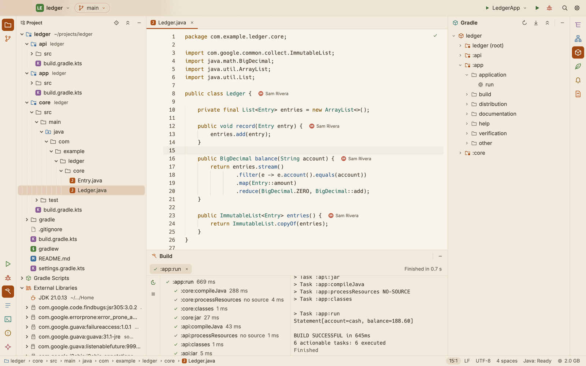

# Gradle

SnoutCode reads your Gradle build to know your modules, source folders, libraries and tasks. This page covers syncing, the Gradle tool window, running tasks, builds that fail to sync, the JDK each build runs on, and the Gradle daemons SnoutCode starts.

## How SnoutCode reads the build

When you open a project, SnoutCode's Java engine starts and syncs the Gradle model. A sync only configures the builds: no task runs, nothing is compiled, and no `build/` folder appears in your project. The engine keeps Gradle's build output and project caches in its own cache folder, `~/Library/Caches/SnoutCode`.

The next time you open the project, the engine reuses the last model when nothing it was read from has changed (settings and build scripts, version catalogs, `gradle.properties`, `buildSrc`, the wrapper's properties). Opening is then much faster.

The status bar shows what the engine is doing while it syncs and imports.

## Many builds in one folder

The folder you open is the project. It can be one Gradle build or hold many side by side, for example `~/projects/shop` with `billing/`, `catalog/` and `web/`, each a build of its own.

- A folder that is a build, or lies inside one, is that build.
- Any other folder holds every build found under it, up to 8 levels down. Folders named `build`, `.gradle`, `node_modules`, `out` and `target`, and hidden folders, are skipped.

All the builds are synced together into one model, several at once. A build that fails to sync does not stop the others.

## Sync after you change a build script

When a Gradle script changes after the model was read, a bar above the editor says **Gradle files changed. Sync?**

- Click **Sync** to read the build again.
- Click **Not now** to put the bar away until the scripts change again.

To sync at any time:

- In the Gradle tool window, click **Sync the Gradle Project** in its header.
- Or open the command palette (⇧⌘P) and run **Sync Gradle Project**.

When the Java engine is running, a sync restarts it, and it syncs as it starts. If the sync fails, the bar says **The Gradle sync failed** with the reason, and offers **Try again**.

## Builds that fail to sync

A build that did not sync shows in the Project view as a node of its own, greyed, with an error badge and its Gradle version. Under it, a line in red gives the reason. Hover it to read the full error.

When a build that synced before fails now, its modules stay, from the last model that synced. They carry a warning badge, and their tooltip says why and that the last model is shown.

See [Projects](projects.md) for the Project view.

## The Gradle tool window

*The `ledger` build's tasks, and `:app:run` in the Build window with each task it ran.*

Open it from the **Gradle** button on the right edge of the window. It lists:

1. each build,
2. its Gradle projects (the root shows as `name (root)`),
3. their task groups,
4. the tasks.

Click a row to open or close it. Hover a task to read its description. A build that could not be read shows a warning icon; hover it to read the error.

The header has three buttons:

- **Sync the Gradle Project** syncs the model again.
- **Read the Tasks Again** asks the engine to configure the builds again and list their tasks. The command palette calls it **Refresh Gradle Tasks**.
- **Collapse All** folds everything shut (**Collapse All Gradle Tasks** in the command palette and View ▸ Tool Window Actions).

The tasks appear once the Java engine has imported the project. Until then the window says **No tasks yet**.

## Run a task

Double click a task in the Gradle tool window, or press ⌃⌥G (**Build ▸ Run Gradle Task…**) and type part of its name or path, such as `boot` or `:app:test`, then press Enter. It runs in the **Build** tool window, at the bottom of the window.

The Build window shows the run and, under it, each task Gradle ran with its outcome: up to date, from cache, skipped or no source. When the compile reports errors or warnings, the run shows their count; click it to open the Problems tool window. Compile errors go to Problems on their own, and Problems opens when there are errors (⇧⌘M shows it at any time).

Each run gets a tab in the Build window. Use **Rerun** (⌘R) and **Stop** (⌘F2) on the left of the window, or the × on a tab to stop the run and close it.

To run `bootRun`, `run` or another task as a run configuration, see [Run and debug](run-and-debug.md).

## The JDK each build runs on

Each build runs Gradle on a JDK that its Gradle version supports. SnoutCode looks for the JDKs installed on your Mac and picks one that fits:

- When the build's scripts ask for a Java level (a source compatibility, a toolchain, a release), that JDK if it is installed, else the oldest newer one the build's Gradle version runs on.
- When they ask for none, the newest JDK the build's Gradle version runs on.

SnoutCode remembers the JDK it picked for the build.

SnoutCode finds the JDKs macOS knows of (those in `/Library/Java/JavaVirtualMachines` and `~/Library/Java/JavaVirtualMachines`), those of SDKMAN, Gradle's provisioned toolchains, and the JDKs SnoutCode downloaded.

### When no installed JDK fits

A bar above the editor says, for example, **This project needs JDK 17. Download it?**

- Click **Download** to download Eclipse Temurin of that version into `~/Library/Application Support/SnoutCode/jdks`. The bar shows the progress. When it is done, the builds waiting for that JDK start on it.
- Click **Not now** to leave it. Runs, tests and the debugger then say that the build needs a JDK that is not installed.

If the download fails, the bar says why and offers **Try again**.

### Choose the JDK yourself

1. Open Settings (⌘,) and go to **Gradle**, under Build Tools.
2. Under **JDK per project**, pick a JDK for each build of the open project, or **Automatic (the build's Java level)**.

The Java engine restarts on the chosen JDK the next time it starts. A JDK that the build's Gradle version cannot run on is not used.

[Project Structure](project-structure.md) (⌘;) sets the JDK of every build of the project, adds a JDK from a folder SnoutCode did not find, and shows each module's source sets, Java levels and dependencies, with the versions that lost a conflict and the line of the build file that declares each.

## Gradle daemons

The Java engine runs Gradle on daemons of its own:

- They are private to SnoutCode. `./gradlew` in a terminal never runs on them, SnoutCode never runs on the daemons you start from a terminal, and `./gradlew --stop` leaves SnoutCode's daemons alone.
- They stop when the engine stops.
- They stop after some time without a build: 15 minutes unless you change it.

To change how long the daemons may sit idle:

1. Open Settings (⌘,) and go to **Gradle**.
2. Under **Gradle daemons**, set **Stop idle daemons after** with the − and + buttons, from 1 to 240 minutes.

The new value holds for daemons started after the Java engine starts again.

To see the daemons, how long they have been idle, and to stop them at once, use the Processes window. See [Processes](processes.md).
