# Java

How SnoutCode understands your Java code: completion, navigation, refactoring and problems.

## Where it works

The Java features work in the Java files of a Gradle build. They come from SnoutCode's Java engine, which starts when the project is a Gradle build, or when you open a Java file of one. There is one engine per Gradle build. It stops when you open another project in its place, or quit.

The engine reads the build's Gradle model first, so it knows the source folders, the libraries and the Java level of every module without running a build. See [Gradle](gradle.md).

Spring Boot configuration files (`application.properties`, `application.yml` and their profile variants) get completion and checks from the same engine. See [Spring](spring.md).

Most commands below are in the **Code** and **Refactor** menus, and in the command palette (⇧⌘P).

## Completion

Completion opens as you type a name or a `.`. Press ⌃Space to open it anywhere.

When you accept a class the file does not import yet, SnoutCode adds the import.

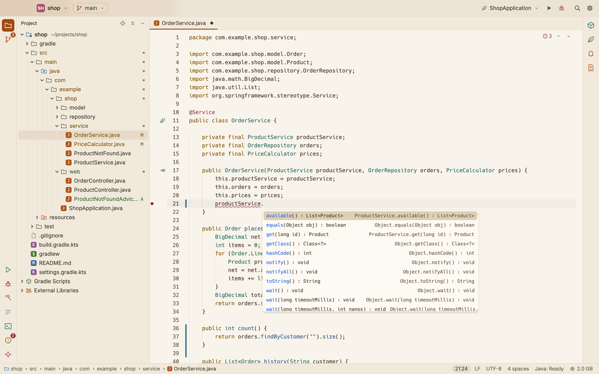

*Completion after `productService.`: the methods, with their types.*

## Parameter hints

When you type `(` or `,` in a call, the method's signature shows over the caret with the current parameter in bold. It stays while the caret is on that line. Press ⇧⌘Space (Code ▸ Show Parameter Hints) to show it again.

## Parameter name hints

Where a call passes a literal, such as a string, a number or `true`, the name of the parameter it is passed to shows after the end of the line, in a quiet chip: `new Shop("Ada");` is followed by `owner: "Ada"`, and a call with several literals gets a chip for each, in order. Arguments that are names or expressions get none, since they usually say what they are.

The hints follow your typing: they move with their arguments at once, and the engine is asked again when you pause.

To turn them off or on, choose View ▸ Parameter Name Hints, run **Toggle Parameter Name Hints** from the command palette, or use the setting in Settings ▸ Editor. It has no shortcut until you give it one in the keymap.

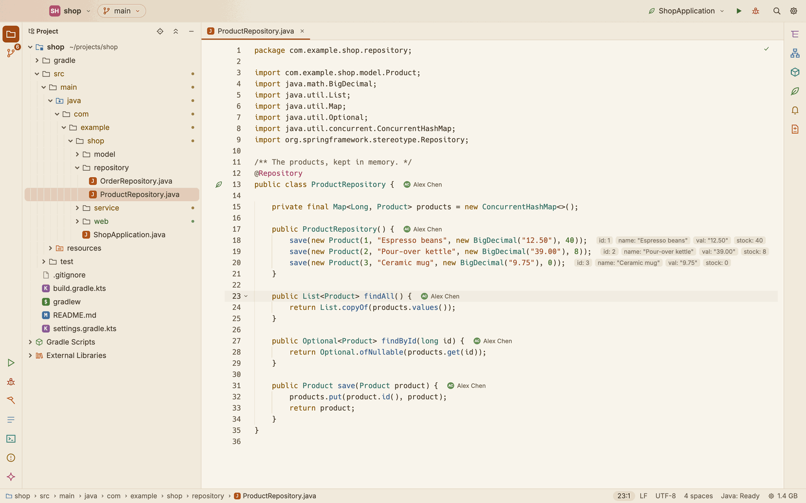

## Hover

Rest the pointer on a name to see its type and documentation. On a squiggle, you see the problem's message.

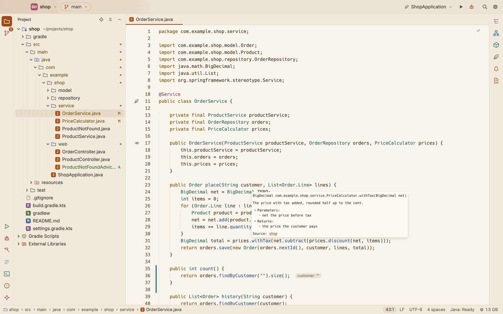

*The pointer on `withTax`: its signature and its Javadoc.*

## Go to a definition

- Press F12 (Code ▸ Go to Definition), or ⌘-click a name.
- The definition opens in its file, with the caret on it.
- A class of a library opens in a read only tab named after the class, such as `String.class`. It shows the library's source when the build has a source jar for it. The status bar shows a lock. You can go to definitions from there too.

To find a class, method or field by name instead, use Go to Class (⌥⌘O, below), Go to Symbol (⌘T) or Search Everywhere (⇧⌘A). See [The editor](editor.md#go-to-symbol).

## Go to Class

Press ⌥⌘O (Navigate ▸ Go to Class…) and type part of a class's name. It finds classes, interfaces, enums and records, of the project and of its libraries and the JDK too. (⌥⌘O, because ⌘O opens a project.)

- Type the start of the name (`Circ`), its capitals (`AL` for `ArrayList`), or some of its letters in order (`arrlst`). The closest names come first, and the project's own classes before the libraries' when they match alike.
- Each row shows the class's package, and for a library's class, the jar or the JDK module it comes from, such as `java.util  java.base`.
- ↑ ↓ pick, ↩ opens the class. A library's class opens read only, with its source when the build has a source jar for it, as Go to Definition shows it.

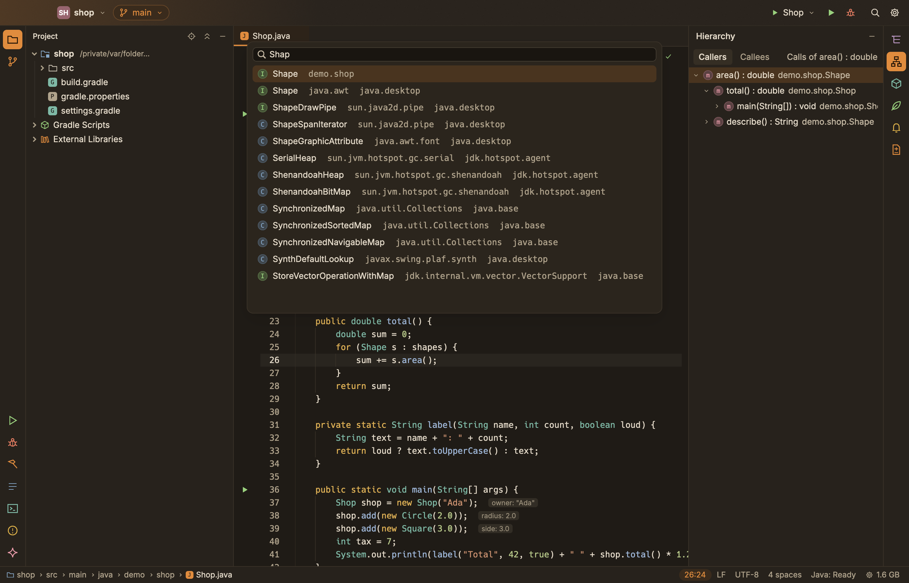

## The structure of a file

The **Structure** window shows the symbols of the Java file in front as a tree: its classes, interfaces, enums and records, and in each its fields, constructors and methods. Open it with ⌘7 (View ▸ Structure), or from its icon at the top of the right stripe; ⌘7 again hides it.

- Each symbol has a badge for its kind (`C` class, `I` interface, `E` enum, `R` record, `f` field, `c` constructor, `m` method) and a mark for its visibility: a green dot for public, an amber dot for protected, a ring for package private, a lock for private. A method shows its return type, a field its type.
- The symbol the caret is in is highlighted, and follows the caret as you move it. Click a symbol to go to it; click the arrow beside a type to fold it.
- Type in the filter field at the top to keep the symbols whose names match, with the types that hold them.
- The button beside the filter sorts the symbols by name, types first. Click it again for the order of the file.
- The tree follows the editor in front, and your edits, a moment after you stop typing.

**File Structure** (⌘F12 in an editor, Navigate ▸ File Structure…) shows the same tree in a box over the editor, with the symbol the caret is in already picked. Type to filter it, use ↑ ↓ to pick, and ↩ to go there; Esc closes it.

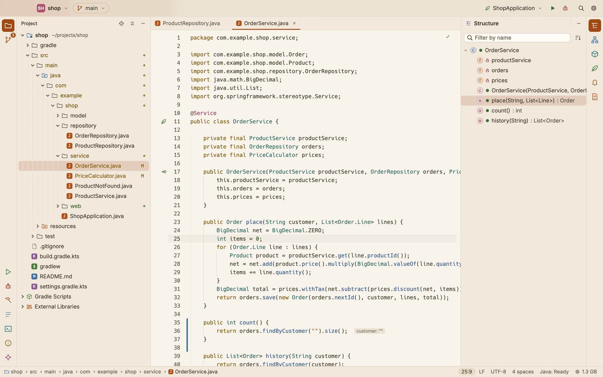

## Type and call hierarchy

The **Hierarchy** window, on the right stripe below Structure, shows how types and methods are related. Its tree opens one level at a time, asking the engine as it goes: click the arrow beside a row, or double-click the row.

- **Type Hierarchy** (⌃H, Navigate ▸ Type Hierarchy): put the caret on a class or an interface, where it is declared or where it is used. The window shows its **Subtypes**, the classes that extend or implement it, and theirs below them. Click **Supertypes** at the top of the window for what it extends and implements instead.
- **Call Hierarchy** (⌃⌥H, Navigate ▸ Call Hierarchy): put the caret on a method. The window shows its **Callers**, the methods that call it, and theirs below them. Click **Callees** for the methods it calls instead.

Click a row to go there: a type or a method opens at its declaration, and a caller at the call. Types and methods of libraries and the JDK open read only, as with Go to Definition. The stripe icon, or View ▸ Hierarchy, shows the window again with the last hierarchy.

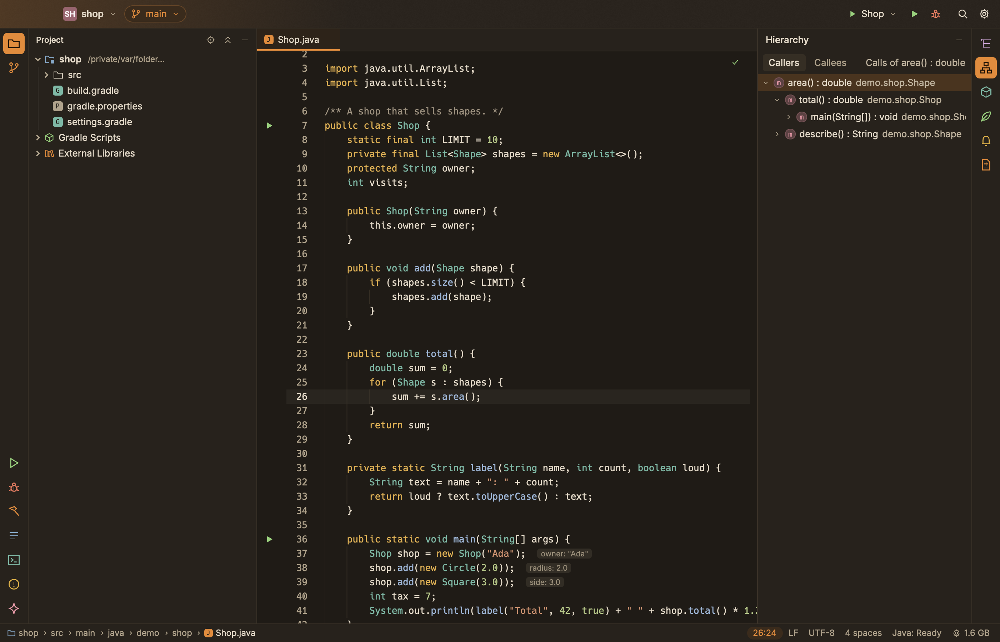

## Find references

Put the caret on a name and press ⇧F12 (Code ▸ Find References). Every use of it is listed in the **References** window, in the bottom dock, titled `References to <name>: <n> results`. Each row shows the file, the line and column, and the line of code. Click a row to go there.

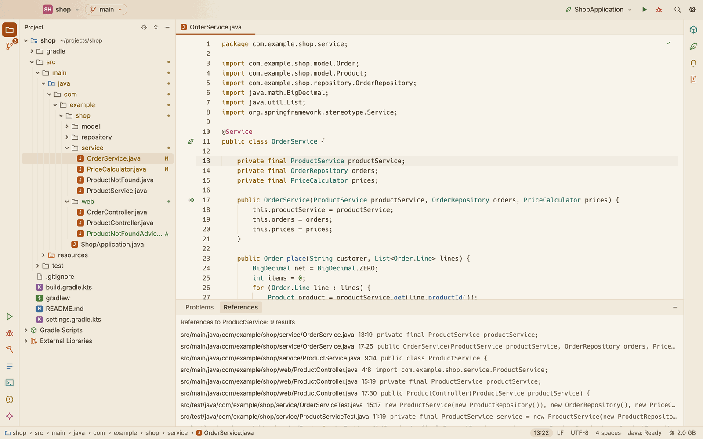

*The references to `ProductService`, in the main and the test sources.*

## Rename

1. Put the caret on a name and press F2 (Refactor ▸ Rename Symbol…).
2. Type the new name in the field that opens over the caret.
3. Press ↩ to rename it everywhere the engine finds it, in every file. Esc cancels.

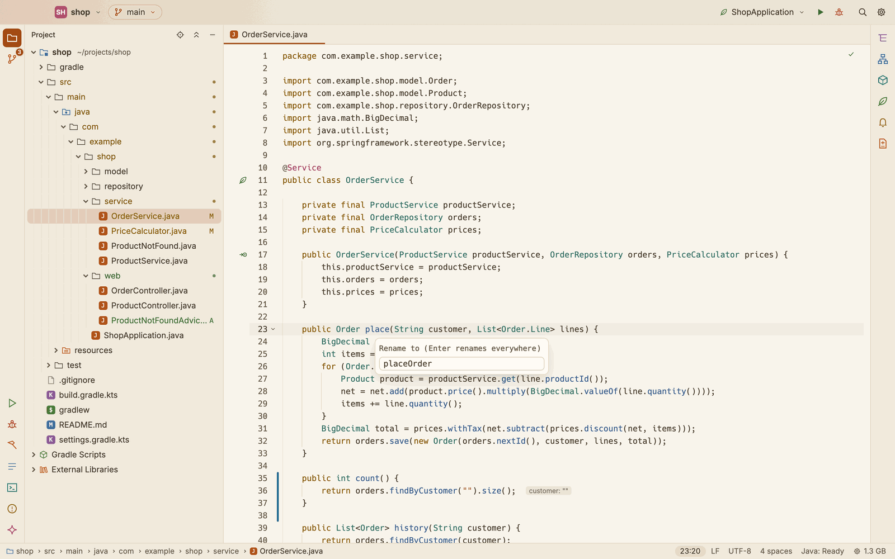

*Renaming `place` to `placeOrder`.*

Files that are open take the change as an edit you can undo. Files that are not open are changed on disk.

## Extract and inline

The **Refactor** menu, the command palette and the editor's right click menu (under Refactor) have these:

| Shortcut | Command | Select | What it does |
|---|---|---|---|
| ⌥⌘M | Extract Method | Whole statements, or an expression | Moves them into a new method, and calls it in their place. |
| ⌥⌘V | Extract Variable | An expression | Puts it in a new local variable, declared just before. |
| ⌥⌘C | Extract Constant | An expression of constants, such as a literal | Makes it a `static final` field of the class. |
| ⌥⇧⌘F | Extract Field | An expression | Makes it a field of the class. |
| ⌥⌘N | Inline | Nothing: put the caret on a name | Puts a local variable's value, a method's body or a constant's value in place of its uses, and removes it. |

Extract Field is ⌥⇧⌘F rather than ⌥⌘F, because ⌥⌘F is Replace in File.

After an extraction, the new name is selected in the rename field over the caret, as with F2: type a better one and press ↩ to rename it everywhere, or Esc to keep the name the engine chose.

When the expression appears more than once in the method, a small menu asks whether to replace this occurrence only or all of them. Use ↑ ↓ and ↩, or click; Esc cancels.

When the refactoring is not possible with what is selected, nothing changes, and a note under the caret says why, such as `Cannot extract a variable here: select an expression`.

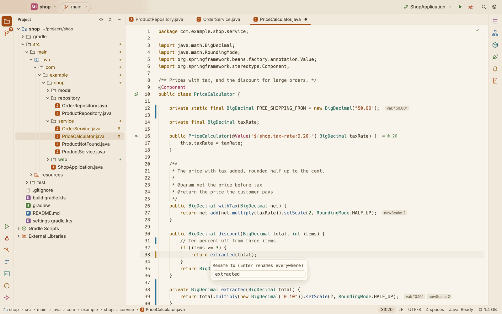

## Quick fixes

Press ⌘. (Code ▸ Quick Fix…) to list the fixes and actions the engine offers at the caret, such as adding a missing import. Choose one to apply it. Quick Fix… is also in the editor's right click menu.

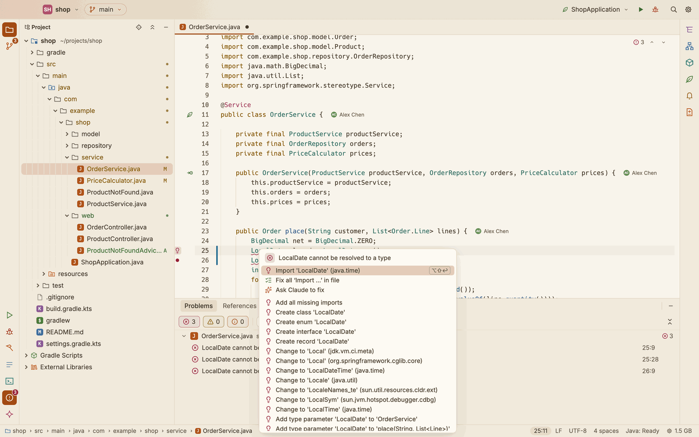

*The fixes for `LocalDate`, which the file does not import: first, the import.*

## Organize imports

Press ⌥⇧O (Code ▸ Organize Imports). The imports are sorted, unused ones are removed, and missing ones are added where only one class fits.

## Format code

- Press ⌥⌘L (Code ▸ Format Selection) to format the lines you selected and leave the rest of the file as it is. With nothing selected, it formats the whole file.
- Press ⌥⇧F (Code ▸ Format Document) to format the whole file, whatever is selected.

Both keep the file's own indentation, tabs or spaces.

## Errors and warnings

The engine checks the files as you type.

- Problems are underlined in the code, and a dot marks their lines in the gutter.
- The top right corner of the editor counts the file's errors and warnings. Its up and down arrows step through them. A tick means there are none.

### The Problems window

Press ⇧⌘M (Code ▸ Show Problems) to open the **Problems** window in the bottom dock. It lists every error and warning in the project, errors first, then by file and line. Its header counts them, such as `2 errors, 5 warnings`. Click a row to go there.

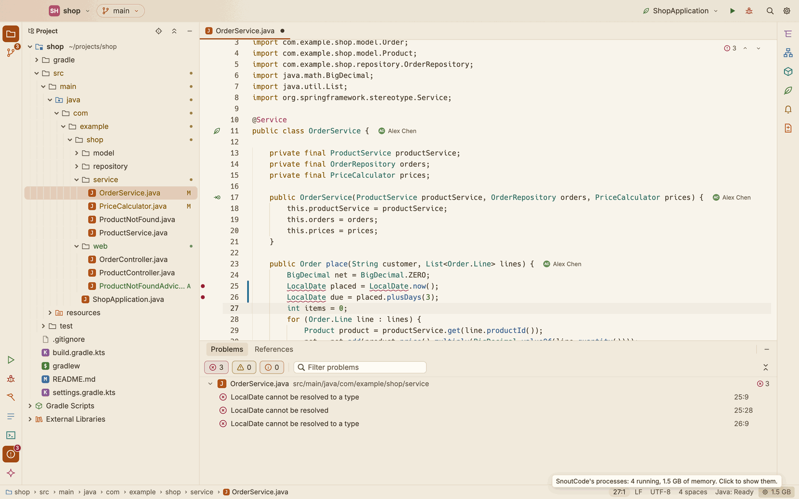

*Two errors in the Problems window, underlined in the code, and counted at the top right of the editor.*

The Problems window also lists what the last Gradle compile reported, when you build, run or test. A compile with errors brings the Problems window forward. See [Run and debug](run-and-debug.md).

Problems and References share the bottom dock: click their names in its header to switch between them.

## How far the engine is

When a project opens, the engine syncs the Gradle model, compiles Scala if the build has any, and then imports and indexes each module. You can edit meanwhile. Each module becomes ready on its own, so the files of small modules work early in a large project.

- **The status bar** shows the engine's work on the right while it runs, such as `Java: 7 of 12 modules ready`, with a thin progress bar. Click it to see everything that runs in the background, with each module's stage. The modules still on their way come first.
- **The editor** shows its own module's stage in the top right corner until that module is ready, with a percentage when one is known.

A module's stage is one of:

| Stage | What happens |
|---|---|
| Syncing the Gradle model | The engine reads the build. This is shown for the project as a whole. |
| Compiling Scala | The module's Scala, or a shared Scala folder it uses, is compiling. |
| Importing | The engine imports the module and builds what uses its classes. |
| Ready | Every Java feature works in the module's files. |

Until a module is ready, its errors and warnings are held back, so Java that uses Scala classes does not show false errors while the Scala compiles.

Once the engine is idle, the status bar says `Java: Ready`, or what it is doing. Click it to open the Problems window.

### When the engine stops or needs a JDK

- **Needs JDK 17** (or another version): no JDK on this Mac runs the build's Gradle version. A bar offers to download it: click **Download**, or **Not now**. See [Gradle](gradle.md).
- **Java stopped, starting again**: the engine stopped unexpectedly and starts again by itself. After five times in a row it gives up and says `The Java engine keeps stopping`.
- **Stopped**: the engine was stopped from the Processes window. See [Processes](processes.md).

In the last two cases, click **Restart** beside the status, or run **Restart the Java Engine** from the command palette.

If the status bar says **Java support unavailable**, the Java engine is missing. Click it to read why. See [Troubleshooting](troubleshooting.md).

## Scala in the build

The Java engine cannot read Scala source. So in a build with Scala, the engine compiles each source set's Scala with the build's own Gradle task, in the background, and gives the classes to the Java side. Java code that uses Scala classes then gets completion, navigation and checks like any other.

- The first compile runs when the engine starts, the builds of the files you have open first. Later starts skip what has not changed.
- A Scala folder that several builds compile is compiled once.
- When you save a `.scala` file, the engine compiles the changed Scala again, incrementally, and the Java that uses it is checked again. The background tasks show `Compiling the changed Scala`.
- If the compile fails, the status bar says `The Scala compile failed: see Problems`, and its errors are in the Problems window.

Scala files themselves open as plain text, without these features.
