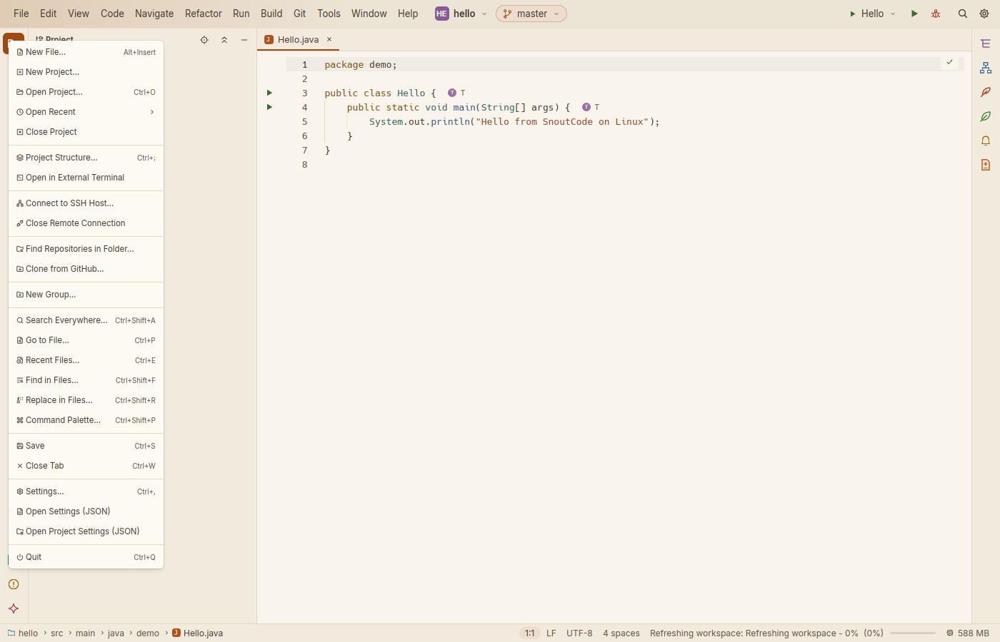

# SnoutCode on Linux

SnoutCode runs on Linux as it does on a Mac: the same window, tool windows, Java engine and Git
panel. This page covers installing it, and what is different on Linux: the menus in the
window, the keys, and where SnoutCode keeps its files.

## What you need

- Linux on x86_64 (amd64) or aarch64 (arm64), with glibc 2.35 or newer: Debian 12, Ubuntu
  22.04, Fedora 36, Arch Linux, or later.
- An X11 or a Wayland session. GNOME, KDE Plasma, Xfce and the tiling window managers all
  work.
- Vulkan, or OpenGL through EGL, to draw the window. The drivers your desktop already uses
  provide it; on a machine without a GPU, Mesa's software renderers (`mesa-vulkan-drivers` on
  Debian and Ubuntu, `vulkan-swrast` on Arch) do.
- Git on your `PATH`, for the Git panel.
- Nothing else. The package carries the Java engine with a Java runtime of its own, so you do
  not need Java installed to start SnoutCode or to get Java support in the editor. Your builds
  get a JDK as on a Mac (see [Java for your builds](getting-started.md#java-for-your-builds)).

## Install

### Debian and Ubuntu

Download `snout-code_<version>_amd64.deb` (or `_arm64.deb`) and install it with apt, which
also installs what it depends on:

```sh
sudo apt install ./snout-code_1.0.0_amd64.deb
```

SnoutCode is then in your desktop's applications, and `snout-code` starts it from a terminal.
To remove it: `sudo apt remove snout-code`.

### Arch Linux

Download `snout-code-<version>-1-x86_64.pkg.tar.zst` (or `-aarch64`) and install it with pacman:

```sh
sudo pacman -U snout-code-1.0.0-1-x86_64.pkg.tar.zst
```

To remove it: `sudo pacman -R snout-code`. The `PKGBUILD` the package is made from is beside
it.

### What the packages install

| Where | What |
|---|---|
| `/usr/bin/snout-code` | the program (a link to the one below) |
| `/usr/lib/snout-code/snout-code` | the program |
| `/usr/lib/snout-code/engine/` | the Java engine, with its Java runtime in `runtime/` |
| `/usr/lib/snout-code/server/` | the Linux servers Remote SSH installs on remote machines |
| `/usr/share/applications/snout-code.desktop` | the desktop entry |
| `/usr/share/icons/hicolor/*/apps/snout-code.png` | the icon, in every size |

### Open a project from the command line

```sh
snout-code ~/projects/shop
snout-code ~/projects/shop/src/main/java/shop/App.java:42
```

## The window

Linux has no menu bar shared by every app, so SnoutCode draws its menus in the window's title
bar, left of the project's name: File, Edit, View, Code, Navigate, Refactor, Run, Build, Git,
Tools, Window and Help. They are the macOS menus, item for item, with the same icons, and each
item shows its shortcut. There is no app menu: **Settings…** and **Quit** are at the end of
File, and **About SnoutCode** at the end of Help, where IntelliJ IDEA has them on Linux.

Click a menu to open it; with one open, moving the pointer to another opens that one. Esc or a
click elsewhere closes it.



*The File menu, drawn in the window's title bar.*

SnoutCode draws its own title bar with the minimize, maximize and close buttons at the right
(client-side decorations). Drag the title bar to move the window and double-click it to
maximize; drag an edge to resize. Under a window manager that decorates windows itself, the
title bar leaves its buttons out. Closing the window quits, asking first as
[Quitting](getting-started.md#quitting) describes.

**Show in Files** (the Mac's Reveal in Finder) opens the folder in your file manager. **Move to
Trash** uses your desktop's Trash (`gio trash`, else trash-cli, else `~/.local/share/Trash`).

## Keys

On Linux, Ctrl takes the place of ⌘: ⌘S is Ctrl+S, ⇧⌘F is Ctrl+Shift+F, ⌥⌘B is Ctrl+Alt+B.
Shortcuts show the Linux way, as "Ctrl+Shift+F". Where Ctrl and a key already meant something
else, SnoutCode follows IntelliJ IDEA's keymap for Linux instead:

| Command | macOS | Linux |
|---|---|---|
| Run | ⌃R | Shift+F10 |
| Debug | ⌃D | Shift+F9 |
| Run Context Configuration | ⌃⇧R | Ctrl+Shift+F10 |
| Debug Context Configuration | ⌃⇧D | Ctrl+Shift+F9 |
| Rerun | ⌘R | Ctrl+F5 |
| Replace (in the editor) | ⌥⌘F | Ctrl+R |
| Extract Field | ⌥⇧⌘F | Ctrl+Alt+F |
| Show Project, Git, Structure | ⌘1, ⌘2, ⌘7 | Alt+1, Alt+2, Alt+7 |
| Go to Class… | ⌥⌘O | Ctrl+N |
| New File… | ⌘N | Alt+Insert |
| Move to Trash (outside text fields) | ⌘⌫ | Delete |
| Pause Program | ⌥⌘F9 | none |
| Toggle Breakpoint Enabled | ⌥⌘F8 | none |
| Edit Breakpoint Condition… | ⌥⇧⌘F8 | none |
| Redo | ⇧⌘Z | Ctrl+Y or Ctrl+Shift+Z |

Everything else in [Keyboard shortcuts](keyboard-shortcuts.md) is the same with Ctrl for ⌘:
Find in Files is Ctrl+Shift+F, Go to Declaration Ctrl+B, Show Context Actions Alt+Enter, Format
Selection Ctrl+Alt+L, Type Hierarchy Ctrl+H. No default uses Ctrl+Alt with a function key, which
switches the virtual console. The three commands with none there can be given keys in Settings
▸ Keymap, as any other.

Some desktops keep keys for themselves before an app sees them. GNOME and Ubuntu lock the
screen with Super+L and, on some versions, Ctrl+Alt+L (Format Selection); give Format Selection
other keys in Settings ▸ Keymap, or the desktop's shortcut other keys in its settings.

### In the terminal

In the Terminal tab and the agent console, the Ctrl keys go to the shell, as in any Linux
terminal: Ctrl+C interrupts, Ctrl+D ends the input, Ctrl+R searches the history, Ctrl+W deletes
a word. The terminal's own commands take Shift as well:

| Shortcut | In the terminal |
|---|---|
| Ctrl+Shift+C | Copy |
| Ctrl+Shift+V | Paste |
| Ctrl+Shift+F | Find |
| Ctrl+click | Open the link under the pointer |

## Where SnoutCode keeps its files

SnoutCode follows the XDG base directories. A variable that is set moves its folder.

| What | Where |
|---|---|
| Settings (`settings.json`), keymap, layout, recent projects | `~/.config/SnoutCode/` (`$XDG_CONFIG_HOME`) |
| The JDKs SnoutCode downloads | `~/.local/share/SnoutCode/jdks/` (`$XDG_DATA_HOME`) |
| The Java engine's caches: builds, models, jdtls data | `~/.cache/SnoutCode/` (`$XDG_CACHE_HOME`) |

SnoutCode looks for JDKs in `$JAVA_HOME`, the `java` on your `PATH`, `/usr/lib/jvm`,
`/usr/java`, `/opt/java` and `/opt/jdk`, `~/.sdkman/candidates/java`, `~/.gradle/jdks`, and its
own folder above.

## Open in External Terminal

Settings ▸ Tools ▸ Terminal ▸ **Open in** lists the terminals installed: Default Terminal
(`xdg-terminal-exec`, else `x-terminal-emulator`), GNOME Terminal, Konsole, Xfce Terminal,
Ghostty, WezTerm, Alacritty, kitty, foot and xterm, or a command of your own with `{dir}` in it.

## Build it from source

Building the packages needs Docker, and nothing else on the machine:

```sh
scripts/package-linux.sh                 # this machine's architecture
scripts/package-linux.sh x86_64 aarch64  # both
```

They go to `target/linux-packages/`. The app is built in an Ubuntu 22.04 image, with the
Ghostty terminal engine and the Java engine with its Java 21 runtime; the Arch package is made
with makepkg in the `archlinux` image. `scripts/test-linux.sh` runs the tests in the same image
and starts the app under X11 (Xvfb) and Wayland (sway), and `scripts/linux/install-test.sh` installs the
packages in clean Debian, Ubuntu and Arch containers and checks that the app starts its Java
engine on a project.

To work on SnoutCode on a Linux machine, install Rust, Git, a C toolchain and the libraries
GPUI builds against (on Debian and Ubuntu: `build-essential pkg-config libxkbcommon-x11-dev
libwayland-dev libx11-xcb-dev libfontconfig-dev libfreetype-dev`), then use `./snout.sh` as on
a Mac. It finds a JDK 21 in `JAVA_HOME` or `/usr/lib/jvm`, or downloads Temurin 21 to
`~/.cache/SnoutCode/build-jdk`, and `./snout.sh --pick` asks for a folder with zenity or kdialog.

## When something goes wrong

- **The window does not open**, and the log says no adapter was found: install Vulkan drivers
  for your GPU, or Mesa's software renderer (see [What you need](#what-you-need)). Start it
  from a terminal with `SNOUT_LOG=info snout-code` to see which GPU it tried.
- **The window stays black** on a machine without a GPU, under X11: Mesa's software Vulkan
  draws nothing into some X servers' windows (Xvfb's, for one). Draw with OpenGL instead:
  `VK_ICD_FILENAMES=/nonexistent snout-code`.
- **No icon in the dock or the app list**: log out and in again, so the desktop reads the new
  desktop entry.
- See [Troubleshooting](troubleshooting.md) for the logs and the Java engine's status.
