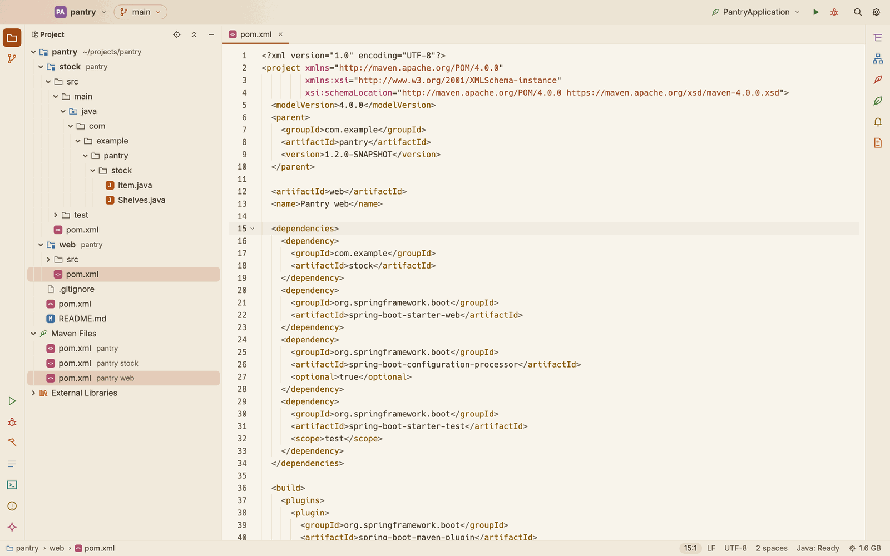
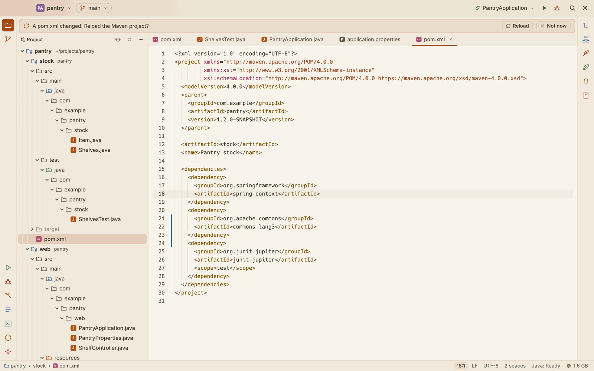
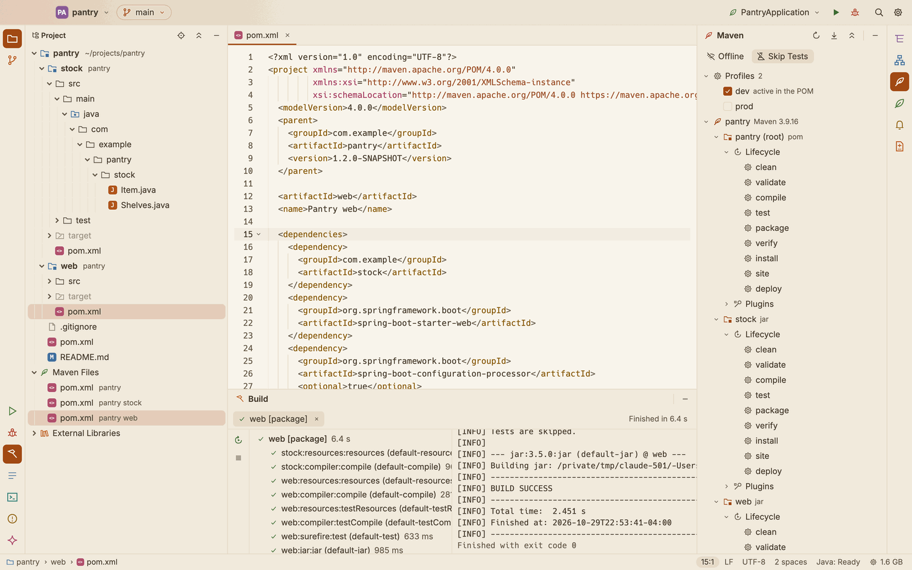
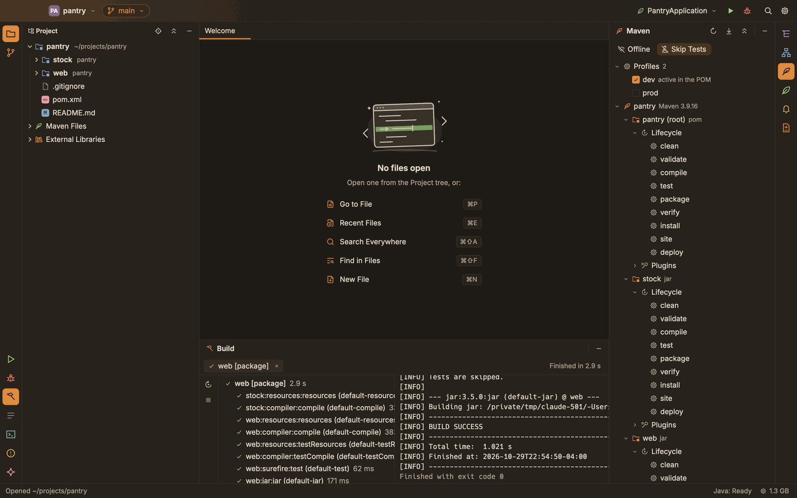
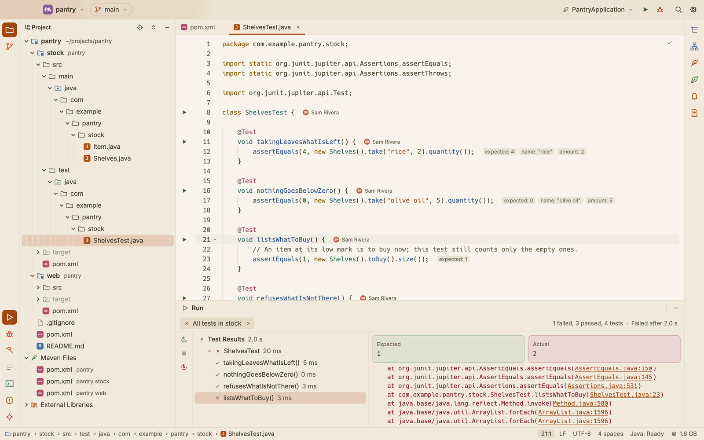
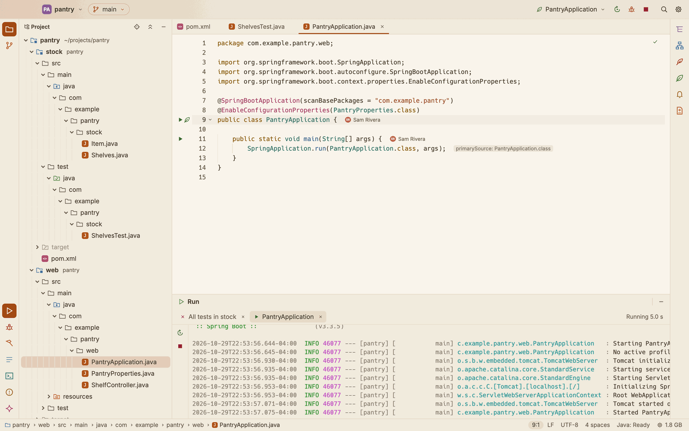
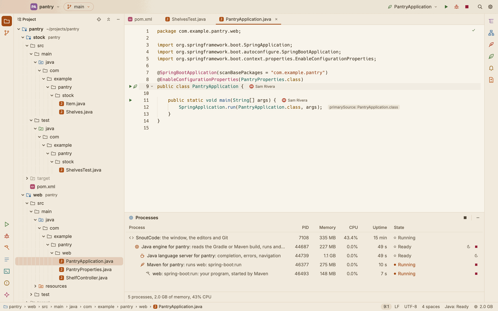
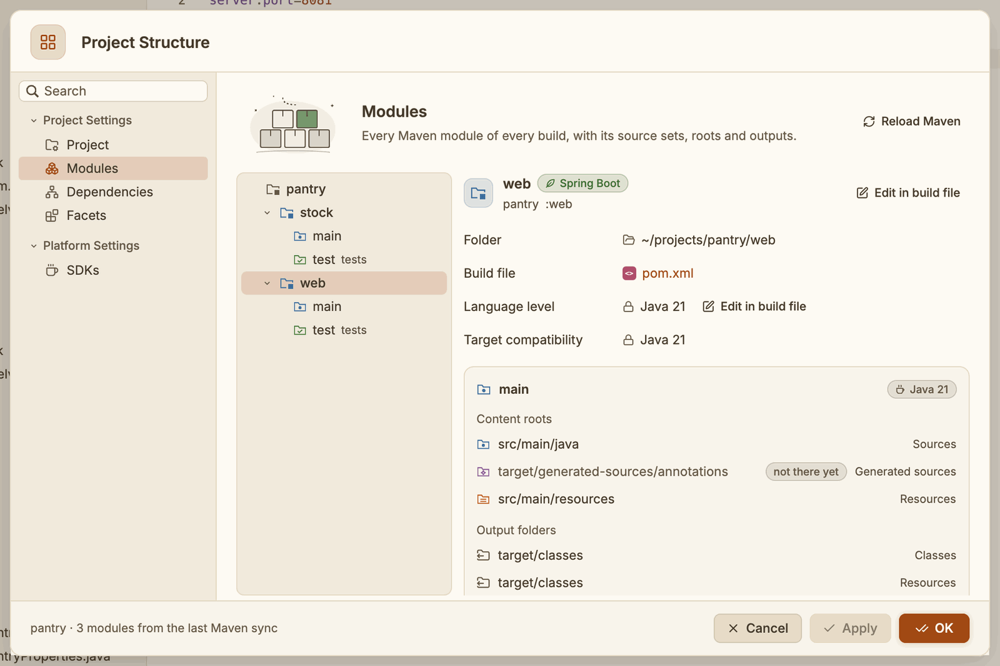

# Maven

SnoutCode opens Maven projects as it opens Gradle ones: the modules, their source folders, libraries and Java levels come from your POMs, and the Maven window runs lifecycle phases and plugin goals. You do not need Maven installed. This page covers how SnoutCode reads a Maven build, the Maven tool window, running goals, profiles, tests, and the Maven SnoutCode runs.

*The `pantry` reactor: a library, `stock`, and a Spring Boot application, `web`, under a parent POM. The POM is coloured as XML.*

## How SnoutCode reads a Maven build

When you open a folder with a `pom.xml`, SnoutCode's Java engine reads the build with Maven's own model builder and resolver, inside the engine. Nothing runs: no plugin, no compile, and no `target/` folder appears until you run a goal.

It reads what `mvn` would see:

- **The reactor.** The root POM and every module it lists, also those listed in a profile that is on. A module's own modules are read too.
- **Parent POMs**, from the folder (`relativePath`) or from the repositories.
- **BOM imports** (`<scope>import</scope>` in dependency management) and dependency management.
- **Profiles**: those on by default, those `settings.xml` turns on, those `.mvn/maven.config` names with `-P`, and those you turn on or off in the Maven window.
- **Your settings**: `~/.m2/settings.xml` (mirrors, proxies, servers, offline, the local repository), and `-Dmaven.repo.local` in `MAVEN_OPTS`.

Each module becomes a module of the project, with:

- its source folders, and those the Build Helper plugin adds (`add-source`, `add-test-source`);
- the generated sources: what annotation processors write to `target/generated-sources/annotations`, and each folder a generator filled under `target/generated-sources`;
- its resources and test resources;
- its dependencies by scope: `compile`, `provided` and `system` for the main code to compile against, `compile` and `runtime` for it to run with, and every scope for the tests. A dependency on another module of the reactor (a test jar too) is that module, not a jar;
- its Java level: the compiler plugin's `release`, `source` and `target`, else the `maven.compiler.*` properties; `-parameters` and `--enable-preview` when the plugin sets them;
- its JDK: a JDK of that level, or the toolchain's when the Toolchains plugin or the compiler's `jdkToolchain` names one.

The modules show in the Project view as Gradle projects do, with `target` excluded, and the POMs, `.mvn/maven.config` and the wrapper's properties under **Maven Files**. See [Projects](projects.md).

A folder may hold Gradle builds and Maven builds side by side: each is read, and they open as one project. A folder that has both a Gradle script and a `pom.xml` is read as a Gradle build.

## Reload after you change a POM

When a POM (or `.mvn/maven.config`, or the wrapper's properties) changes after the build was read, a bar above the editor says **A pom.xml changed. Reload the Maven project?**

- Click **Reload** to read the build again.
- Click **Not now** to put the bar away until the files change again.

To reload at any time, click **Reload the Maven Project** in the Maven window's header, or run **Reload Maven Project** from the command palette (⇧⌘P).

## The Maven tool window

*The profiles, the `web` module's lifecycle and Spring Boot's goals, and `package` run with **Skip Tests** on.*

Open it from the **Maven** button (a quill) on the right edge of the window. It shows when the project has a Maven build. It lists:

1. **Profiles**: every profile of the build, ticked when it is on. **active in the POM** marks those the POMs turn on by themselves.
2. Each Maven build, with the Maven that runs it.
3. Its modules (the root shows as `name (root)`), with their packaging.
4. Under each module, **Lifecycle**: `clean`, `validate`, `compile`, `test`, `package`, `verify`, `install`, `site` and `deploy`.
5. Under each module, **Plugins**: the plugins the module's packaging binds and those its POM declares, each with its goals. Hover a goal to read what it does.

Above the list:

- **Offline** runs Maven with `-o`: only the local repository, no network.
- **Skip Tests** runs goals with `-DskipTests`.

SnoutCode remembers both, and the profiles you turned on or off, for the project.

The header has three buttons:

- **Reload the Maven Project** reads the build again.
- **Read the Goals Again** lists the plugins' goals again (**Read the Maven Goals Again** in the command palette).
- **Collapse All** folds everything shut (**Collapse All Maven Goals** in the command palette and View ▸ Tool Window Actions).

## Turn a profile on or off

Click a profile in the Maven window. SnoutCode reads the build again with it, so its modules, dependencies and properties count for the editor, and every goal you run then gets it with `-P`. Click it again to go back to what the POMs say.

## Run a goal

Double click a phase or a goal in the Maven window, or press ⌃⌥G (**Build ▸ Run Gradle Task…**, or **Build ▸ Run Maven Goal…** for the goals alone) and type part of it, such as `web: package` or `spring-boot`, then press Enter. It runs in the **Build** tool window.

A goal of a module runs in that module alone, as `mvn -pl` would with the modules it uses built first:

1. The modules it depends on are compiled.
2. The goal runs in the module, and the other modules of the reactor resolve to their class folders, so they need not be installed in your local repository.

The Build window shows the command, Maven's output, and each plugin goal it ran (`web:compiler:compile (default-compile)`) with its time. Compiler errors and warnings go to the Problems tool window, as for Gradle. Use **Rerun** (⌘R) and **Stop** (⌘F2) on the left of the window.

## Run and debug

- **Main classes** run from the run icon in their gutter, as the editor compiled them, with the module's runtime classpath as Maven resolves it.
- **Tests** run through Maven's Surefire, with the module's test classpath and its Surefire configuration. Each test shows in the test tree as it runs; **Rerun Failed Tests** (⌥⌘R) runs only the failed ones (`-Dtest=Class#method`).
- **Debug** works for both: a test's JVM waits for the debugger, and the debugger attaches when it listens.
- **Spring Boot**: a module with Spring Boot's Maven plugin gets two run configurations, the application's main class, and `spring-boot:run`. Spring profiles set in a configuration go to `-Dspring-boot.run.profiles`.

See [Run and debug](run-and-debug.md).

## The Maven that runs your goals

SnoutCode needs no Maven of yours:

- When the build has the Maven wrapper (`mvnw` and `.mvn/wrapper/maven-wrapper.properties`), goals run with it, on the Maven version it names.
- Otherwise SnoutCode downloads Apache Maven 3.9.16 from Maven Central the first time it runs a goal, checks it against its SHA-512, and keeps it in `~/Library/Caches/SnoutCode/maven`.

Maven runs on the build's JDK (see [Gradle](gradle.md#the-jdk-each-build-runs-on) for how SnoutCode picks one: for a Maven build, a JDK of its Java level), with your `settings.xml` and local repository. While it runs, the Processes window lists it, with the test JVM or the application it starts. See [Processes](processes.md).

## Edit a POM

`pom.xml` is coloured as XML. Inside a `<groupId>`, `<artifactId>` or `<version>`, completion offers what your local repository holds: groups one segment at a time, the artifacts of the group the block names, and the versions of its artifact, newest first.

When you save a POM, the bar above the editor offers to reload the build.

## Project Structure

Project Structure (⌘;) shows the Maven modules, their source sets and Java levels, and each module's resolved dependencies by scope, with the version dependency management chose and the one the POM asked for. **Edit in build file** opens the POM line that declares a dependency, the module, the plugin or the Java level, in the module's POM or the parent that sets it. See [Project Structure](project-structure.md).

## Over SSH

On a remote machine, the Java engine reads the Maven build there, and runs goals there with the remote machine's wrapper, or the Maven it downloads into its own cache there. See [Remote SSH](remote-ssh.md).
