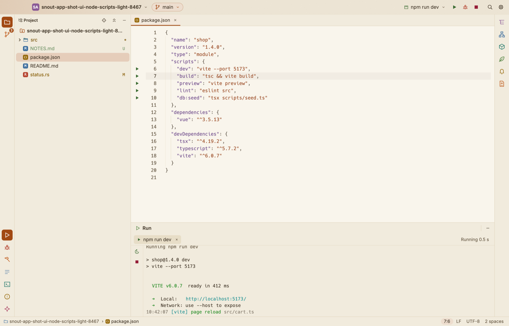

# Node projects

A folder with a `package.json`, and no Playwright tests or Gradle or Maven build, opens as a Node project. It never starts the Java engine. Its TypeScript and JavaScript get completion, navigation and problems as in [TypeScript and JavaScript](typescript.md), and it runs and debugs as a Java project does: its scripts are run configurations, any script file runs as Current File, and Debug stops at breakpoints in the TypeScript or JavaScript.

Everything runs on the Node the project asks for (`.nvmrc`, `.node-version`, `volta`, `engines`), found on your machine or downloaded; see [Node](typescript.md#node).

## The project

The Project view says, at the top, the project's package manager and its Node, such as `npm · Node 24.13.0`.

When `package.json` lists packages and `node_modules` is missing, a bar above the editor says so and offers **Install packages**. It runs `npm ci` (with a `package-lock.json`, else `npm install`), or `pnpm install`, `yarn install` or `bun install` by the project's lockfile, in the Build window. **Not now** hides the bar.

A repository with both a Java build and a `package.json` (a Spring Boot application with its front end, say) opens as the Java project it is, with the `package.json` scripts among its run configurations too.

## Several packages

A project can hold several packages: a workspace (npm, pnpm, Yarn or Bun) whose root lists them, or folders that each have their own `package.json`, such as `frontend/` beside a Java build. SnoutCode finds every `package.json` down to four folders deep, leaving out `node_modules`, build output (`dist`, `build`, `out`, `target`, `coverage`) and hidden folders.

- Each package's scripts are configurations of their own, named with the package's folder: `npm run dev (apps/web)`. The project's own scripts come first and have no folder in their name.
- A script runs in its package's folder, on the Node that package asks for (its `.nvmrc` or `engines`, else the project's).
- The package manager is the lockfile's: the package's own, else the nearest one above it, which for a workspace is the one at its root.
- Each package's `package.json` has run icons beside its scripts.
- A script file runs in the package it is in, with that package's `tsx`, or the workspace root's when it is installed there.
- The bar offers to install the packages of the first package that lacks them, in the folder that holds its lockfile or its workspace (the workspace's root, so one install covers all its packages), else in its own. Once that install ends, it looks again.

## Scripts



*`package.json` with its scripts' run icons; `npm run dev` picked in the title bar and running.*

Each script of `package.json` is a run configuration, under **Scripts** in the title bar's configuration menu, named as it runs: `npm run dev`, `pnpm run build`. The package manager is the one the lockfile names. Until you pick a configuration, the title bar starts on the project's `dev` or `start`, else a package's (see [Several packages](#several-packages)), else the first script.

In `package.json` itself, a run icon sits beside each script. Click it for **Run** or **Debug**; ⌃⇧R and ⌃⇧D in the editor run the script the caret is on. The list follows `package.json` each time you save it.

A script's **Script arguments** (in Edit Configurations) go after it, past `--` for npm: `npm run build -- --watch`.

## Script files

With **Current File** picked in the title bar, Run and Debug take the file in front when it is a script: a `.js`, `.mjs` or `.cjs` file runs on the project's Node. The editor's right click menu has **Run '…'** and **Debug '…'** for it too, and ⌃⇧R and ⌃⇧D do the same.

A TypeScript file (`.ts`, `.mts`, `.cts`) runs through the project's `tsx`, when it has that package. Without it, Node runs the file itself, stripping the types, from Node 22.6 (with `--experimental-strip-types` before 22.18 and 23.6). On an older Node, the run says to add `tsx` to the project. A `.tsx` file needs `tsx`.

Type declarations (`.d.ts`), test files (`*.spec.ts`, `*.test.js`) and files in `node_modules` are not run this way.

## Node configurations

For a file you run often, or with arguments, make a configuration of the **Node** kind in **Run ▸ Edit Configurations…**:

| Field | What it is |
|---|---|
| File | The file to run, relative to the project, as `src/server.ts` |
| Program arguments | What the program gets |
| Node options | Node's own, as `--max-old-space-size=4096` |
| Environment variables | As `NAME=value; OTHER=value` |
| Attach to port | Leave empty to run the file; see [Attach to a running Node](#attach-to-a-running-node) |

A **Package script** configuration has a **Script** (the name in `package.json`), **Script arguments** and variables.

## Debugging

Debug (⌃D, or **Debug** on a script's icon) runs the script or file under js-debug, the JavaScript debugger VS Code ships. SnoutCode downloads it the first time you debug (about 1 MB), checks it against its checksum, and keeps it in its data folder.

- Breakpoints go in any TypeScript or JavaScript file of the project: click a line number. In TypeScript they sit on the TypeScript line, through the source maps of `tsx` or Node.
- The debugger follows every Node process the run starts. An npm script starts a shell, which starts Node; that Node, and any it starts in turn, stop at the breakpoints.
- When the program stops, the Debug window shows its stack, variables and watches, and stepping, Resume and Run to Cursor work as for Java (see [Run and debug](run-and-debug.md#when-the-program-stops)).
- The program's output goes to the Debug window as it would to the Run window. Stop ends the program and every process it started.

## Attach to a running Node

To debug a Node you start yourself (a server in a terminal, a container with its port forwarded), start it listening for a debugger:

```
node --inspect src/server.js
```

Then make a **Node** configuration with **Attach to port** set to its port (9229 unless you said otherwise) and start it with Run or Debug. The breakpoints are set in it, and it stops at them as a program SnoutCode started does. **Stop** lets go of the program and leaves it running.
