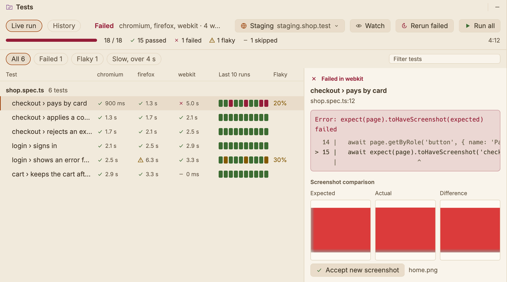

# Playwright projects

SnoutCode opens a repository of Playwright tests as a project of its own: TypeScript editing, the Node it runs on, its packages and browsers, and a Tests window that follows each run, without Java. It suits a QA team whose tests live in their own repository and test the application from the outside, through its URL.

## What counts as one

A folder is a Playwright project when it has a `playwright.config.ts` (or `.js`, `.mjs`, `.cjs`, `.mts`, `.cts`), or a `package.json` that depends on `@playwright/test`. Open it as any project: **File ▸ Open…**, or from the welcome page.

The Project view shows the project's folders and files. A line at its top says which Playwright the project has, its package manager and the Node it runs on, such as `Playwright 1.64.1 · npm · Node 22.11.0`, or `not installed` until its packages are.

A Playwright project never starts the Java engine. Its TypeScript files get completion, navigation, rename and problems from the TypeScript server; see [TypeScript and JavaScript](typescript.md).

## Getting it ready to run

When the project opens, SnoutCode looks at what its tests need, and a bar above the editor says what is missing:

- **Its packages.** When `node_modules` does not hold the test runner yet, the bar offers **Install packages**. SnoutCode runs `npm ci` (or `npm install` when there is no `package-lock.json`). A project with a `pnpm-lock.yaml`, `yarn.lock` or `bun.lock` gets `pnpm install`, `yarn install` or `bun install` instead; that tool must be installed.
- **Its browsers.** Each Playwright version runs particular builds of Chromium, Firefox and WebKit. When those are not downloaded, the bar names them and offers **Install browsers**, which runs `playwright install` with the project's own Playwright. The browsers go where Playwright keeps them (`~/Library/Caches/ms-playwright` on a Mac, `~/.cache/ms-playwright` on Linux, or `PLAYWRIGHT_BROWSERS_PATH` when you set it), so the command line and SnoutCode share them.

Both run in the **Build** window, where their output shows as it comes, with **Stop** to end them. When an install ends, SnoutCode looks again: after the packages it checks the browsers, and the TypeScript server starts again so it sees the packages' types. If an install fails, the bar says so; the Build window shows why.

The commands run on the Node the project asks for (see [Node](typescript.md#node)). When none fits, the Node bar comes first.

**Not now** hides the bar until something else is missing.

On Linux, browsers also need system libraries. Playwright installs them with `sudo npx playwright install-deps`, which you run yourself in the Terminal.

## Running tests

A Playwright project runs its tests with its own Playwright, on the Node it asks for, the way `npx playwright test` would. Start a run from any of these:

- **The Tests window**: **Run all**, **Rerun failed** (Playwright's `--last-failed`, which needs Playwright 1.44 or later) and, for the test picked, **Run this test**.
- **The title bar**: the configurations **All tests** and one per project of the configuration (**Tests in chromium**, …), with Run. Debug runs them in the Playwright Inspector (`--debug`).
- **The editor**: each `test(…)` and `test.describe(…)` of a spec file has a run icon in the gutter. ⌃⇧R runs the test the caret is in.

**Edit Configurations…** makes your own: a configuration of the Playwright kind takes Playwright's arguments (`--grep @smoke`, `--repeat-each=5`) and environment variables.

The console in the **Run** window reads as Playwright's `list` reporter. The **Tests** window follows the same run test by test.

**Stop** ends the run and the browsers it started: everything the run started goes with it.

## The Tests window

The **Tests** window opens on its own when a run starts. Its button is at the bottom of the left stripe, with the number of failed tests on it.

- **The summary bar** shows the run's progress, how many tests passed, failed, were flaky (they passed on a retry) or skipped, the time taken and, while it runs, about how long is left (from the tests' past times). Next to it are the environment, **Watch**, **Rerun failed**, and **Run all** or **Stop**.
- **Watch** runs the next runs with the browsers showing, one test at a time (`--headed --workers=1`).
- **The workers**: while a run goes, each worker has a line with its project, its test and the step it is at, such as `click getByRole('button', { name: 'Pay' })`.
- **The results grid** has a row per test, grouped by file, and a column per project of the configuration (each browser). Each cell has the result and the time. **Last 10 runs** shows the test's past results, and **Flaky** how often it passed only on a retry, or failed and then passed with nothing changed. Filter by **Failed**, **Flaky** or **Slow** (over 4 s), or by text.
- **A test's detail**, when you pick a cell or a row:
  - the error, with the lines around the one that failed;
  - for a screenshot that did not match, the expected, actual and difference images side by side;
  - the steps, with their times;
  - from the test's trace, a filmstrip of the page, the requests that failed and the console's errors;
  - what the test printed.

  Its buttons:
  - **Accept new screenshot** runs the test again with `--update-snapshots`, so its screenshots become the expected ones.
  - **Open full trace** opens Playwright's own trace viewer, with the DOM at each step.
  - **Video** plays the recording in the system's player.
  - **Run this test** runs it again in its project.
  - **Show in editor** opens the test at its line.
  - **Copy error** copies the error and its stack.

  The trace, the screenshots and the video are there when the configuration records them (`trace`, `screenshot`, `video` under `use`). A project made with **New Project** keeps them when a test fails.

When a run of more than a minute ends while SnoutCode is in the background, the Dock icon bounces once and shows the number of failures until you come back.

## Environments

The tests point at an application through its URL, and the URL changes from run to run: your machine, staging, a review app. **Run ▸ Edit Environments…** keeps a list of environments. Each has:

- a name;
- the **Application URL**, which runs get as `BASE_URL` (the configuration of a project made with **New Project** reads it as `baseURL`);
- other **variables**, such as `USER_EMAIL=qa@example.com; LOCALE=en`;
- a **`.env` file** of the project to read first, such as `.env.staging`.

Pick the environment runs go against in the title bar, or in the Tests window's summary bar. **No environment** leaves the configuration as it is.

Environments are kept with the project's settings on this machine, outside the repository, so each tester has their own. Keep passwords in the `.env` file and leave that file out of the repository.

## History

Every run is kept on this machine, outside the repository, with the latest 200 runs of each project. The **History** tab lists them, newest first, with:

- what ran and the environment;
- the branch and commit of the tests;
- the counts and the time;
- **New since the run before**: the tests that failed in that run but not in the one before it.

The grid's **Last 10 runs**, the flaky rates and the time left all come from this history.
