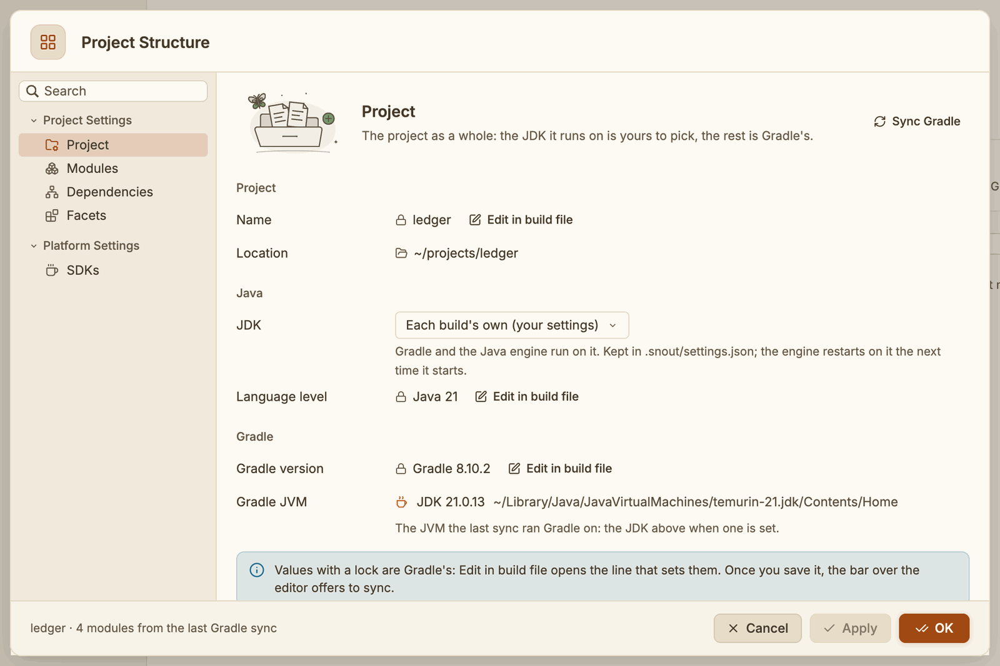
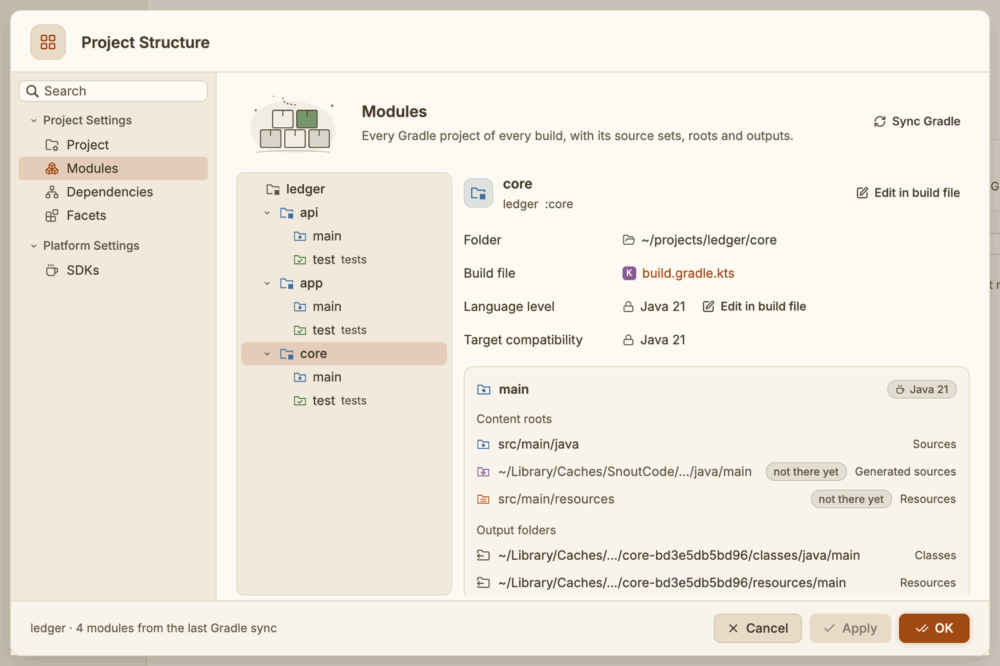
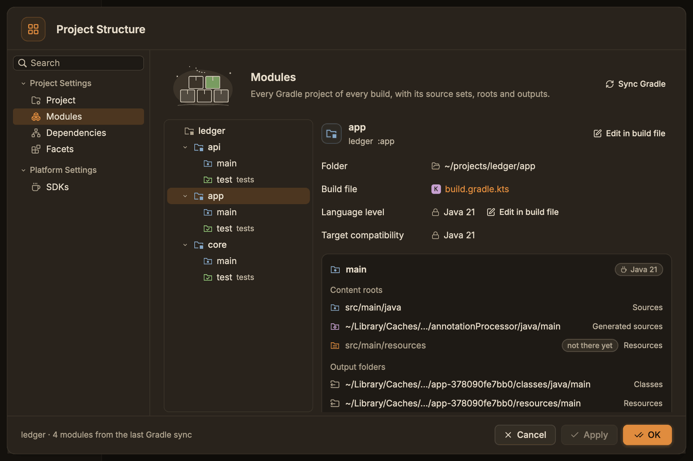
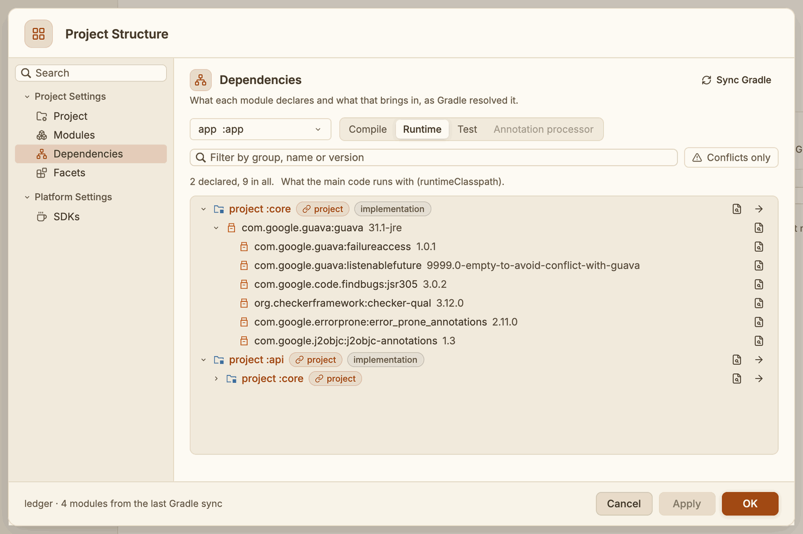
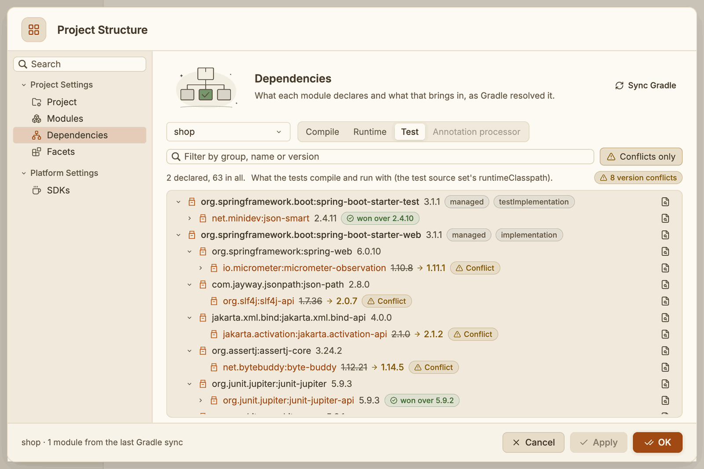
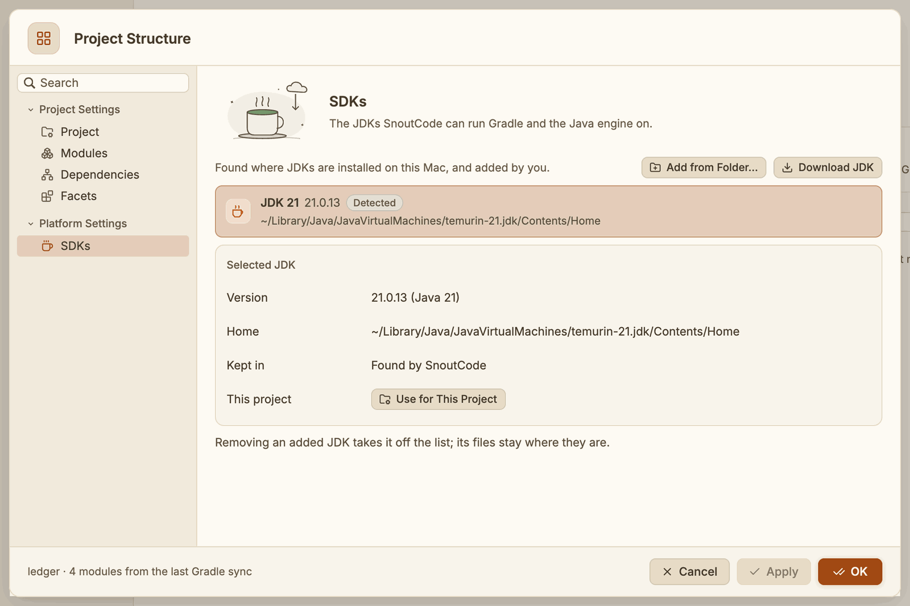
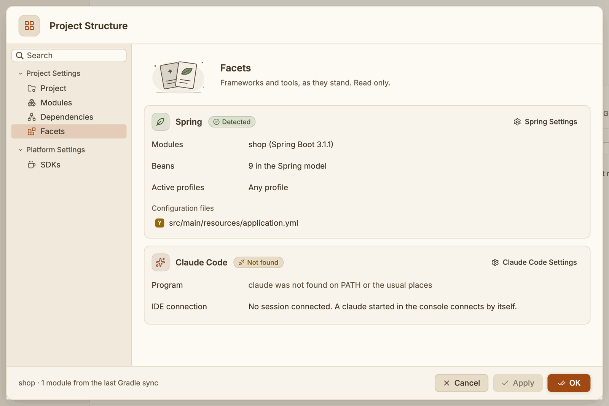

# Project Structure

Project Structure shows your project as Gradle and SnoutCode configure it, in one window: the JDK it runs on, its modules and their source folders, every dependency and where it comes from, the JDKs on your machine, and the frameworks SnoutCode found.

## Open Project Structure

Any of these opens it:

- File ▸ Project Structure… (⌘;)
- **Project Structure…** in the command palette (⇧⌘P)

⌘; is the shortcut of the command **Project Structure…**. You can give it other keys in Settings, under Keymap (see [Settings and keymap](settings-and-keymap.md#keymap)).

The pages are listed on the left, under **Project Settings** and **Platform Settings**. Type in **Search** to find a page by what it holds, for example "jdk" or "conflicts".

## What you can change here, and what Gradle owns

Two kinds of values show in the window:

- **Values SnoutCode owns** are changed in place: the JDK the project runs on, and the JDKs you add or remove. The window edits a copy of them. **Apply** saves the changes and keeps the window open, **OK** saves them and closes it, and **Cancel** (or Esc) closes it without changing anything. The project's JDK is saved in the project's own settings, `.snout/settings.json` (see [Your settings and the project's](settings-and-keymap.md#your-settings-and-the-projects)). The JDKs you add are saved in your own settings.
- **Values Gradle owns** carry a lock: the project's name, its Java level, the Gradle version, the modules, their folders and their dependencies. SnoutCode never writes them, because the next sync would read them from the build again. Click **Edit in build file** beside one instead. The window closes and the file that declares the value opens at its line: a `build.gradle(.kts)`, the `settings.gradle(.kts)`, the version catalog `gradle/libs.versions.toml`, or `gradle/wrapper/gradle-wrapper.properties`. When the line cannot be found (a value set in a convention plugin, for example), the file opens at its top.

Once you save a build file, the bar above the editor says **Gradle files changed. Sync?** Click **Sync** to read the build again (see [Sync after you change a build script](gradle.md#sync-after-you-change-a-build-script)). **Sync Gradle** at the top of the Project, Modules and Dependencies pages syncs at any time; the pages follow when the sync is done.

The window reads what the last Gradle sync wrote. Until a project has been synced, its Gradle pages say **No Gradle model yet** and offer to sync it.

## Project

- **Name** and **Location**: the root project's name (from `rootProject.name` in the settings script) and the project's folder.
- **JDK**: the JDK every Gradle build of the project runs on, and the Java engine with it. **Each build's own (your settings)** leaves the choice to each build, as set in Settings ▸ Build Tools ▸ Gradle (see [The JDK each build runs on](gradle.md#the-jdk-each-build-runs-on)). The list holds the JDKs of the SDKs page. A JDK set here shows the badge **Set for this project**. The Java engine restarts on it the next time it starts.
- **Language level**: the Java level the modules compile at (their `--release`, else their source compatibility), as one level or a range.
- **Gradle version**: the version each build's wrapper downloads. Its **Edit in build file** opens the `distributionUrl` line of the wrapper's properties.
- **Gradle JVM**: the JDK the last sync ran each build's Gradle on.

A project of several builds lists the Gradle rows once per build.

## Modules

The tree on the left holds every Gradle project of every build the project holds: the root project, its subprojects, included builds (marked **included build**) and `buildSrc`. Under each module are its source sets, `main`, `test` and any others. A test source set is marked **tests**. Click the arrow beside a module to fold its source sets away.

Select a module to see:

- its Gradle path, folder and build file (click the build file to open it),
- its **Language level** (with its toolchain, when one is set) and its **Target compatibility**, the level of the bytecode it produces,
- a card for each source set, with its Java level and:
  - **Content roots**: its source, resource, test and generated folders, each with its icon. A folder the build names that does not exist yet says **not there yet**.
  - **Output folders**: where it compiles its classes and copies its resources.

Select a source set to see its card alone. **Edit in build file** at the top opens the line of the settings script that includes the module.

## Dependencies

Pick a module at the top, then a scope:

| Scope | What it lists |
|---|---|
| **Compile** | What the main code compiles against (`compileClasspath`) |
| **Runtime** | What the main code runs with (`runtimeClasspath`) |
| **Test** | What the tests compile and run with (the test source set's `runtimeClasspath`) |
| **Annotation processor** | The annotation processors javac runs on the main code |

The tree starts with the dependencies the module declares, each with the configuration that declares it (`implementation`, `testRuntimeOnly`). Click the arrow beside one to see what it brings in, as Gradle resolved it. A line under the scopes counts what is declared and what is on the classpath in all.

- **Projects**: a dependency on another project of the build reads **project :core** with a **project** badge. Click its name to show that module on the Modules page, or the arrow at the end of the row to see its own dependencies.
- **Version conflicts**: when one dependency asks for a version and another one is used, the row shows the version asked for struck through, an arrow and the version used, with a **Conflict** badge. Hover it to read why: a newer version asked for elsewhere won, or a dependency management plugin or a platform chose it. The version that won says **won over** and the versions it replaced. A version a platform or a BOM gives (the dependency names none) says **managed**.
- **Unresolved**: a dependency Gradle could not find is a red row with Gradle's reason.

**Filter** finds dependencies by group, name or version anywhere in the tree, and shows each one under what brings it in. **Conflicts only** lists just the dependencies whose version lost a conflict.

At the end of a row:

- **Show in build file** (the page with a magnifier) opens the build script at the line that declares the dependency. For a dependency brought in by another, it opens the declaration of the one that brings it in. A dependency declared through the version catalog (`libs.guava`) is found by its alias.
- **Show in version catalog** (the open book) opens `gradle/libs.versions.toml` at the dependency's entry, when the catalog declares it.

## SDKs

The JDKs SnoutCode can run Gradle and the Java engine on. Each says where it comes from:

- **Detected**: found where JDKs are installed (macOS's JavaVirtualMachines folders, SDKMAN, Gradle's provisioned toolchains).
- **Downloaded**: downloaded by SnoutCode.
- **Added**: added by you.

The one the project runs on says **This project's**. Click a JDK to see its version and home under the list; **Use for This Project** makes it the project's JDK, as the Project page's picker does.

- **Add from Folder…** asks for the folder of a JDK: its home (the folder holding `bin/java`), a macOS `.jdk` bundle, or a folder that holds one JDK. **Apply** or **OK** keeps it, in your `settings.json` under `sdks`. A JDK you added is offered by the Project page, by Settings, and when SnoutCode picks a JDK for a build.
- The bin at the end of an added JDK's row takes it off the list. Its files stay where they are.
- **Download JDK** downloads Eclipse Temurin 25, 21, 17 or 11 into SnoutCode's JDKs folder, as the bar offering a missing JDK does (see [When no installed JDK fits](gradle.md#when-no-installed-jdk-fits)). The page shows the progress, and the JDK is listed when it is done.

## Facets

What SnoutCode found for the frameworks and tools of the project. The page is read only; its buttons open the Settings page where each is set.

- **Spring**: **Detected** when a module applies the Spring Boot plugin or the Spring model has beans. It lists those modules with their Spring Boot version, the beans in the Spring model, the **Active profiles** the beans are evaluated under, the profiles the project knows, and its configuration files (`application*.properties`, `application*.yml` and `bootstrap*` in the resources). Click a configuration file to open it. **Spring Settings** opens Settings ▸ Frameworks ▸ Spring, where the active profiles are chosen (see [Spring](spring.md)).
- **Claude Code**: whether the `claude` program was found, and how many Claude Code sessions are connected to SnoutCode. **Claude Code Settings** opens Settings ▸ Tools ▸ Agents (see [Coding agents](agents.md)).

## Remote SSH

On a remote machine (see [Remote SSH](remote-ssh.md)), Project Structure shows the project there: its model, its build files and the JDKs of that machine. **Add from Folder…** browses the remote machine's folders, and **Download JDK** downloads to it. The JDKs you add there are kept in your settings under the machine's name, apart from those of your Mac.
