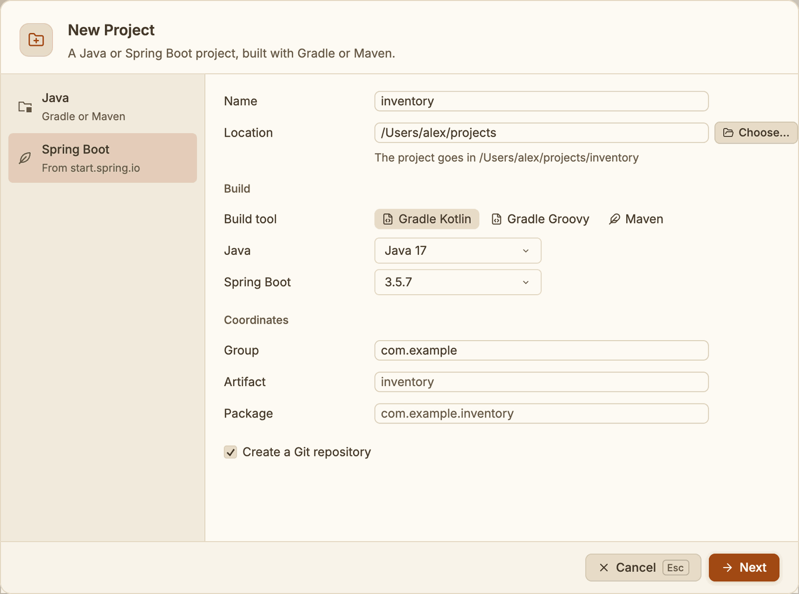
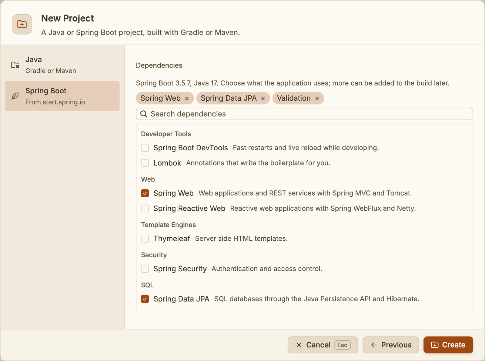
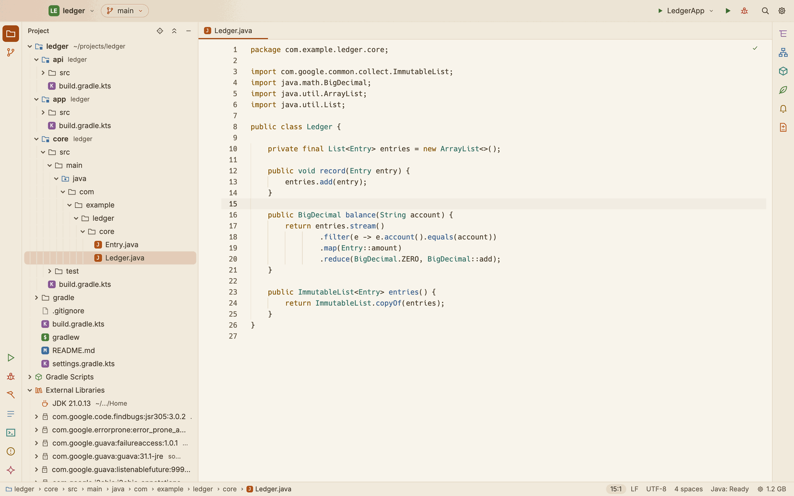

# Projects

Open a folder as your project, move between projects, and find your way around one.

## The folder is the project

The folder you open is the project, as you give it. Git finds the repository at or above it,
so you can open a whole repository or one folder inside it, such as one service of a larger
repository. The project's name is the folder's name.

A project can be one Gradle or Maven build, or hold several builds side by side, Gradle and
Maven alike. SnoutCode reads them together into one model of modules (see
[The Project view](#the-project-view), and [Maven](maven.md) for Maven builds).

SnoutCode has one window. It shows one project at a time; opening another project takes its
place.

## Open a project

Any of these opens a folder:

- File ▸ Open Project… (⌘O)
- **Open Project…** on the Welcome page
- **Open Project…** in the project menu, at the left of the title bar
- drag a folder from Finder onto the window ("Drop a folder to open it")

A folder outside any Git repository opens the "Not a Git repository" dialog:

- **Find repositories inside** looks through its subfolders, 4 levels deep, and adds every
  repository it finds to your recent projects. File ▸ Find Repositories in Folder… does the
  same for a folder you choose.
- **Initialize a repository here** runs `git init` in the folder and opens it.

When you open another project while one is open and a tab has unsaved changes, SnoutCode asks
first: **Save**, **Don't Save** or **Cancel**.

On a remote machine, Open Project… browses that machine's folders instead. See
[Remote SSH](remote-ssh.md).

## Open a recent project

- File ▸ Open Recent lists up to 12 projects, most recent first, then the projects of remote
  machines. **Clear Recent** at the bottom empties the list.
- The project menu in the title bar lists the 10 most recent.
- The Welcome page lists them all, with each one's branch and when you last opened it. Type
  in **Search recent projects** to filter by name or path.
- The command palette (⇧⌘P) has an "Open Recent: name" command for each.

## Clone a repository

Click **Clone Repository…** on the Welcome page. Enter the **Repository URL**, and under
**Into folder** the folder to clone it in; the dialog shows where it lands. **Clone** copies the repository and opens
it. File ▸ Clone from GitHub… opens the same dialog.

## Close a project

Choose File ▸ Close Project, or **Close Project** in the project menu of the title bar. If a
tab has unsaved changes, SnoutCode asks whether to save them. The project's tabs are kept for
when it opens again, and the Welcome page shows.

Closing the window quits SnoutCode, which stops the Java engine and anything it runs.

## Your tabs come back

Each project keeps its editor tabs. When you switch to another project or close it, SnoutCode
remembers its tabs; when the project opens again, they come back with the caret and the view
where they were. A project without saved tabs shows the Welcome page. SnoutCode keeps the tabs
of your recent projects only.

When you start SnoutCode, it opens the project you had open last, with its tabs, the tool
windows and their sizes, and the view (Project or Git) you were on.

## Create a new project

Choose File ▸ New Project…, or **New Project…** on the Welcome page. The dialog makes a Gradle
or Maven project and opens it.

*A Spring Boot project: its name, folder, build and coordinates.*

1. Pick the kind of project:
   - **Java**: an application built by Gradle or Maven. SnoutCode writes it itself, so it needs
     no network.
   - **Spring Boot**: from start.spring.io, with the versions and dependencies it offers.
2. Fill in the **Name** and the **Location**. **Choose…** picks the folder. The dialog shows
   the folder the project goes in. By default it goes beside the project you opened last, or
   in your home folder.
3. Under **Build**, pick the **Build tool**: **Gradle Kotlin** or **Gradle Groovy** (the build
   script's language), or **Maven**; and the **Java** version. A Java project can target Java 25, 21, 17, 11 or 8. A Spring Boot project offers
   the Java and **Spring Boot** versions start.spring.io lists.
4. Under **Coordinates**, set the **Group**, **Artifact** and **Package**. Left empty, the
   artifact comes from the name and the package from the group and artifact.
5. Leave **Create a Git repository** checked to run `git init` in the new folder.
6. For a Java project, click **Create**. For Spring Boot, click **Next**, choose the
   dependencies (search them, or pick them from their groups), then click **Create**.
   **Previous** goes back.

*The dependencies of a Spring Boot project, picked from their groups.*

The dialog says what is wrong while it cannot create the project, for example "Give the
project a name." or a folder that already exists and is not empty. Esc or **Cancel** closes it.

A Java project gets a `settings` and `build` script, a `Main` class with a test (JUnit 5), a
`.gitignore` and the Gradle wrapper, so `./gradlew` builds it. With Maven, it gets a `pom.xml`
instead (the Java level, JUnit 5 and Surefire) and no wrapper: SnoutCode runs Maven itself
(see [Maven](maven.md)). A Spring Boot project with Maven has Spring Boot's parent POM and its
Maven plugin, as start.spring.io makes it.

When start.spring.io cannot be reached, the dialog says so and lists the dependencies
SnoutCode knows itself. **Try Again** asks start.spring.io again. The project is then made from
SnoutCode's own template; Gradle downloads Spring Boot once there is a network. If creating
fails while start.spring.io is unreachable, **Create Without the Network** makes it from the
template.

## The Project tool window

Show the Project tool window with ⌘1, View ▸ Project, or the Project icon at the top of the
left stripe. ⌘2 shows the Git view instead (see [Git](git.md)).

The name at the top of the tool window switches between two views:

- **Project**: the project as its Gradle or Maven model has it.
- **Files**: the plain file tree of the folder.

SnoutCode remembers which one you chose. The buttons on the right of its header:

- **Select Opened File** shows the file of the tab in front.
- **Collapse All** closes every folder.
- **Hide** hides the tool window.

All three are also in View ▸ Tool Window Actions and the command palette (**Select Opened File**, **Collapse the Project Tree**, **Hide the Side Panel**).

### The Project view

*The `ledger` build: its modules `api`, `app` and `core`, the Gradle scripts and the libraries.*

The Project view shows:

- **The project's folder**, with its path.
- **Its modules**, one per Gradle project or Maven module. A module's note names its build when that differs
  from its name, and the modules it uses. A module whose build failed to sync this time shows
  a warning, and the last model that synced.
- **Shared folders**, marked "shared": source folders that several modules compile. The
  tooltip names them.
- **Builds that did not sync**, with their Gradle or Maven version and the reason. See
  [Troubleshooting](troubleshooting.md).
- **Gradle Scripts**: every build's settings, build and applied scripts. For a Maven project
  the node is **Maven Files**: the POMs, `.mvn/maven.config` and the wrapper's properties; a
  project with both is **Build Files**.
- **External Libraries**: the JDK and the libraries, down to their packages and classes. A
  library with sources says "sources". Click a class to open it read only.

Source folders have their own icons and colours: sources, test sources, resources, test
resources, generated sources, and excluded folders. Hover over a folder to see which it is.

Until the build model has been read, the Project view shows the plain file tree with the
note "Reading the build model". If the model cannot be read, the note says why. See
[Gradle](gradle.md) and [Maven](maven.md) for syncing.

### The Files view

The Files view shows the folder's files as they are on disk. Files made or deleted elsewhere
show up at once.

In both views:

- Files carry their Git state in colour: modified, added, untracked or conflicted.
- What `.gitignore` leaves out is dimmed.
- One click shows a file in the preview tab, which the next preview replaces. A double click
  keeps it open in a tab of its own.
- Right click a file for **Open**, **Reveal in Finder**, **Open in External Terminal** and
  **Copy path**; a folder has the last three. Open in External Terminal opens the terminal app
  of your choice at the folder (a file's own folder); see
  [Terminal](terminal.md#open-in-external-terminal).
