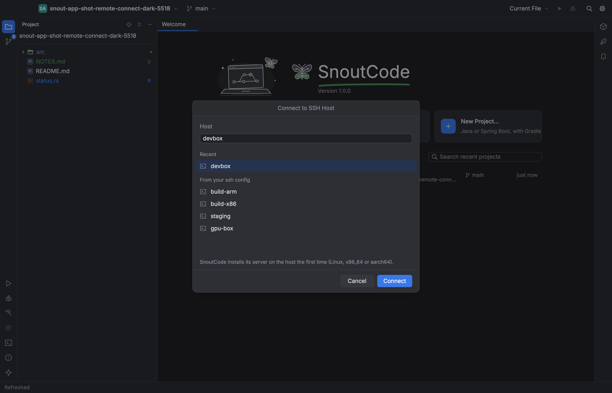

# Remote SSH

Work on a project that lives on a Linux machine, with the window on your Mac.

The window stays on your Mac. The project, Git, the Java engine, builds, runs, the program you debug and terminals are on the remote machine. SnoutCode runs your system's `ssh`, so `~/.ssh/config`, the SSH agent, `ProxyJump` and the rest apply, and one SSH connection carries everything.

## What you need

**The remote machine** runs Linux on x86_64 or aarch64, any distribution: the server SnoutCode installs is a single static binary. It needs `git` and `tar`. To download Java for the engine it uses `curl` or `wget`; a machine that cannot reach the internet gets Java through your Mac instead.

**On your Mac**, `ssh <host>` should work in a terminal. Keys from the SSH agent or a key file work as they do there. When SSH asks for a password, a key's passphrase, or whether to trust a new host key, SnoutCode asks in a dialog (**Password**, **Key Passphrase** or **Trust This Host?**).

A host can be a `Host` entry of `~/.ssh/config`, or of the files it `Include`s:

```
Host devbox
  HostName devbox.example.com
  User me
  IdentityFile ~/.ssh/id_ed25519
```

## Connect

1. Choose File ▸ Connect to SSH Host….
2. Pick a host under **Recent** or **From your ssh config**, or type one (`devbox`, `me@devbox.example.com`). Click **Connect**.

   

3. The first time, SnoutCode installs its server on the host. The status bar's background tasks show it; it takes a few seconds.
4. A dialog browses the remote machine's folders. Type a path or go up and into folders (**Show hidden folders** lists the hidden ones too), then click **Open**.

The window opens again on that folder, with the host's name in the title bar. The Java engine starts there. The first time, SnoutCode downloads Java 21 for the engine and copies the engine over, which takes a minute or two.

If the connection fails, the dialog says why, and you can try again.

Processes on the remote machine get the environment of your login shell there: `PATH`, `JAVA_HOME`, SDK managers and the like.

## Work on the remote machine

- File ▸ Open Project… browses the remote machine.
- File ▸ Open Recent lists remote projects as `shop on devbox`. Pick one to connect and open it in one go.
- The windows on a host keep their own tabs and recent projects, apart from your Mac's. A host starts with your Mac's appearance and shortcuts.
- The host's name in the title bar has a dot that shows the connection's state, and a menu with **Close Remote Connection** (and **Reconnect** once the connection is lost).

The Claude Code console runs `claude` on the remote machine. Its connection to SnoutCode's editor (proposed changes, the selection, Claude Changes) works for projects on your Mac only, for now. See [Claude Code](claude-code.md).

## When the connection drops

SnoutCode connects again by itself. The status bar and the dot by the host's name say **Reconnecting to devbox…**.

Builds, programs, the program you debug, terminals and the engine keep running on the remote machine meanwhile, and their output is kept for when the connection comes back.

After two minutes of trying, SnoutCode stops and says **The connection to devbox is lost**. Click **Reconnect** in the status bar, or choose it from the host's menu in the title bar.

## Disconnect

Choose File ▸ Close Remote Connection, or **Close Remote Connection** in the host's menu. The window opens again on your Mac.

The server on the remote machine stops by itself after three hours without a window connected, and stops what it runs with it.

## What SnoutCode puts on the remote machine

Everything is under `~/.snout-code/`, except the engine's caches.

| Path | What |
|---|---|
| `~/.snout-code/server/<version>/snout-server` | The server, uploaded over SSH and checked by SHA-256. `daemon.sock`, `daemon.pid` and `daemon.log` sit beside it while it runs. |
| `~/.snout-code/engine/<hash>/` | The Java engine's files, copied once per engine build. |
| `~/.snout-code/jdks/` | Java 21 for the engine, from Eclipse Temurin, checked by SHA-256, and any JDK a build asked SnoutCode to download. |
| `~/.cache/SnoutCode/` | The engine's caches: the Gradle model, Gradle's project caches, the Java language server's workspace. With `XDG_CACHE_HOME` set, it is `$XDG_CACHE_HOME/SnoutCode/`. |

To remove it all, stop the server, then delete the folders. The next connection installs it again.

```sh
for server in ~/.snout-code/server/*/snout-server; do "$server" --stop; done
rm -rf ~/.snout-code ~/.cache/SnoutCode
```

## What SnoutCode keeps on your Mac

- `~/Library/Application Support/SnoutCode/remote/<host>/settings.json`: the settings of the windows on each host (tabs, recent projects, layout).
- `~/Library/Application Support/SnoutCode/remote.json`: the recent hosts and remote projects.

See also [Troubleshooting](troubleshooting.md).
