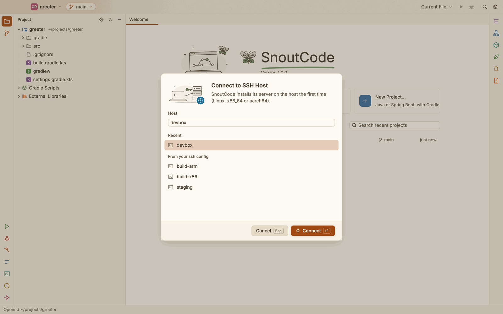
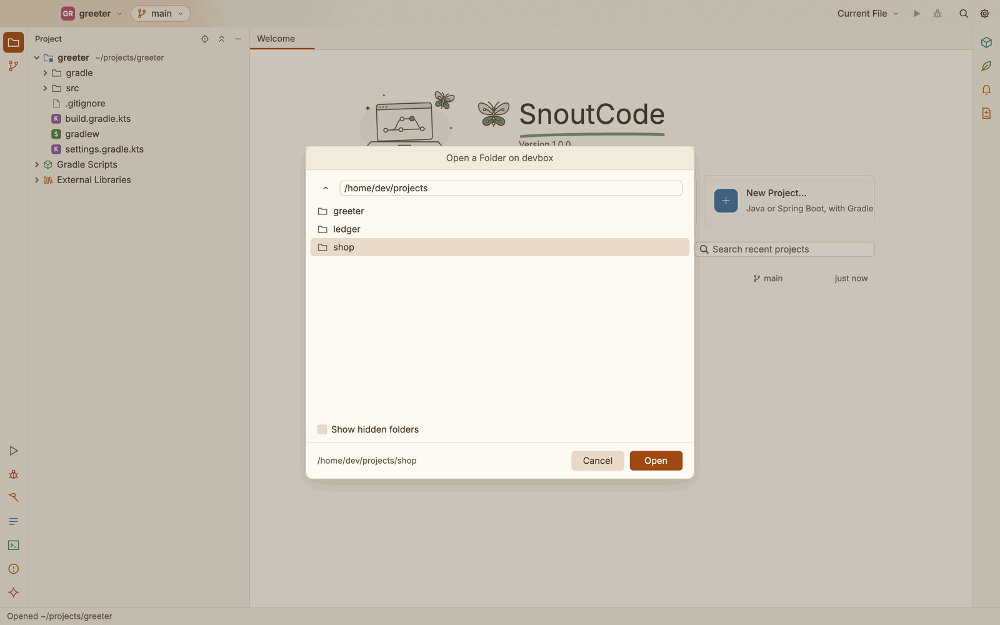
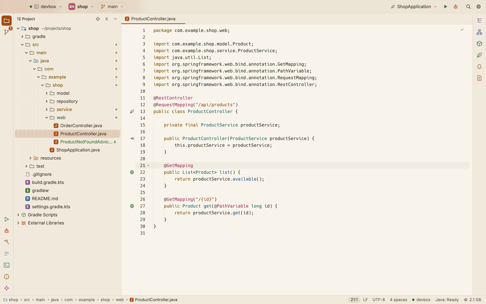
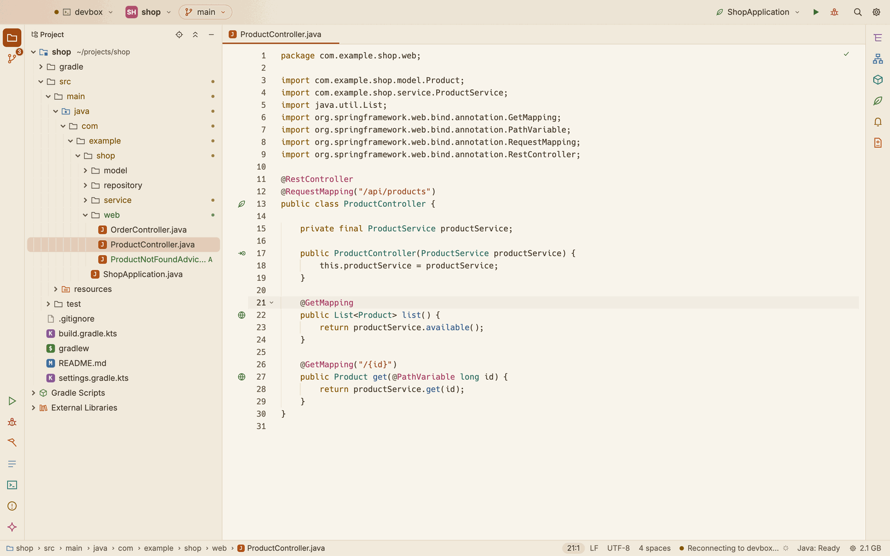

# Remote SSH

Work on a project that lives on a Linux machine, with the window on your Mac.

The window stays on your Mac. The project, Git, the Java engine, builds, runs, the program you debug and terminals are on the remote machine. SnoutCode runs your system's `ssh`, so `~/.ssh/config`, the SSH agent, `ProxyJump` and the rest apply, and one SSH connection carries everything.

## What you need

**The remote machine** runs Linux on x86_64 or aarch64, any distribution: the server SnoutCode installs is a single static binary. It needs `git` and `tar`. To download Java for the engine it uses `curl` or `wget`; a machine that cannot reach the internet gets Java through your Mac instead. For Claude Code there, install `claude` on that machine; its hooks use `curl`.

**On your Mac**, `ssh <host>` should work in a terminal. Keys from the SSH agent or a key file work as they do there. When SSH asks for a password, a key's passphrase, or whether to trust a new host key, SnoutCode asks in a dialog (**Password**, **Key Passphrase** or **Trust This Host?**).

A host can be a `Host` entry of `~/.ssh/config`, or of the files it `Include`s:

```
Host devbox
  HostName devbox.example.com
  User me
  IdentityFile ~/.ssh/id_ed25519
```

## Connect

1. Choose File ▸ Connect to SSH Host…, or click **Remote Project…** on the Welcome page.
2. Pick a host under **Recent** or **From your ssh config**, or type one (`devbox`, `me@devbox.example.com`). Click **Connect**.

   

   *A recent host, and the hosts of the ssh config.*

3. The first time, SnoutCode installs its server on the host. The status bar's background tasks show it; it takes a few seconds.
4. A dialog browses the remote machine's folders. Type a path or go up and into folders (**Show hidden folders** lists the hidden ones too), then click **Open**.

   

   *The projects in the home folder of `devbox`.*

The window opens again on that folder, with the host's name in the title bar. The Java engine starts there. The first time, SnoutCode downloads Java 21 for the engine and copies the engine over, which takes a minute or two.

While it connects, the dialog says so. If the connection fails, the dialog says why, and you can try again.

If you quit SnoutCode while a window is on a remote project, the next start opens it again: the window shows first, then connects and opens the project. Starting SnoutCode on a folder or files opens those instead. If the host cannot be reached, the next start opens your Mac's last project.

Processes on the remote machine get the environment of your login shell there: `PATH`, `JAVA_HOME`, SDK managers and the like.

## Work on the remote machine



*`shop` on `devbox`: the host in the title bar, and the Java engine running there.*

- File ▸ Open Project… browses the remote machine.
- File ▸ Recent Projects lists remote projects as `shop on devbox`. Pick one to connect and open it in one go. The Welcome page lists them under **Remote**.
- Opening a project on another host closes the connection to this one. A folder on the same host keeps it.
- The windows on a host keep their own tabs, recent projects and recent files, apart from your Mac's. A host starts with your Mac's appearance and shortcuts.
- The host's name in the title bar has a dot that shows the connection's state, and a menu with **Close Remote Connection** (and **Reconnect** once the connection is lost).

## Claude Code on the remote machine

The Claude Code console runs `claude` on the remote machine, and it connects to the window as it does on your Mac: proposed changes open in the editor, it sees your selection, the editor follows and plays out its edits, and the Agent Changes window lists them. See [Coding agents](agents.md).

- SnoutCode writes its lock file into the remote machine's `~/.claude/ide/` (or `$CLAUDE_CONFIG_DIR/ide/`), so a `claude` there finds the window, and gives the console's `claude` the hooks' settings in a folder of the remote machine's temporary folder.
- `claude` reaches the window through two ports on the remote machine's loopback (127.0.0.1), one for the editor connection and one for the hooks. The server listens on them and carries each connection back to your Mac over the SSH connection; nothing else is opened, and the SSH server needs no port forwarding allowed.
- Both ports are kept while the connection comes back, so the hooks go on reporting edits after a reconnect. Close Remote Connection closes them and removes the lock file. When SnoutCode quits, it removes the lock file, and the ports close when the server stops.
- The editor connection drops with the SSH connection. If the console's header no longer shows **Claude connected** after a reconnect, run `/ide` in Claude Code to connect again.

## Forward ports

A server the project runs on the remote machine, such as a dev server, an API or a database, can be reached from your Mac at the same port of `localhost`, as with `ssh -L`. List the ports in the project's `.snout/settings.json` (see [Settings for this project](project-settings.md#settings-for-this-project)), which is on the remote machine, in the project's folder:

```json
{
  "forwarded_ports": [3306, 4200, 8080, "19000:9000"]
}
```

A number forwards that port of your Mac to the same port on the remote machine. `"local:remote"` forwards your Mac's `local` to the remote machine's `remote`, for a port your Mac already uses. Commit the file and everyone who opens the project over Remote SSH gets the same ports.

- SnoutCode listens on those ports of your Mac's loopback (127.0.0.1, and ::1 where it is free) while the project is open. Each connection is carried to the port on the remote machine's loopback over the SSH connection; the SSH server needs no port forwarding allowed.
- The host's menu in the title bar lists the ports, each with a check mark when it is forwarded or a warning that says why not. **Edit Forwarded Ports…** there opens the project's file.
- Open another project and its ports are forwarded in place of these. Save the file and the change applies at once.
- A port your Mac already uses is not forwarded. The status bar and the host's menu say which one, and the others are forwarded all the same.
- When the connection drops, the ports stay open on your Mac, and connections made meanwhile wait for it to come back. Connections already open end. Close Remote Connection closes the ports.
- A port nothing listens on, on the remote machine, takes a connection and closes it.
- In a window on your Mac, the setting does nothing: the ports are there already.

## When the connection drops

SnoutCode notices a dropped connection when the `ssh` processes on your Mac end (killed, or because the network went) or the SSH server's side closes it. It also sends the server a ping every 15 seconds, and a connection that leaves one unanswered for 15 seconds counts as dropped.

Then SnoutCode connects again by itself, trying again after a quarter of a second, then less and less often, up to every 10 seconds. The status bar and the dot by the host's name say **Reconnecting to devbox…**.



*Reconnecting to `devbox`: the dot by the host's name and the status bar say so.*

Builds, programs, the program you debug, terminals and the engine keep running on the remote machine meanwhile, and their output is kept for when the connection comes back.

After two minutes of trying, SnoutCode stops and says **The connection to devbox is lost**. Click **Reconnect** in the status bar or in the Project tool window (which says **The connection is lost** in place of the files), or choose it from the host's menu in the title bar.

## Disconnect

Choose File ▸ Close Remote Connection, or **Close Remote Connection** in the host's menu. The window opens again on your Mac, and the next start stays on your Mac.

The server on the remote machine stops by itself after three hours without a window connected, and stops what it runs with it.

## What SnoutCode puts on the remote machine

Everything is under `~/.snout-code/`, except the engine's caches and Claude Code's files while a window is open.

| Path | What |
|---|---|
| `~/.snout-code/server/<version>/snout-server` | The server, uploaded over SSH and checked by SHA-256. `daemon.sock`, `daemon.pid` and `daemon.log` sit beside it while it runs. |
| `~/.snout-code/engine/<hash>/` | The Java engine's files, copied once per engine build. |
| `~/.snout-code/jdks/` | Java 21 for the engine, from Eclipse Temurin, checked by SHA-256, and any JDK a build asked SnoutCode to download. |
| `~/.claude/ide/<port>.lock` | While a window is open on the machine: Claude Code's lock file, readable by you only (see [Claude Code on the remote machine](#claude-code-on-the-remote-machine)). |
| `$TMPDIR/snout-code-claude-<pid>-<port>/` | While a window is open on the machine: the settings for the hooks of the console's `claude`, and during a [draft](git.md#draft-the-message-with-your-agent) the change and its message, readable by you only. `$TMPDIR` is `/tmp` when it is not set. |
| `~/.cache/SnoutCode/` | The engine's caches: the Gradle or Maven model, Gradle's project caches, the Java language server's workspace, and the Maven it downloads (`maven/`) when a Maven build has no wrapper. With `XDG_CACHE_HOME` set, it is `$XDG_CACHE_HOME/SnoutCode/`. |

To remove it all, stop the server, then delete the folders. The next connection installs it again.

```sh
for server in ~/.snout-code/server/*/snout-server; do "$server" --stop; done
rm -rf ~/.snout-code ~/.cache/SnoutCode
```

## What SnoutCode keeps on your Mac

- `~/Library/Application Support/SnoutCode/remote/<host>/settings.json`: the settings of the windows on each host (tabs, recent projects, recent files, layout).
- `~/Library/Application Support/SnoutCode/remote.json`: the recent hosts and remote projects, and the remote project to open again at the next start.

See also [Troubleshooting](troubleshooting.md).
