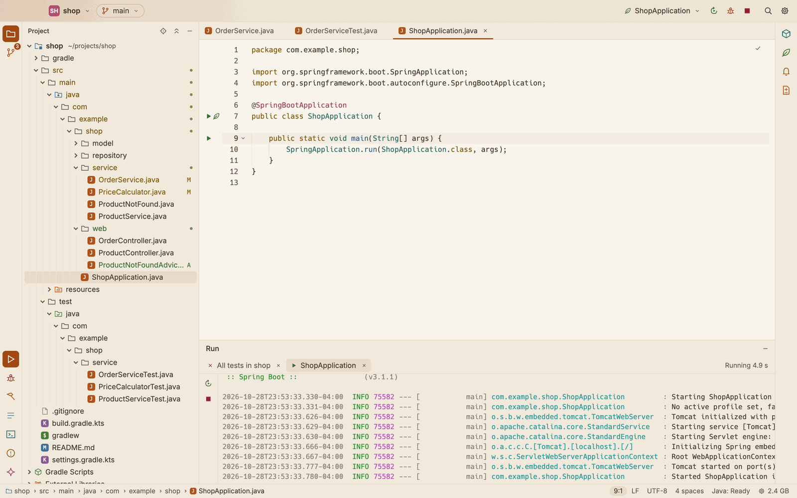
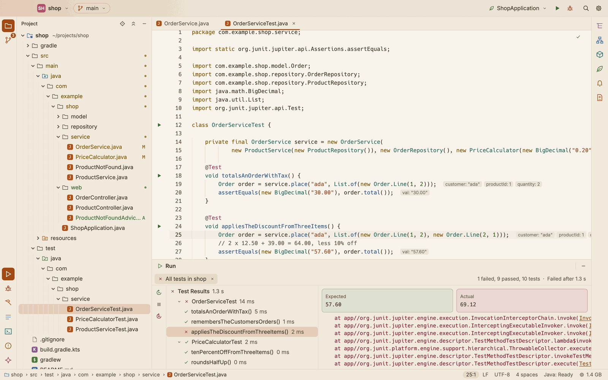
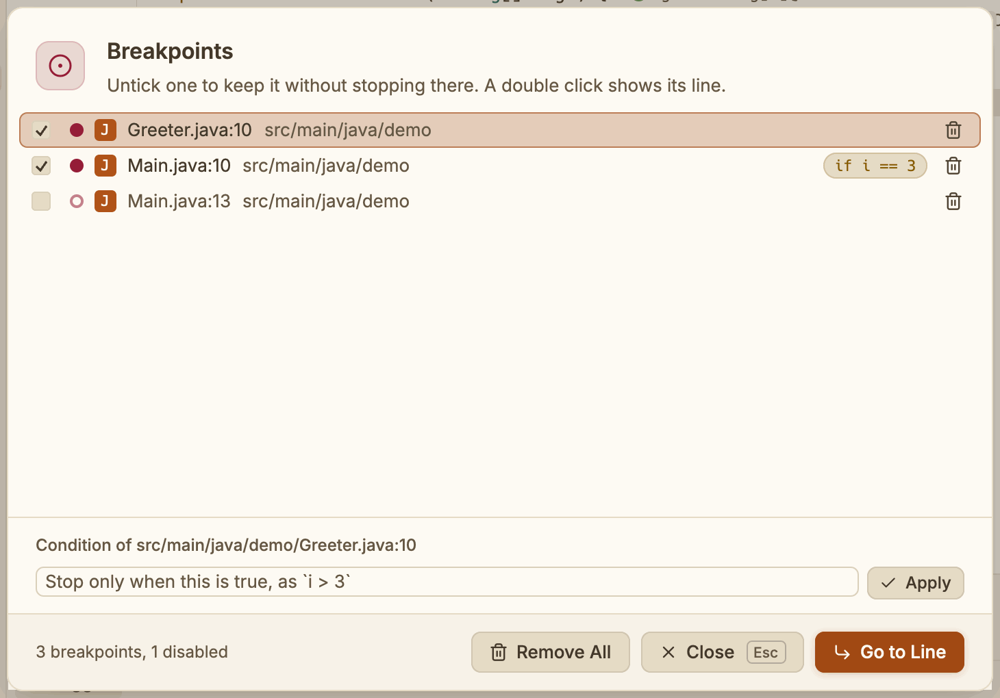
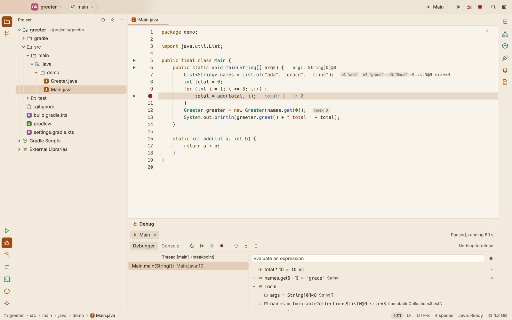
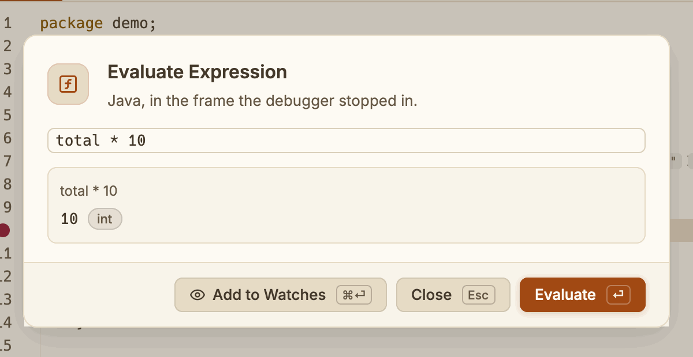

# Running and debugging

Run your application, its Gradle tasks or Maven goals and its tests, and debug them, from the title bar, the editor's gutter or the keyboard. Runs, tests and the debugger need a Gradle or Maven build and the Java engine; see [Gradle](gradle.md) and [Maven](maven.md).

## Run configurations

A run configuration says what runs. The Java engine finds these in your build by itself:

- **Spring Boot**: the application class marked `@SpringBootApplication`.
- **Application**: the other main classes.
- **Gradle**: the `bootRun` and `run` tasks.
- **Maven**: `spring-boot:run` in a Maven module with Spring Boot's plugin.
- **Tests**: the tests of each module.

They appear once the Java engine is ready. Until you pick one, the title bar starts on the Spring Boot application, else the first main class, else the first Gradle task or Maven goal.

Your configurations, your changes to the build's, the configuration you picked last and your breakpoints are kept with SnoutCode's settings, under `~/Library/Application Support/SnoutCode/projects/`, never in the project folder.

### Edit configurations

Open **Run ▸ Edit Configurations…**, or pick **Edit Configurations…** at the foot of the title bar's configuration menu. The **Run Configurations** dialog lists the configurations on the left, grouped as in the title bar, with your own under **Yours**. A dot marks the ones you made or changed.

For the configuration you select, set:

| Field | What it is |
|---|---|
| Name | What the title bar shows |
| Kind | Application, Gradle, Maven or Tests |
| Module | The module it runs in |
| Main class | For an application, as `com.example.App` |
| Task | For Gradle and tests, as `:app:bootRun`; **Goals** for Maven, as `spring-boot:run` |
| Program arguments | What the program gets; for a Gradle or Maven configuration these are **Gradle arguments** or **Maven arguments**, the build tool's own |
| VM options | As `-Xmx1g -Dkey=value` |
| Environment variables | As `NAME=value; OTHER=value` |
| Active profiles | Spring profiles, as `dev, local` |

Quotes keep an argument with spaces whole. Active profiles become `spring.profiles.active` for the program (for a Gradle task, through `--args`; for Maven, `-Dspring-boot.run.profiles`). The **Profiles** button beside the field lists the profiles the Spring model knows, with where each comes from; pick one to add it or take it out. To see the beans as such a configuration would run, pick **As '…' runs** in the Spring window's profile switch (see [Spring](spring.md#profiles)).

- Click **+** (Add Configuration) to make a new one.
- Click **−** to remove one of yours. On a configuration from the build, it puts the build's version back.
- Click **Apply** to save, or **OK** to save and close. **Cancel** or Esc closes without saving.

A change to a configuration from the build stands in for it. The configuration selected when you save becomes the title bar's.

## The title bar

*`ShopApplication` running: Rerun, Debug and Stop beside its configuration.*

The right side of the title bar holds:

- **The configuration menu.** It shows the configuration that runs, with an icon for its kind. Open it to pick **Current File** or one of the configurations, or **Edit Configurations…**.
- **Run** (▶). Runs the configuration (⌃R). While that configuration runs, it becomes **Rerun**, which stops it and starts it again.
- **Debug** (the bug). Debugs the configuration (⌃D).
- **Stop** (■). Shows while something runs, and stops everything in the Run and Debug windows (⌘F2).

With **Current File**, Run and Debug take the file in front: its test class, else its main class.

Run and Debug are grey until the Java engine is ready.

## Run from the editor

The gutter shows run icons:

- on a test class and on each test method,
- on a class with a `main` method, and on that method,
- on a class marked `@SpringBootApplication`.

Click an icon, then **Run '…'** or **Debug '…'**. A main class shows as `App.main()`.

To run what the caret is in (the test method, else the test class, else the main class):

- press ⌃⇧R to run it, or ⌃⇧D to debug it,
- or right click in the editor and choose **Run '…'** or **Debug '…'**,
- or use **Run ▸ Run Context Configuration** and **Debug Context Configuration**.

Running a main class from the gutter makes its configuration the title bar's, when the build lists it.

## How a run starts

A main class runs as the editor compiled it, not through Gradle or Maven, so it waits until every module is ready. Gradle tasks and tests compile through Gradle, Maven goals and tests through Maven, and only wait for the engine. In a Maven module, the main class runs with the module's runtime classpath as Maven resolves it (`compile` and `runtime` scopes), and its tests run through Surefire with the module's test classpath; see [Maven](maven.md#run-and-debug).

If you start a run before the Java engine is ready, the run's tab says **Waiting for the Java engine**, and the run starts as soon as the engine is ready.

When nothing can run, the run's tab says why. For example:

- the project has no Gradle or Maven build,
- the build needs a JDK that is not installed (download it from the bar above the editor, or pick a JDK in Settings; see [Gradle](gradle.md)),
- the Java engine is not running.

## The Run window

*The shop's Spring Boot application started from the title bar, its output in the Run window.*

Runs show in the **Run** tool window, debug sessions in **Debug**, and Gradle tasks and Maven goals in **Build**. Each opens at the bottom of the window when a run starts. You can also open them from the buttons at the bottom of the left edge.

Each run gets a tab, with its state at the right: **Running 0:12**, **Finished in 3.2 s**, **Failed after …** or **Stopped after …**. Starting the same thing again reuses the tab of a finished run.

The console shows:

- the command line of a main class, its working directory, the Gradle tasks, or the Maven command,
- the program's output, in its colours,
- how it ended: **Finished**, **Failed** or **Stopped**, with the exit code when there is one.

File places in the output are links. Click a stack trace line such as `at demo.App.main(App.java:12)`, or a file path followed by a line number as compilers print it, to open that line.

The buttons down the window's left edge:

- **Rerun** (⌘R) stops the run and starts it again.
- **Stop** (⌘F2) stops it.
- **Rerun Failed Tests** (⌥⌘R), for a test run, runs only the tests that failed.

The keys work from anywhere: ⌘R runs again whatever ran last (in Run, Debug or Build), ⌥⌘R the tests that failed in the last test run. Both are in the **Run** menu and the command palette.

Click × on a tab to stop the run and close the tab.

## Tests

Run tests from the gutter, with ⌃⇧R in a test, or with a **Tests** configuration.

The Run window shows a test run as a tree: **Test Results** with the run's time, then each test class, then its tests. Each has an icon for passed, failed, skipped or running, and its time. Click the arrow of a class to fold it.

The tab's state line also gives the counts of passed, failed and skipped tests.

Click a test to see, on the right:

- its state,
- for a failed assertion, the **Expected** and **Actual** values side by side,
- the failure and its stack,
- what the test printed, under **Output**.

When the run ends, the first failed test is selected.

*All the shop's tests: one failed, with what it expected and what it got.*

In a Maven module, tests run through Maven's Surefire and report to the same tree as they run: each class, then its tests. **Rerun Failed Tests** runs only those that failed (`-Dtest=Class#method`). Tests that only JUnit 4 runs show once the run ends, from Surefire's reports.

## Debug

Start a debug session with the title bar's Debug button (⌃D), **Debug '…'** on a gutter icon, or ⌃⇧D in the editor. Tests can be debugged the same way. In a Maven module, a debugged test's JVM, or the application `spring-boot:run` starts, waits for the debugger, which attaches as soon as it listens.

### Breakpoints

Breakpoints go in Java, Scala, Kotlin and Groovy files.

- Click on a line number to set a breakpoint. Click again to remove it. **Toggle Breakpoint** (⌘F8, Run menu) does the same for the caret's line.
- Right click a breakpoint to give it a condition (a right click on a line without one opens the gutter's menu, whose **Breakpoint Condition…** sets one with a condition), or press ⌥⇧⌘F8 (**Edit Breakpoint Condition…**) on its line. In the box **Breakpoint on line N**, type an expression such as `i > 3`, then press Enter or click **Done**. The program stops there only when it is true. Leave it empty to stop every time. **Remove** removes the breakpoint.
- **Toggle Breakpoint Enabled** (⌥⌘F8) keeps the breakpoint on the caret's line but stops the program there no more; it shows as a ring. Press it again to enable it.

**View Breakpoints…** (⇧⌘F8) lists every breakpoint of the project, by file and line, with its condition. Untick one to disable it, pick one to edit its condition below the list, click its bin to remove it, or **Remove All**. A double click, or **Go to Line**, shows its line.

*Three breakpoints of the greeter: one with a condition, one disabled.*

Breakpoints are kept with the project, and you can set and change them while a session runs.

### When the program stops

*Stopped in the loop of `Main`: the values inline, two watches, and the local variables.*

The editor opens the file at the line where the program stopped, and shows the values of the variables used on that line and the lines above it.

The **Debug** window has two tabs, **Debugger** and **Console**. The Debugger tab shows:

- on the left, the thread that stopped and why (pick another thread from its menu), then its stack frames; click a frame to show its line and variables,
- on the right, the watches and the variables of the selected frame; click a variable with an arrow to open it.

### Step through the code

Use the buttons of the Debug window's toolbar, the **Run** menu, or the keys:

| Action | Key |
|---|---|
| Resume Program | F9 |
| Pause Program | ⌥⌘F9 |
| Step Over | F8 |
| Step Into | F7 |
| Step Out | ⇧F8 |
| Run to Cursor | ⌥F9 |
| Stop | ⌘F2 |
| Rerun | ⌘R |

**Pause Program** stops the running program where it is. **Run to Cursor** lets the stopped program go on until it reaches the caret's line, as if a breakpoint were there for once; the breakpoints on the way still stop it.

### Evaluate expressions and watches

While the program is stopped, press ⌥F8 (**Run ▸ Evaluate Expression…**) to evaluate Java in the frame it stopped in. The selection, or the name at the caret, is filled in and evaluated at once; type another expression and press Enter. The value shows with its type. **Add to Watches** (⌘Enter) keeps it among the watches.

*`total * 10` evaluated where the greeter's loop stopped.*

You can also type an expression in the **Evaluate an expression** box at the top of the variables.

- Press Enter to evaluate it. The result shows under the box.
- Press ⇧Enter, or click the eye button (**Add to Watches**), to add it to the watches.

Watches are evaluated again each time the program stops. Click × on a watch to remove it.

### Change code while debugging

Save a change while a debug session runs. Once the editor has compiled it, SnoutCode reloads the changed classes into the running program. The Debug window's toolbar and the console say **Reloaded** and the class, **Nothing to reload**, or why the classes could not be reloaded.
