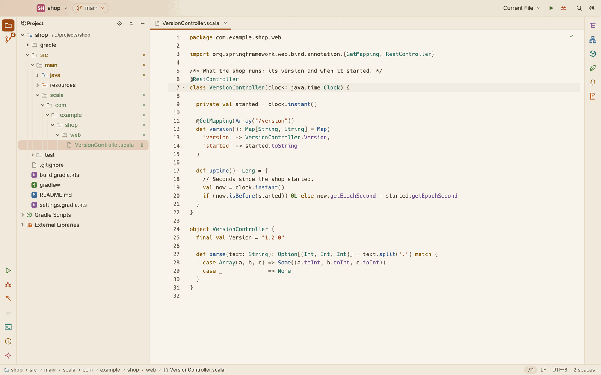

# Scala

How SnoutCode understands Scala: highlighting, completion, navigation, rename and problems in `.scala` files, as for Java. It is made for Gradle builds that mix Java and Scala, such as Spring Boot services with Scala controllers and services.

## Highlighting

Every `.scala`, `.sc` and `.sbt` file is highlighted: keywords, types, strings, annotations, comments and the rest, in the colours of the theme. Highlighting needs nothing else and works in any project.

## Where the rest works

The language features come from Metals, the Scala language server. Each Gradle build with Scala gets one Metals, which starts when you open one of the build's Scala files. A project with several builds side by side starts one for each build you open a Scala file of. They stop when you open another project in its place, or quit.

A shared source folder that is not a build of its own, but that several builds compile (for example `../core/src/main/java` in each build's `sourceSets`), goes to the Metals of one of the builds that compile it: the one already running when there is one.

The first time, Metals imports the build. It runs the build's Gradle with the Bloop plugin, then compiles the Scala and the Java beside it. This takes a minute or more on a large build. The status bar says what it is doing for the file in front, such as **Scala: Importing build** or **Scala: Compiling bamboo-web**, and **Scala: Ready** once done. Later opens reuse the import, and import again only when the build scripts change. SnoutCode accepts Metals's offer to import for you, so no question is asked.

Bloop, the compile server Metals uses, runs as a process of its own and stays after Metals stops, so the next start finds the build compiled; quitting SnoutCode does not stop it. Metals and Bloop keep what they need in the build's folder: `.metals/`, `.bloop/` and, for some builds, `.bsp/`. SnoutCode lists these in the repository's own `.git/info/exclude`, which is never committed, so they do not show as changes in the Git view.

## What you get

- **Completion** as you type a name or a `.`, with the types and members of the build's Scala, its Java and its libraries. Press ⌃Space to open it anywhere.
- **Hover** over a name for its type and its documentation.
- **Go to Definition** (⌘B, F12, or ⌘-click), into the build's Java and Scala and into its libraries.
- **Go to Implementations** (⌥⌘B, ⌥⌘-click or ⌘-right-click) for a trait, an abstract class or a method.
- **Find References** and **Rename** (F2), across the build.
- **Problems**: compile errors and warnings show as squiggles, in the inspections widget at the editor's top right, and in the Problems window. They come from compiling, so they show a moment after you save.
- **Quick fixes** (⌥↩), such as adding a missing import.
- **Format** the file or the selection with Scalafmt, when the build has a `.scalafmt.conf` (Metals does not format without one, and SnoutCode does not write one for you).
- **Structure** (⌘7) and **File Structure** (⌘F12) show the file's classes, objects, traits and their members.
- **Go to Class** (⌥⌘O) and **Go to Symbol** (⌘T) find Scala classes and members too, next to the Java ones.
- **Type Hierarchy** (⌃H) and **Call Hierarchy** (⌃⌥H) from a Scala file.
- The **Spring** gutter marks on Scala beans and endpoints, as in Java (see [Spring](spring.md)).

Java code that uses Scala classes gets its completion and checks from the Java engine, which compiles the Scala it needs (see [Java: Scala in the build](java.md#scala-in-the-build)).

## Versions and the JDK

SnoutCode runs Metals 1.6.7, the newest release that still covers Scala 2.11.12 as well as the later Scala 2.12, 2.13 and 3 releases. Scala 2.11 is old, and Metals no longer fixes its bugs there, but its features work.

Metals runs on a JDK 17 or newer: the build's own JDK when it is that new, else Java 21, else Java 17, from the JDKs on your machine (see [Project Settings](project-settings.md)). The build's Gradle and the compiles run on the build's own JDK. Without a JDK 17 or newer, the status bar says **Scala: Needs JDK 17 or newer**.

The first time, SnoutCode downloads Coursier, the Scala tool that fetches Metals, from its GitHub release, checks it against its known checksum, and fetches Metals with it from Maven Central. Both are kept in SnoutCode's data folder, beside the JDKs it downloads. This takes about a minute and needs a network connection; later starts are instant.

## When it does not work

- The status bar says **Scala: …** with the reason when Metals cannot start or keeps stopping. After a crash it starts again on its own, up to five times in a row.
- When the import fails, the status bar says so, and the file has no build target (**Scala: no target**): Metals then knows only the file itself. Metals remembers a failed import, so SnoutCode asks it to import again each time it starts. If it fails again, the build usually does not sync with Gradle either: run it once in the terminal (`./gradlew build`) to see why.
- Gradle runs the import on the JDK the build's Gradle version supports, the same one the Java engine picks: the level the build declares, else the newest its Gradle runs on (Gradle 8.1, for example, runs on Java 19 at most).
- Metals shows in the Processes window as **Scala language server for** the build. It takes up to 2 GB of memory.
- Metals writes its own log to `.metals/metals.log` in the build's folder. SnoutCode's log has its messages too, as lines starting with `[scala]` (see [Troubleshooting](troubleshooting.md)).
