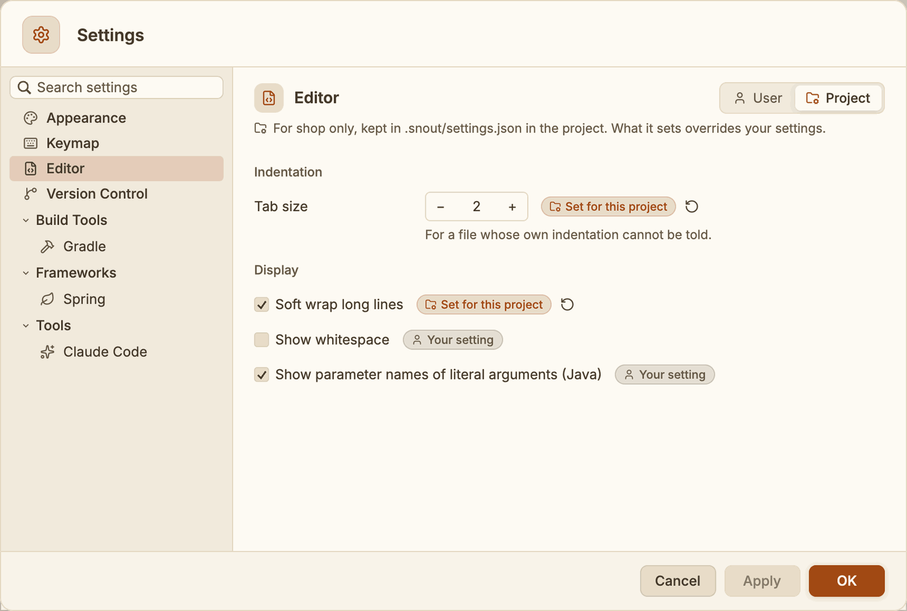
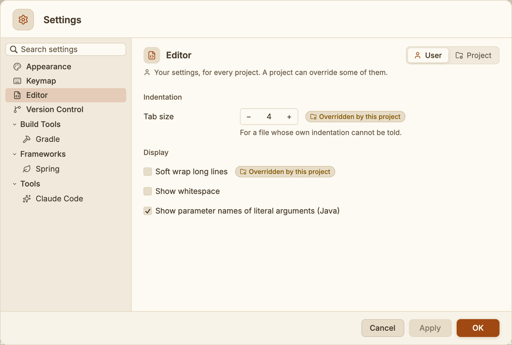
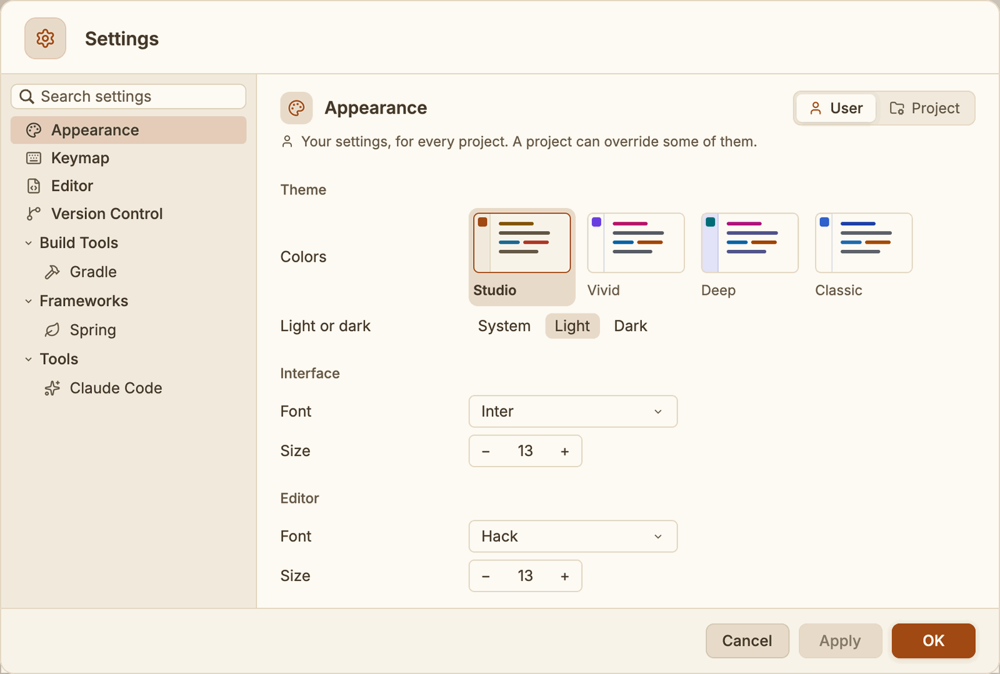
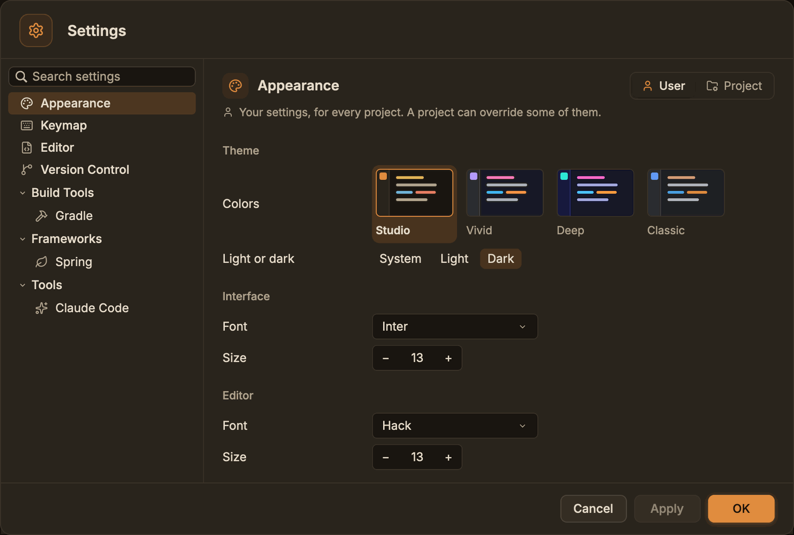
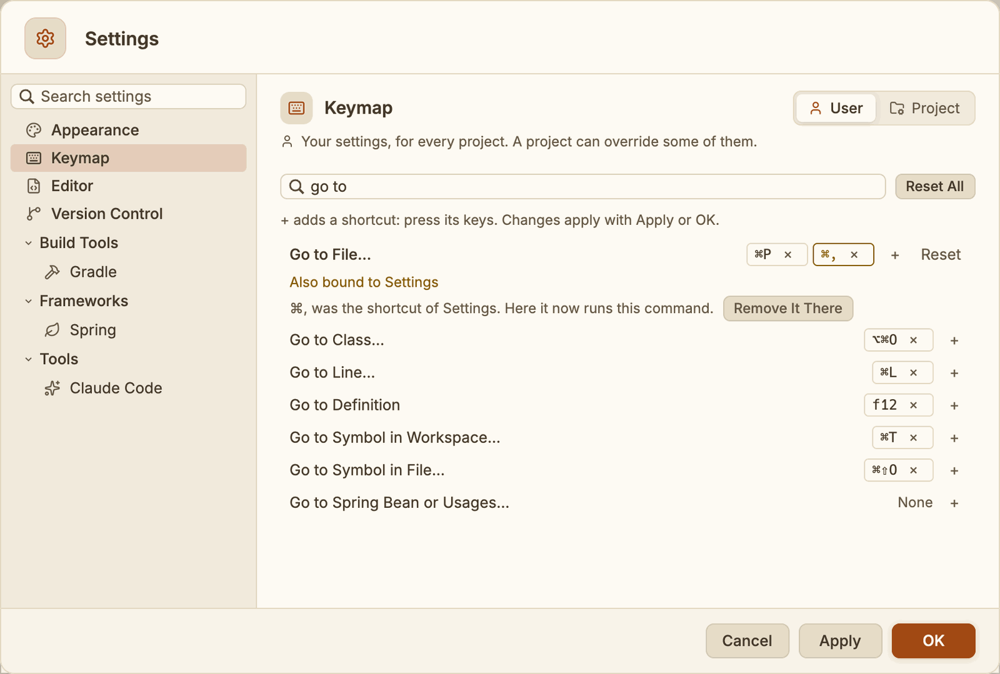

# Settings and keymap

Change how SnoutCode looks and behaves, and change its keyboard shortcuts.

## Open Settings

Any of these opens the Settings sheet:

- SnoutCode ▸ Settings… (⌘,)
- the gear at the right of the title bar
- **Settings…** in the command palette (⇧⌘P)

The pages are listed on the left. Type in **Search settings** to find a page by what it holds,
for example "jdk" or "font".

The sheet edits a copy of your settings:

- **Apply** puts the changes in place and keeps the sheet open.
- **OK** puts them in place and closes it.
- **Cancel**, or Esc, closes it without changing anything.

## Your settings and the project's

The switch at the top right of each page picks whose settings it shows:

- **User**: your settings, for every project. This is where the sheet opens.
- **Project**: the open project's own settings, kept in `.snout/settings.json` in the
  project's folder. A value set there overrides yours, for that project only. Commit the file
  and everyone who opens the project in SnoutCode gets the same values.



*The shop sets its own tab size and soft wrap; whitespace and parameter hints are yours.*

In the **Project** scope, each setting a project can set says where its value comes from:

- **Set for this project**: the project's file sets it. The round arrow beside it resets it to
  your setting (the file no longer sets it).
- **Your setting**: the project leaves it to you. Change it here to set it for the project.

In the **User** scope, a setting the open project sets for itself says **Overridden by this
project**. You can still change your value: it holds in the projects that do not set it.



*Your tab size is 4, but in the shop it is 2.*

A project can set these, by their names in the file:

| Setting | In the file | Values |
| --- | --- | --- |
| Editor ▸ Tab size | `tab_size` | 1 to 8 |
| Editor ▸ Soft wrap long lines | `soft_wrap` | `true` or `false` |
| Editor ▸ Show whitespace | `show_whitespace` | `true` or `false` |
| Editor ▸ Show parameter names of literal arguments | `param_hints` | `true` or `false` |
| Version Control ▸ Fetch every | `fetch_minutes` | 5 to 120 |
| Gradle ▸ JDK, every build | `jdk` | the JDK's home folder |
| Gradle ▸ Stop idle daemons after | `daemon_idle_minutes` | 1 to 240 |
| Spring ▸ Active profiles | `spring_profiles` | `"any"`, `"config"`, or a list of names |

The other pages (Appearance, Keymap, Claude Code) hold settings that are yours alone; in the
**Project** scope they say so. Run configurations are kept per project already: see
[Run and debug](run-and-debug.md).

A project's file looks like this:

```json
{
  "tab_size": 2,
  "soft_wrap": true,
  "jdk": "/Library/Java/JavaVirtualMachines/temurin-21.jdk/Contents/Home",
  "spring_profiles": ["dev"]
}
```

SnoutCode reads the file again whenever it changes, within a second, whoever changed it: you
in an editor, a `git pull`, a teammate's commit. When it cannot be read (it is not JSON, or a
value has the wrong type), SnoutCode keeps the values it read last, says what is wrong in the
status bar and over the **Project** scope's pages, and reads it again once you fix it. Keys
SnoutCode does not know are kept when it writes the file.

On a project opened over [Remote SSH](remote-ssh.md), the file is on the remote machine, in
the project's folder there, and SnoutCode reads and writes it there.

## Appearance



*The four colour themes, and light or dark.*



*The same page in dark mode, in Studio.*

**Theme**

- **Colors**: the colour theme. Each comes in light and dark, and the swatches show the one
  in use.
  - **Studio** (the default): warm cream and walnut, with a terracotta accent in light and
    an amber one in dark, after Snout Studio.
  - **Vivid**: neutral greys, a violet accent, and colour wherever it carries meaning.
  - **Deep**: midnight indigo, with an aqua accent that glows.
  - **Classic**: the earlier neutral greys and blue accent.
- **Light or dark**: **System** (the default) follows your Mac, and switches the moment you
  change it in System Settings ▸ Appearance, or when the Mac changes on its own at sunset.
  **Light** and **Dark** keep SnoutCode in one, whatever the Mac does. View ▸ Appearance
  switches it too.

In every theme, text is at least as legible as WCAG AA asks. Lines added and removed show
in blue and orange, which stay apart with the common forms of colour blindness, and errors
and warnings differ in lightness as well as colour.

**Interface**

- **Font**: Inter or System.
- **Size**: from 10 to 20. The default is 13.

**Editor**

- **Font**: Hack or Menlo.
- **Size**: from 8 to 32. The default is 13. View ▸ Zoom In (⌘=), Zoom Out (⌘-) and Actual
  Size (⌘0) change it too.

**Quitting**

- **Confirm before quitting** (on by default): ⌘Q and the window's close button ask first.
  Off, SnoutCode quits at once, unless quitting would lose unsaved changes or stop something
  running: then it always asks. See [Quitting](getting-started.md#quitting).

## Editor

**Indentation**

- **Tab size**: from 1 to 8. The default is 4. A file gets it when its own text does not show
  how it is indented.

**Display**

- **Soft wrap long lines**: new editor tabs wrap long lines. View ▸ Soft Wrap (⌥Z) switches it
  for the tab in front.
- **Show whitespace**: editors show spaces and tabs.
- **Show parameter names of literal arguments (Java)**: on by default. See
  [Java](java.md#parameter-name-hints). View ▸ Parameter Name Hints switches it too.

## Version Control

**Git**

- **Fetch every**: how often SnoutCode fetches your projects in the background, to count what
  there is to pull. From 5 to 120 minutes, in steps of 5. The default is 10.

## Build Tools ▸ Gradle

**JDK per project** (User scope)

Each Gradle build of the open project has a row. Pick the JDK its Gradle runs on, or
**Automatic (the build's Java level)** to let SnoutCode choose. SnoutCode remembers the JDK it
chose for a build, so that JDK shows here once the build has run. The list holds the JDKs
found on this Mac (see [Getting started](getting-started.md#java-for-your-builds)).

In the **Project** scope, one row, **Every build**, sets the JDK of all the project's builds
(`jdk` in its file); **Each build's own (your settings)** leaves the choice to the rows above.

The chosen JDK is used the next time the Java engine starts for the project: when you open
the project again, or start SnoutCode again. A JDK that cannot run the build's Gradle version,
or is older than the Java level the build asks for, is passed over for one that fits.

**Gradle daemons**

- **Stop idle daemons after**: how long SnoutCode's own Gradle daemons stay without a build
  before they stop. From 1 to 240 minutes, a minute at a time up to 5, then in steps of 5. The
  default is 15. **Apply** or **OK** saves it; a new value holds for the daemons started after
  the Java engine starts again. See [Processes](processes.md).

## Frameworks ▸ Spring

**Active profiles**

- **Evaluate beans under**: the profiles the open project's Spring model is evaluated under.
  **Any (no profile chosen)**, **Those the application files make active**, or **These
  profiles**, with their names in **Profiles**, separated by commas. It is the same setting
  as the Spring window's **Active profiles** switch: see [Spring](spring.md#profiles). Set it
  in the **Project** scope to share it in the project's file; then the switch in the Spring
  window changes the file too.

## Tools ▸ Claude Code

**Program**

- **Claude Code**: the `claude` program to run. Leave it empty to find `claude` on your `PATH`,
  in `~/.local/bin` and the usual places. See [Claude Code](claude-code.md).

The Claude Code commands are on the Keymap page with the others: Send Selection to Claude,
Accept and Reject Claude's Change, Next and Previous Claude Change, Accept and Revert Claude
Change at Caret, and Accept All and Revert All Claude Changes.

## Keymap



*Go to File given ⌘, too: the page says Settings… has those keys.*

The Keymap page lists every command with its shortcuts. Type in **Search commands or
shortcuts** to find a command by its name or by its keys.

### Add a shortcut

1. Find the command.
2. Click **+** beside it. The row says "Press the keys, or Esc".
3. Press the keys. Esc stops without adding anything.
4. Click **Apply** or **OK**.

A command can have several shortcuts. A command you changed shows its name in heavier type.

### Remove a shortcut

Click **×** on the shortcut, then **Apply** or **OK**. A command can be left with no shortcut.

### Keys another command uses

When a shortcut is also bound to another command where it applies, the row says "Also bound to"
that command, and the keys show in a warning colour.

When you add keys that belong to another command, the row says so, for example "⌘P was the
shortcut of Go to File. Here it now runs this command." Click **Remove It There** to take the
keys away from the other command.

### Go back to the defaults

- **Reset**, on a changed command, brings back its default shortcuts.
- **Reset All**, beside the search box, brings back every default.

Changes take effect as soon as you apply them, in the menus too. No restart is needed.

For the default shortcuts, see [Keyboard shortcuts](keyboard-shortcuts.md).

## Where settings are kept

SnoutCode keeps your settings in `~/Library/Application Support/SnoutCode/settings.json`, and
a project's own in `.snout/settings.json` in the project (see
[Your settings and the project's](#your-settings-and-the-projects)). It
writes the file as you work: your recent projects, each project's tabs, the window's layout,
your choices in the menus and the Settings sheet.

The shortcuts you changed are under `keymap`, by command, with the keys as a list:

```json
"keymap": {
  "snout::GoToFile": ["cmd-k"],
  "snout::ShowProblems": []
}
```

Keys are written as `cmd-shift-p`. Two key presses in a row are written with a space, as
`cmd-k cmd-s`; such a shortcut can be set here, though the Keymap page records one key press.
An empty list takes every shortcut of the command away.

To edit the file by hand, quit SnoutCode first, since the app writes the file while it runs. A
value SnoutCode cannot read takes its default, and the rest of the file is kept. A file that is
not JSON at all is copied to `settings.json.unreadable` before SnoutCode starts from the
defaults.

## Session restore

SnoutCode reopens what you had: the project open last, its editor tabs with the caret and the
view where they were, the tool windows and their sizes, and the Project or Git view. Each
recent project keeps its own tabs. See [Projects](projects.md#your-tabs-come-back).
