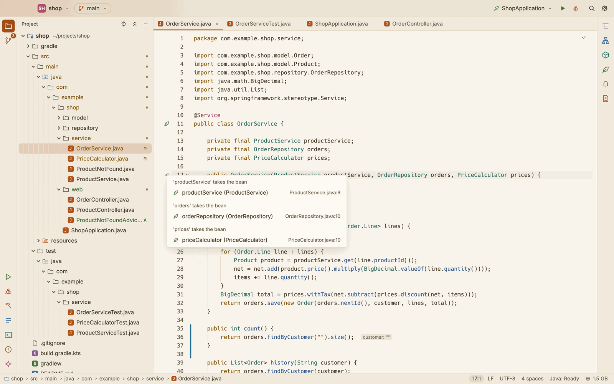
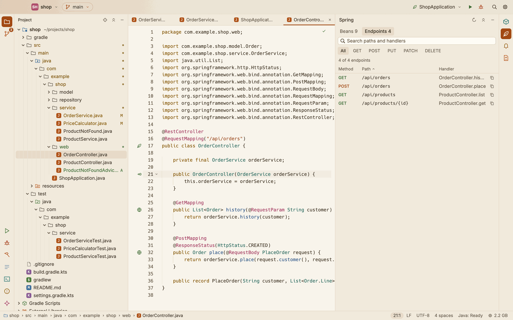
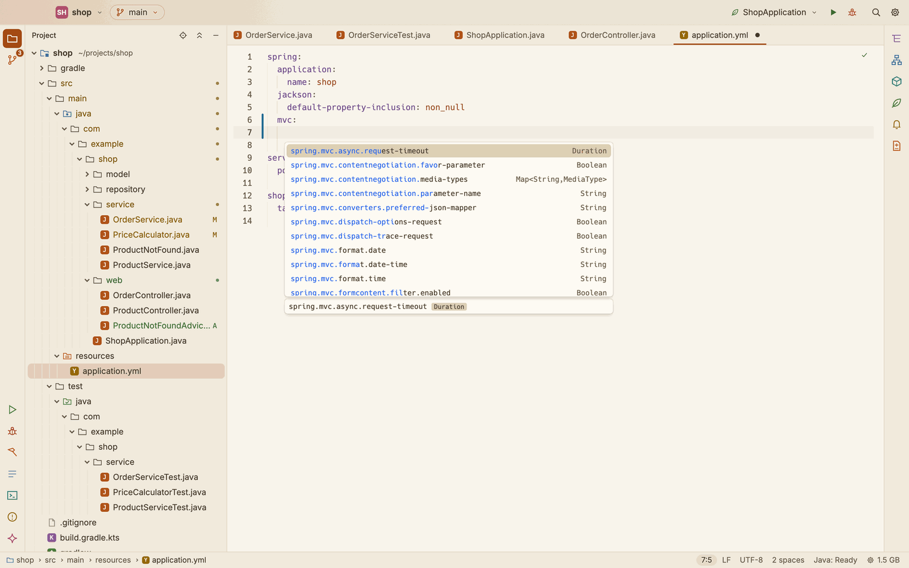
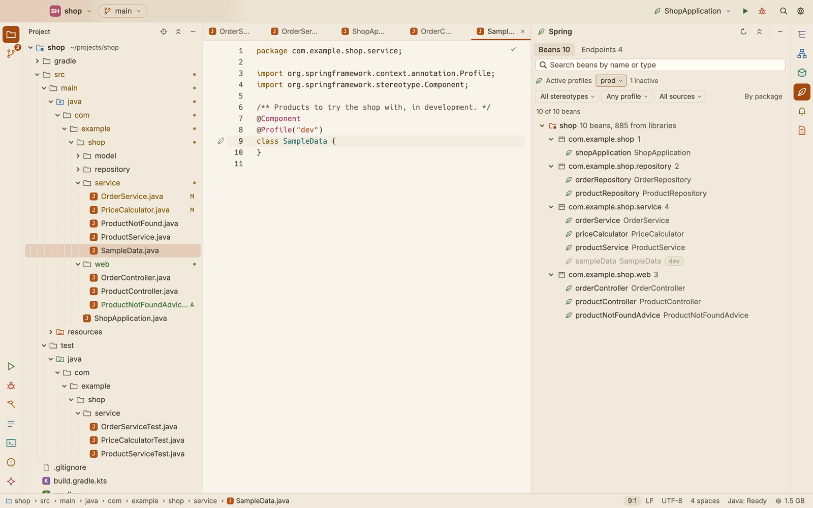

# Spring

SnoutCode reads the Spring model of your project: its beans, where they are injected, and its HTTP endpoints. It shows them in the editor's gutter and in the Spring tool window, and helps you edit `application.properties` and `application.yml`.

Spring support comes from the Java engine. It starts once the engine has imported the project (see [Java](java.md)). A project without Spring on its classpath simply shows nothing.

## What SnoutCode finds

- **Beans:** classes annotated `@Component` and the annotations built on it (`@Service`, `@Repository`, `@Controller`, `@RestController`, `@Configuration`, `@ControllerAdvice`, and your own), `@Named` classes, `@Bean` methods, `@ConfigurationProperties` classes, `<bean>` definitions in XML files named by `@ImportResource`, Spring Data repositories and MyBatis mappers.
- **Library beans:** the beans that the auto configurations of your dependencies declare, and what the container supplies itself (`ApplicationContext`, `Environment` and others).
- **Injection points:** `@Autowired` and `@Inject` fields, setters and methods, constructor injection, `@Bean` method parameters, `@Resource` and `@Value`.
- **Endpoints:** `@RequestMapping` and its variants (`@GetMapping` and the others) on controller methods, with the class's mapping joined to each method's.

Each module has its own application context: the beans its component scans reach, starting at its `@SpringBootApplication` class. Beans written in Scala are found too, once the Scala bridge has compiled them. Test source folders are left out.

`@Primary`, `@Qualifier`, `@Profile` and `@Conditional...` are recorded, never evaluated. A bean with a profile or a condition may be absent at run time, so it never makes an injection ambiguous.

The model is read once the engine is ready, and again shortly after you save a Java or Scala file. To read it again yourself, run **Read the Spring Model Again** from the command palette (⇧⌘P) or click the refresh button in the Spring window's header.

## The Spring gutter

*A click on the injection mark of `OrderService`'s constructor: the bean each parameter takes.*

Java and Scala editors get a lane of Spring marks in the gutter, one per line:

- a **globe** on an endpoint's handler method,
- a **leaf** on a bean's declaration,
- an **arrow into a socket** on an injection point. It is drawn in the warning colour when no bean fits or several do.

Hover a mark to see what it means: the endpoint's method and paths, how many places a bean is injected into, or which bean an injection takes.

Click a mark to go somewhere:

- **An injection point** that takes one bean goes straight to that bean.
- **An injection point** that could take several beans lists them; click one to go to it.
- **A bean** lists every place it is injected into, with the file and line of each. When there are more than 8 places, a filter field narrows the list by class, member or file; press Return to go to the first one left.
- **An endpoint** lists its method and paths, with **Copy Path** and **Show in Endpoints**, which opens the Spring window's Endpoints tab searching for that path.

A bean that comes from a library opens as its class, read only.

From the keyboard, **Go to Spring Bean or Usages…** (Code menu, or the command palette) does what a click on the caret line's mark does.

### @Value placeholders

A `@Value("${key}")` shows the value it gets at the end of its line, in quiet italics: the value from the module's `application.properties` or `application.yml` and from the files of the profiles that `spring.profiles.active` names (or of the active profiles you chose, see [Profiles](#profiles)), or the placeholder's default.

## Missing and ambiguous beans

When a required injection has no bean that fits, or several, SnoutCode warns on that line, like any other problem (see [Java](java.md) for the Problems tab). When the only bean that fits is a component outside the scanned packages, the warning says so. An interface that a library implements at run time (a Feign client, a mapper) is not reported.

Press ⌘. on the warning for quick fixes:

- **Inject 'name' with @Qualifier**, one for each candidate of an ambiguous injection. It adds the import too.
- **Make it optional: @Autowired(required = false)** for a missing one.

## The Spring tool window

Open it from the leaf on the right stripe, or with **Spring Beans and Endpoints** in the command palette (⇧⌘P). Its header has **Read the Spring Model Again**, **Collapse All** and **Hide**; the first two are also in the command palette, and **Collapse the Spring Window** in View ▸ Tool Window Actions.

Until the engine has imported the project, the window says "No Spring model yet". While it reads, the header says "Reading…".

### Beans

*The shop's beans, by package.*

The Beans tab lists each module, with its number of beans and how many more come from libraries. Click a module or a group to fold it open or shut.

- **Group** the beans by package or by stereotype: click **By package** or **By stereotype** to switch.
- **Search** beans by name or type in the field at the top. Every word you type must match.
- **Filter** with the chips: a stereotype (**All stereotypes**, Service, Controller and so on), a profile (**Any profile**, **No profile**, or one profile; shown when some bean has a profile), and a source (**All sources**, Java, Scala, XML).

Each bean shows how many places it is injected into, and chips for **Primary**, **Scala** and **XML** where they apply. Click a bean to go to its declaration.

### Endpoints

*The shop's endpoints, with their methods, paths and handlers.*

The Endpoints tab is a table of every request mapping: **Method**, **Path**, **Handler**, and **Module** when the endpoints come from more than one module.

- **Search** paths and handlers in the field at the top.
- **Filter** by HTTP method: All, GET, POST, PUT, PATCH or DELETE.
- **Sort** by any column: click its header, and click again to reverse.
- **Copy** a path with the copy button at the end of its row.
- **Go** to the handler method: click the row. Hover it to see every path it answers, with what it consumes and produces.

A mapping with no HTTP method shows **ANY**.

## application.properties and application.yml

Files named `application*.properties`, `application*.yml` or `application*.yaml`, and the same names starting with `bootstrap`, are Spring Boot configuration files. In them you get:

- **Completion** of keys and values. In YAML, keys complete relative to the keys above the line. Values offer booleans, an enum's constants and the hints your libraries declare.
- **Hover** on a key: its type, description, default value, deprecation and the class that declares it.
- **Go to definition** (F12) on a key: the `@ConfigurationProperties` field, setter or class, in your sources or in a library, and the code that reads the key.
- **Validation** as you type: unknown keys, values that do not fit the key's type (numbers, booleans, enums, durations, data sizes, each element of a list) and deprecated keys. A value with a `${...}` placeholder is not checked, nor are keys inside a map or a list of objects.

*Completion under `spring.mvc` in `application.yml`, with the type of each key.*

What a file knows comes from the module whose resource folder holds it: the configuration metadata of every library on its classpath, its own `@ConfigurationProperties` classes (with their Javadoc and defaults), and the keys its code reads (`@Value` placeholders, `@ConditionalOnProperty`, `getProperty("key")` calls).

## Profiles

SnoutCode can evaluate the beans under the profiles you choose, as Spring would when the application starts with them. Pick them with the **Active profiles** switch at the top of the Spring window's Beans tab, or with **Spring Active Profiles…** (⌃⌥P, Code menu, or the command palette):

- **Any profile** (the default): profiles are not evaluated. A bean with a `@Profile` may be there or not, so it never makes an injection ambiguous.
- **As the application files say**: the profiles `spring.profiles.active` names in `application.properties` or `application.yml`, or the default profile when none is named.
- **A profile by name** turns it on or off: the beans are evaluated under the profiles ticked, as `--spring.profiles.active` would make them, whatever the files say. **As '…' runs** takes the profiles of the configuration selected in the title bar.

*The shop under `prod`: `sampleData`, a `@Profile("dev")` bean, is dimmed.*

The profiles offered come from the names of the profile files (`application-dev.yml`), the documents of a file (`spring.config.activate.on-profile`), `spring.profiles.active`, `include`, `default` and `group`, and the `@Profile` of every bean. To the profiles chosen, SnoutCode adds those `spring.profiles.include` names and the members of their groups (`spring.profiles.group.<name>`).

While profiles are evaluated:

- `@Profile` takes Spring's expressions: a name, `!name`, `a & b`, `a | b` and parentheses, and a bean with several values needs any one of them.
- A bean the active profiles leave out is **dimmed** in the Spring window, and its leaf in the gutter is faded. The switch says how many beans are left out. No injection takes such a bean, so the injection marks and the warnings follow: two beans for different profiles are no longer ambiguous, and a bean only for another profile is missing.
- The `@Value` hints take their values from `application.yml` and the documents and files of the active profiles.
- A profile file or document the active profiles leave out gets a quiet note on its first key, **Not read now**, naming the active profiles.
- Completion offers the known profiles as values of `spring.profiles.active`, `include`, `default`, `group` and `spring.config.activate.on-profile`.

Your choice is kept with the project. The Spring window's **profile** filter chip is something else: it shows only the beans of one profile, or only those with no `@Profile`, whatever is active.

## See also

- [Run and debug](run-and-debug.md): running the Spring Boot application.
- [Java](java.md): diagnostics, quick fixes and navigation.
- [Gradle](gradle.md): how the project's modules are read.
