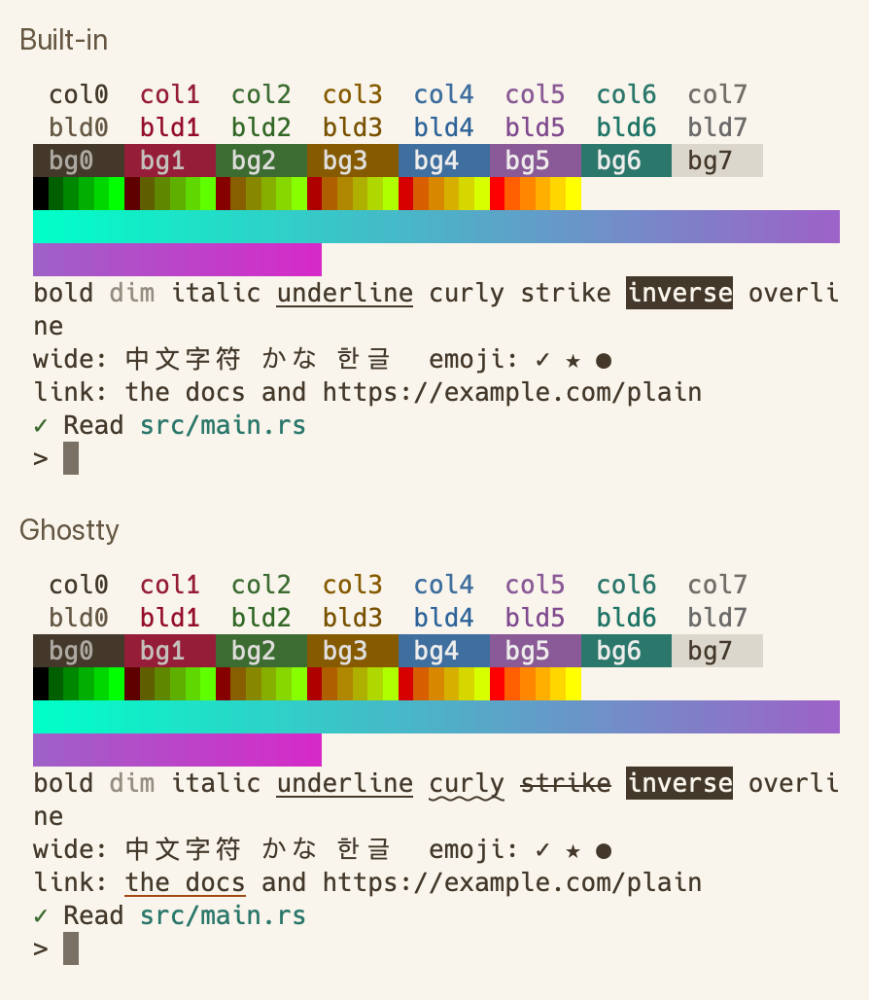

# Terminal

SnoutCode has two terminals in the bottom dock: the **Terminal** tab, your login shell in the
open project, and the [Claude Code](claude-code.md) console. Both are real terminals: colours,
full-screen programs such as `vim`, `less` and `htop`, and the mouse wheel work as they do in a
terminal app. On a project opened over [Remote SSH](remote-ssh.md), the shell and Claude Code
run on the remote machine; the terminal itself is drawn on your Mac.

## The Terminal tab

Click **Terminal** in the bottom dock. The shell starts in the project's folder, as a login
shell (`$SHELL -l`). There is one shell per project, kept running while you switch projects.

| Control | What it does |
|---|---|
| **New** | Starts a new shell, in place of the one running. |
| **End** | Ends the shell. Click **Start** to run one again. |

## Keys, selection and scrolling

- Keys go to the program running, as in a terminal app: Ctrl combinations, the arrows,
  Option as Meta, ⇧↩ and ⌥↩ for a new line in Claude Code's prompt.
- ⌘V pastes. A program that asks for it gets the paste bracketed, so a shell does not run
  pasted lines one by one.
- Drag to select text, then ⌘C to copy it.
- Scroll to see earlier output. The terminal keeps 10,000 lines. Typing goes back to the
  live screen. In a full-screen program the wheel scrolls the program (it gets the wheel as
  mouse events, or as arrow keys).

## Find

Press ⌘F in a terminal to find text in it, scrollback included. The match count shows beside
the field, and every match on the screen is lit, the current one more strongly.

- **Return** goes to the previous (older) match, **⇧Return** to the next one. The arrows
  beside the field do the same.
- **Esc**, or ×, closes the find bar and gives the keys back to the terminal.
- Text selected when you press ⌘F is what it looks for.

The search ignores case.

## Links

⌘-click a web address in a terminal (`https://`, `http://` or `file://`) to open it. A
program can also print a link under other text (an OSC 8 hyperlink); with the Ghostty engine
such text is underlined in the accent colour, and ⌘-click opens its link.

## Terminal engine

The engine is what reads a program's output and keeps the screen: the text, its colours, the
cursor, the scrollback. SnoutCode has two:

- **Built-in**: in every build of SnoutCode.
- **Ghostty**: the terminal emulation of the [Ghostty](https://ghostty.org) terminal
  (libghostty-vt). The default in release builds, which include it.

Choose in Settings (⌘,) ▸ Tools ▸ Terminal ▸ **Terminal engine**, or set `terminal_engine` to
`"Builtin"` or `"Ghostty"` in your settings file (see
[Settings and keymap](settings-and-keymap.md#tools--terminal)). The choice holds for the
terminals started after it: an open terminal keeps the engine it started with until you
click **New** in its header. The Terminal page previews a terminal drawn by the engine chosen,
and lists the terminals running and their engines.

Both engines draw the same way and give the same colours (the 16 colours, the 256-colour
palette and true colour), scrollback, selection, find, links in plain text, the window title
in the header, bracketed paste, application cursor keys, the alternate screen of full-screen
programs and mouse wheel reporting. Ghostty adds:

| What | With Ghostty |
|---|---|
| Resizing | Wrapped lines reflow to the new width, in the shell's screen and its scrollback, instead of being cut. |
| Kitty keyboard protocol | A program that asks for it (Claude Code does) gets unambiguous keys: ⇧↩, Ctrl combinations and Esc each with their own sequence. |
| Hyperlinks (OSC 8) | Kept with their text, underlined, and opened with ⌘-click. |
| Synchronized output (mode 2026) | A program that draws a whole screen at once is shown when the drawing is done, without flicker. |
| More text styles | Strikethrough, curly, double, dotted and dashed underlines, underline colours, and hidden text. |
| Cursor shapes | A program can ask for a bar or underline cursor. |
| Wide characters and emoji | Grapheme clusters (emoji with modifiers, combining marks) stay in one cell. |
| Colour scheme report | A program can ask whether the theme is light or dark. |

*The same output in each engine: Built-in above, Ghostty below with its strikethrough, curly
underline and underlined link.*

When the Ghostty choice cannot run (a build without it), terminals start with the built-in
engine instead. See [Troubleshooting](troubleshooting.md#ghostty-unavailable).
