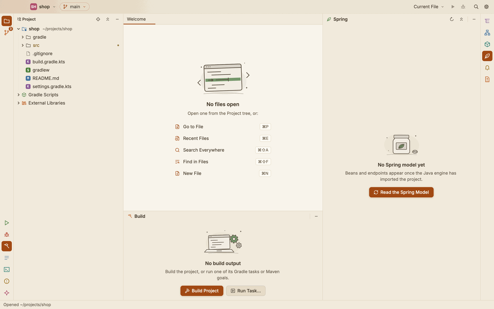
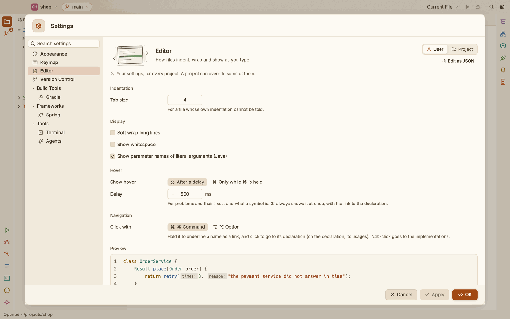

# Tool windows and menus

The tool windows sit around the editor: Run, Debug, Build, Output, Terminal, Problems and the
agent console in the bottom dock; Structure, Hierarchy, Gradle, Maven, Spring, Notifications
and Agent Changes on the right; the Project view on the left. The stripes down the window's
edges open them, and so do the View, Build and Tools menus.

## The header

Each tool window has one header: its icon and title on the left, and its own buttons on the
right, then **Hide** (the minus). Hover a button to see what it does. The buttons per window:

| Window | Buttons |
|---|---|
| Project | the Project or Files view, Select Opened File, Collapse All |
| Gradle | Sync the Gradle Project, Read the Tasks Again, Collapse All |
| Maven | Reload the Maven Project, Read the Goals Again, Collapse All |
| Spring | Read the Spring Model Again, Collapse All |
| Processes | Stop Idle Processes |
| Output | Clear |

Problems and References share one header, with a tab for each. The Terminal and the agent
console have a row under the header for the session: the shell or the agent, a pill that says
how it is (**Running**, **Connected**, **Working**, **Ended**; hover it for what that means),
and **New**, **Continue** and **End**.

## When a window is empty

A window with nothing to show yet says why, with a drawing, and offers the next step:

| Window | It says | The button |
|---|---|---|
| Run | Nothing running | **Run** the configuration chosen in the title bar |
| Debug | No debug session | **Debug** it |
| Build | No build output | **Build Project**, or **Run Task…** |
| Output | No output yet | **Open Git** |
| Problems | No problems | **Build Project**, to check every file |
| References | No usages yet | **Find Usages at the Caret** |
| Structure | No structure | **Go to File…** |
| Hierarchy | No hierarchy yet | **Type Hierarchy** or **Call Hierarchy** at the caret |
| Gradle, Maven | No tasks yet, No goals yet | **Sync the Gradle Project**, **Reload the Maven Project** |
| Spring | No Spring model yet | **Read the Spring Model** |
| Notifications | No notifications | **Show Output** |
| Agent Changes | No changes from agents yet | **Open the Agent Console** |

While something is being read (the Gradle tasks, a file's structure, the processes) the window
says so, with the same kind of drawing.

## The Build menu

| Item | What it does |
|---|---|
| **Build Project** (⌘F9) | Compiles the main and test code of every module: Gradle's `testClasses`, or Maven's `test-compile`. It runs in the Build window. |
| **Rebuild Project** | Cleans first (`clean`), then builds. |
| **Sync Gradle and Maven Projects** | Reads the builds again, as the Gradle window's sync does. |
| **Refresh Gradle Tasks**, **Read the Maven Goals Again** | Lists the tasks or goals again. |
| **Run Gradle Task…** (⌃⌥G) | Picks a Gradle task or a Maven goal by name and runs it. |
| **Run Maven Goal…** | The same, with the Maven goals alone. |
| **Build Window**, **Gradle**, **Maven** | Shows that tool window. |
| **Project Structure…** (⌘;) | See [Project Structure](project-structure.md). |

## The Tools menu

| Item | What it does |
|---|---|
| **Terminal** (⌥F12) | Shows the Terminal tab (see [Terminal](terminal.md)). |
| **Open in External Terminal** | Opens the project's folder in your terminal app. |
| **Agent Console** (⌘J), **Agent Changes**, **Annotate with Agents** | See [Coding agents](agents.md). |
| **Processes**, **Stop Idle Processes**, **Restart the Java Engine** | See [Processes](processes.md). |
| **Tool Settings** | Opens Settings on the Keymap, Terminal, Agents or Gradle page. |
| **Settings…** (⌘,) | See [Settings and keymap](settings-and-keymap.md). |

## Sheets you can resize

Settings, Project Structure and New Project open as sheets over the window. Drag an edge or a
corner to resize one; the list on the left keeps its width and the page grows. Each sheet opens
at the size you left it, kept within the window.

